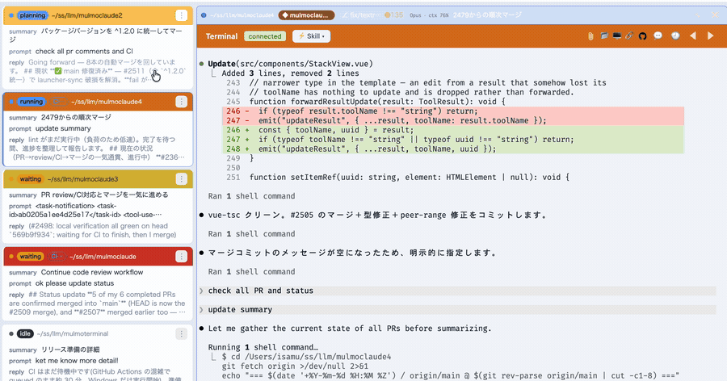
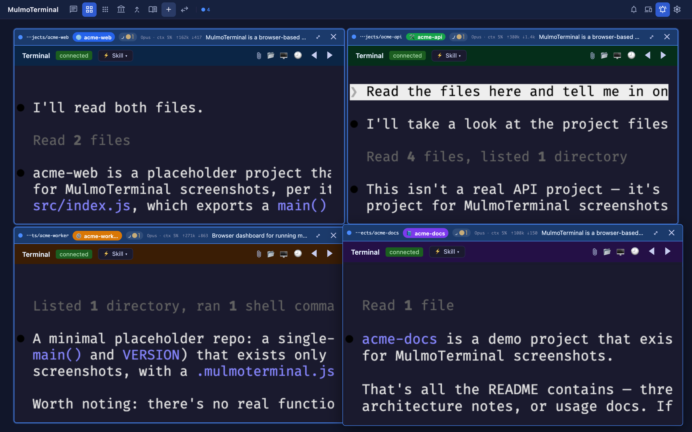

# MulmoTerminal

[English](README.md) · [日本語](README.ja.md) · [简体中文](README.zh.md) · [繁體中文](README.zh-TW.md) · **한국어**

**여러 코딩 에이전트 세션을 나란히 돌리고 —— 어느 것이 당신을 기다리는지 한눈에.**

**병렬 AI 코딩 에이전트**를 위한 **브라우저 터미널**입니다. 여러 세션이 한 칸씩 나란히 놓이고,
**당신을 기다리는 것이 색으로 드러납니다**. 기본은 **Claude Code**이고, 여섯 개의 CLI가 똑같이
일급 시민입니다 —— Codex, Antigravity, Grok, Muse, GitHub Copilot CLI, Cursor CLI.
에이전트 하나로 하는 vibe coding이라면 shell 하나로 충분합니다. 이 도구는 **여러 개를 동시에 돌리다가
누가 당신을 기다리는지 분간이 안 될 때**를 위한 것입니다. 세션은 새로고침을 견디고(tmux),
작업은 **git worktree**에 격리되며, 한 턴이 끝나면 **휴대폰으로 푸시**합니다.

**모든 칸이 진짜 pty입니다.** `htop`, `lazygit`, 개발 서버, Claude Code —— 여기서는 전부 같은 종류입니다.
그래서 "worktree 하나에 세션 하나"라는 제한은 **에이전트에만** 걸리고, shell이나 `yarn dev`는
일하고 있는 에이전트와 같은 worktree에 함께 있어도 됩니다.

## 데모



*실제로 돌고 있는 그리드 —— 각 칸이 **도는 중**, **끝남**, **당신을 기다림** 중 하나로 표시됩니다.*

```bash
npx mulmoterminal@latest        # http://localhost:34567 에서 띄우고 브라우저를 엽니다
```

**Node 24.15 이상**과, `PATH`에 있고 로그인된
[`claude`](https://claude.com/claude-code) CLI가 필요합니다.
`npx mulmoterminal@latest init`이 무엇이 빠졌는지 알려 줍니다.

### tmux + iTerm 분할 창으로는 안 되나요?

병렬로 띄우는 것 자체는 원래 어렵지 않고, tmux로도 됩니다. 놓치는 것은
**다섯 중에 어느 것이 당신을 기다리는가**입니다. 창 하나는 불투명합니다.
도는 중인지, 끝났는지, 권한 확인에서 멈춰 있는지 —— 읽어 보기 전에는 구분이 안 됩니다.

MulmoTerminal에서는 각 칸이 자기 상태를 같은 그리드에 보고합니다 ——
도는 중(파랑), 끝남(초록), **당신을 기다림**(호박색). 화면 밖 칸이 호박색으로 바뀌면 소리가 납니다.
거기에 **세션마다 한 줄인 cockpit roster**가 있어서, 그중 하나에 답하는 동안에도
나머지 넷의 자리를 놓치지 않습니다.

tmux가 깔려 있으면 그 **위에서** 돌고, [재시작도 견딥니다](README.md#session-persistence-tmux).

## 왜 쓰게 되는가

- **모든 에이전트를 한눈에.** 상태에 따라 색이 입혀진 세션 그리드 —— 도는 중(파랑),
  **권한에 막힘 / 당신을 기다림**(호박색), **끝났지만 아직 안 읽음**(파랑), 유휴.
  알림음과 툴바 카운트까지 더해져, 화면 밖에서 멈춘 에이전트가 그냥 지나가지 않습니다.
  터미널 하나를 지켜보는 대신 열 개를 감독하게 됩니다. 하나를 확대해도 **cockpit roster**가
  나머지를 시야에 남겨 둡니다 —— 세션마다 한 줄의 글: AI 요약, 직전 prompt, 최신 답변,
  그리고 브랜치의 **PR 단계**(draft / CI 실패 / ready / merged).
- **터미널만이 아니라, 에이전트를 위한 GUI.** 터미널 옆의 **Canvas** 패널이 에이전트가 MCP로 내놓은 것 ——
  **문서, 폼, 차트, 생성한 이미지, HTML, collection 카드** —— 를 각각 전용 플러그인으로 그립니다.
  에이전트가 글자를 찍어 주는 대신 화면을 건네주는 셈입니다.
- **어디에 있든 다시 불려 옵니다.** 작업이 끝나거나 입력을 기다릴 때 **휴대폰으로 푸시**하고,
  **RemoteHost**와 함께라면 휴대폰에서 세션을 보고 한 번 눌러 답할 수 있습니다
  (**yes / no / continue**). 자리를 뜨고, 불려 오고, 돌아옵니다.
- **재시작해도 아무것도 잃지 않습니다.** `tmux`가 있으면 서버가 죽거나, 다시 시작하거나,
  `node --watch`가 다시 읽어도 모든 세션이 살아 있습니다 —— 절반쯤 돌던 에이전트, 오래 걸리는 빌드,
  개발 서버가 계속 돌고, 돌아오면 알아서 다시 이어집니다.
- **그리드를 떠나지 않고 배포까지.** 저장소 칸마다 **git 브랜치 라벨**이 붙고, 한 번에
  **git worktree**로 격리하고, **diff** 패널을 열고, **commit / push / PR 열기**까지 합니다.
  여러 에이전트가 같은 저장소에서 서로 방해하지 않고 일할 수 있습니다.
- **얼마를 썼는지 압니다.** 세션마다 **컨텍스트 %**, **token**, **추정 $**, 도구 호출의 **타임라인**,
  그리고 셀 제목과 명령 출력의 **AI 요약** —— 벽을 가득 채운 병렬 에이전트를 읽을 수 있게 유지합니다.
- **당신의 방식대로.** 디렉터리마다 **테마, 색, 이름 배지**(`prod`는 빨강, `staging`은 호박색),
  설정 가능한 헤더, 사용자 알림음, 그리고 칸에서 바로 프로젝트 스크립트와 `.claude/skills`,
  deck을 띄우는 Run / Skill / Mulmo 메뉴.



*그리드는 **병렬 에이전트의 조종석**입니다. 각 칸의 헤더에는 판단에 필요한 것이 놓여 있습니다 ——
**모델 · 컨텍스트 %**, **token 수**(`⇡in ⇣out`), **git 브랜치 / 변경** 라벨,
그리고 이 에이전트가 지금 무엇을 하는지에 대한 AI 요약. **칸의 테두리 색이 상태**이고,
화면 밖에서 멈춘 칸은 소리로 당신을 불러옵니다.*

### 안에서는 무슨 일이 일어나는가

각 세션은 서버에서 진짜 PTY로 돕니다(에이전트 CLI를 의사 터미널에 넣습니다).
그리고 WebSocket을 통해 브라우저의 [xterm.js](https://xtermjs.org/) 터미널로 흘러갑니다.

**cockpit roster**는 모든 세션을 나열하고, 어느 것이 **도는 중**(에이전트가 생각하는 중)인지,
어느 것이 **당신을 기다리는지**(권한 확인이나 질문 —— 호박색 점, 답하기 전에는 더 나아가지 않습니다),
어느 것이 **끝났지만 아직 읽지 않았는지**(초록색 점)를 실시간으로 비춥니다. 이것은 **서버가 세션을 띄울 때
주입하는 Claude / Codex activity hook**에서 오는 것이지, 화면의 글자를 파싱해서 얻는 것이 아닙니다.

> 여기가 핵심입니다. 터미널 안에서 "권한 확인에 막힘"과 "아직 생각하는 중"은 **똑같아 보입니다** ——
> 둘 다 그냥 출력이 멎은 상태입니다. 화면을 읽어서는 구분되지 않고, hook은 구분합니다.
>
> (Codex는 "입력 대기"를 보고하지 않습니다. 확인 창을 자기 TUI 안에 그리고 rollout 파일에 남기지
> 않기 때문입니다. 그래서 Codex에는 "도는 중 / 끝남" 두 가지 상태만 있습니다.)

## 옮겨 온 사람들의 말

> 아래는 IDE나 분할 터미널에서 옮겨 온 사용자들의 피드백이며, 벤치마크도 아니고
> 우리가 측정한 결론도 아닙니다. 당신의 환경은 다를 수 있습니다.

**"더 이상 메모리를 잡아먹지 않는다"** —— IDE 창을 여러 개 띄워 에이전트를 격리하는 것은 비쌉니다.
창마다 편집기, 언어 서버, 확장, 파일 감시를 제 몫씩 들고 옵니다. 어떤 사용자는
**64GB 기기도 그 부하에서는 버벅였다**고 했고, 옮긴 뒤에는 괜찮아졌다고 했습니다.
여기서 에이전트는 서버의 PTY이고, 화면은 브라우저 탭입니다.

**"이제 엉뚱한 에이전트에 답하지 않는다"** —— 글자가 흐르는 창 여섯 개는 생김새가 똑같습니다.
어떤 사용자는 **다른 에이전트의 터미널에 답을 쳐 넣었고**, 애초에 그것에 무엇을 시켰는지조차
기억나지 않았다고 했습니다. 주의력의 문제가 아니라, 똑같은 창 N개가 머릿속에 N개의 맥락을
들고 있으라는 뜻이기 때문입니다. 상태 색, 이름 배지, 디렉터리별 색이 그 일을 머릿속에서 화면으로 옮깁니다.

**"많이 보기와 하나를 읽기가 더는 양자택일이 아니다"** —— 터미널을 여섯으로 쪼개면
각 창이 긴 답변 하나를 다 읽기에도 작습니다. 그래서 에이전트를 하나 더할 때마다
읽기 경험이 나빠지는 것을 말없이 받아들이게 됩니다. **그리드 ↔ 확대**는 그 맞바꿈을 없앱니다.
먼저 전부 보고, 하나를 확대해 제대로 읽으며, 그동안에도 cockpit roster가 나머지를 글로 남겨 둡니다.

**"쓰던 세션이 그대로 따라왔다"** —— 세션은 있는 그대로 복원됩니다
(같은 `claude --resume`, 같은 기록). 원래 쓰던 디렉터리를 가리키면 기록이 거기 있습니다.
옮길 것도, 다시 만들 것도 없습니다.

**에이전트가 열 개는 되어야 본전인 것은 아닙니다.** 어떤 사용자는 **1~3개**를 병렬로 돌릴 때부터
이미 옮길 만했다고 했습니다. 위의 이점들은 "더 많이 돌린다"가 아니라 "놓치지 않는다"에 대한 것입니다.

## 설치와 실행

**Node 24.15 이상**과, `PATH`에 있는 아래 CLI들이 필요합니다.

| | 도구 | 무엇을 해 주는가 | 설치 |
| --- | --- | --- | --- |
| **필수** | [`claude`](https://claude.com/claude-code) | 모든 Claude 세션. 이 앱은 그것의 조종석입니다 | `npm i -g @anthropic-ai/claude-code`, 그다음 `claude`를 한 번 띄워 로그인 |
| **필수** | `git` | worktree 격리, 칸마다의 브랜치 / 저장 안 된 점 / diff, PR footer | `brew install git` · `sudo apt install git` · Windows: [git-scm.com](https://git-scm.com/download/win) |
| **필수** | `gh` | 저장소를 가로지르는 **PR & Issue** 화면과 한 번에 PR 열기. 당신의 `gh` 로그인을 쓰고 토큰을 저장하지 않습니다 | [cli.github.com](https://cli.github.com), 그다음 `gh auth login` |
| 선택 | `glab` | **GitLab** 프로젝트에 같은 것을. 자체 호스팅 인스턴스도 지원 | `brew install glab`, 그다음 `glab auth login` |
| 권장 | `tmux` | **세션 지속** —— 터미널이 서버 재시작을 견딥니다 | `brew install tmux` · `sudo apt install tmux` · Windows에는 네이티브 빌드가 없습니다(일반 PTY로 되돌아갑니다) |
| 선택 | `codex` | 칸에서 **Codex 세션** 돌리기 | `npm i -g @openai/codex` |
| 선택 | `ffmpeg` | mulmo-script 패널에서 영상 렌더링 | `brew install ffmpeg` · `sudo apt install ffmpeg` |
| 선택 | `ollama` | 완전히 로컬인 모델로 Claude Code 돌리기 | [ollama.com/download](https://ollama.com/download) |

필수가 아닌 줄이 빠져 있어도 서버는 그대로 뜨고, 그 줄의 기능만 빠지며, 화면이 그 사실을 알려 줍니다.

```bash
npx mulmoterminal@latest           # http://localhost:34567 에서 띄우고 브라우저를 엽니다
# 또는 전역으로 설치:
npm install -g mulmoterminal
mulmoterminal
```

**멈추는 법.** 띄운 터미널에서 `Ctrl+C`를 누르세요. 그 터미널을 못 찾겠다면 브라우저에서
**Settings → Quit MulmoTerminal**을 쓰거나, 아무 터미널에서나
**`npx mulmoterminal@latest stop`**을 실행하세요. `tmux`가 깔려 있으면 에이전트 세션은 살아남아
**Settings → Sessions that survived a restart**에서 돌아옵니다.

**첫 설정(선택).** `npx mulmoterminal@latest init`이 환경을 점검하고,
당신의 Claude Code 기록에서 런처의 **디렉터리 프리셋**을 만들어
`~/.mulmoterminal/config.json`에 씁니다. **멱등**이므로 프리셋을 새로 고치고 싶으면
언제든 다시 돌려도 됩니다.

## 문서

**[receptron.github.io/mulmoterminal](https://receptron.github.io/mulmoterminal/)**

- **사용자 가이드(영문):** [English](https://receptron.github.io/mulmoterminal/guide/en/) ——
  그리드 화면, 일상 작업 흐름, 전체 기능 목록, 설정, 휴대폰 푸시
- **사용자 가이드(일문):** [日本語](https://receptron.github.io/mulmoterminal/guide/ja/)
- **소식:** 새 버전과 새 기능은 X에 올라옵니다 ——
  영문 [@mulmocast](https://x.com/mulmocast), 일문
  [Singularity Society (@SingularitySoci)](https://x.com/SingularitySoci)

## 만드는 사람

**[receptron](https://github.com/receptron)** ——
마이크로소프트에서 **Windows 95**의 소프트웨어 아키텍트였던
**[中島聡 (Satoshi Nakajima)](https://x.com/snakajima)**와
**[有本勇 (Isamu Arimoto)](https://github.com/isamu)**,
즉 **[GraphAI](https://github.com/receptron/graphai)**를 만든 바로 그 둘입니다.

## 라이선스

MIT

---

> **이 문서는 영문 README 앞부분의 제품 소개와 설치에 해당합니다.**
> 설정, 아키텍처, 스크립트, skills, deck, worktree와 PR, 원격 호스트 같은 세부는
> [영문 README](README.md)와 [사용자 가이드](https://receptron.github.io/mulmoterminal/guide/en/)를 보세요.
