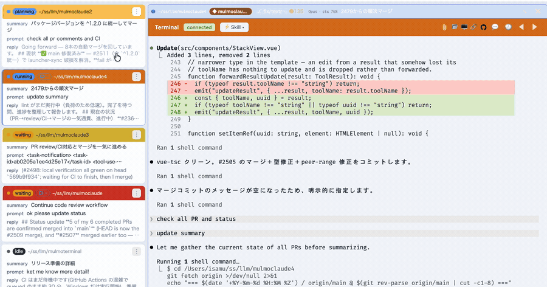
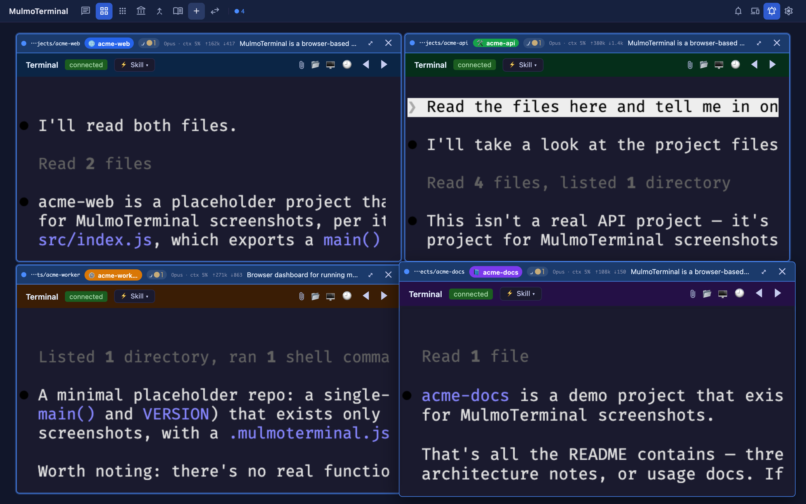

# MulmoTerminal

[English](README.md) · [日本語](README.ja.md) · [简体中文](README.zh.md) · **繁體中文** · [한국어](README.ko.md)

**並行跑多個編碼代理程式的工作階段 —— 一眼看出哪一個在等你。**

一個給**並行 AI 編碼代理程式**用的**瀏覽器終端機**：多個工作階段並排，每個佔一格，
**正在等你的那一個用顏色標出來**。預設是 **Claude Code**，另有六個 CLI 同為一等公民 ——
Codex、Antigravity、Grok、Muse、GitHub Copilot CLI、Cursor CLI。單一代理程式的 vibe coding 一個 shell 就夠了，
這個工具是給**同時跑好幾個、然後分不清誰在等你**的時候用的。工作階段能撐過重新整理（tmux），
工作隔離在 **git worktree** 裡，一輪結束時**推播到手機**。

**每一格都是真正的 pty。** `htop`、`lazygit`、開發伺服器、Claude Code —— 在這裡是同一類東西。
所以「每個 worktree 一個工作階段」的限制**只對代理程式生效**，一個 shell 或 `yarn dev`
可以和正在幹活的代理程式待在同一個 worktree 裡。

## 展示



*實際執行中的網格 —— 每一格標為 **執行中**、**跑完了** 或 **等你**。*

```bash
npx mulmoterminal@latest        # 在 http://localhost:34567 啟動並開啟瀏覽器
```

需要 **Node 24.15 以上**，以及 `PATH` 上已登入的
[`claude`](https://claude.com/claude-code) CLI。
`npx mulmoterminal@latest init` 會告訴你缺了什麼。

### 為什麼不用 tmux + iTerm 分割窗格？

並行地跑起來從來不是難處，tmux 就做得到。丟掉的是**五個裡面哪一個在等你**。
一個窗格是不透明的：執行中、跑完了、卡在權限確認上 —— 不讀一遍就分不出來。

在 MulmoTerminal 裡，每一格都把自己的狀態回報給同一個網格 ——
執行中（藍）、跑完了（綠）、**等你**（琥珀）。螢幕外的格子轉琥珀色時會響一聲。
還有一個**每個工作階段一列的 cockpit roster**，所以你在回答其中一個的時候，
不會弄丟另外四個的位置。

裝了 tmux 的話它就跑在 tmux **之上**，[重啟也不會丟](README.md#session-persistence-tmux)。

## 為什麼你會想要它

- **一眼看完所有代理程式。** 依狀態著色的工作階段網格 —— 執行中（藍）、**被權限擋住 / 等你**（琥珀）、
  **跑完但還沒看**（藍）、閒置。配上提示音和工具列計數，螢幕外卡住的代理程式不會溜過去。
  不必再盯著一個終端機，改成監督十個。放大其中一個，**cockpit roster** 仍然讓其餘的留在視野裡 ——
  每個工作階段一列文字：AI 摘要、上一則 prompt、最新回覆、以及分支的 **PR 階段**
  （draft / CI 失敗 / ready / merged）。
- **給代理程式的 GUI，而不只是終端機。** 終端機旁邊的 **Canvas** 窗格會把代理程式透過 MCP 產出的東西 ——
  **文件、表單、圖表、產生的圖片、HTML、collection 卡片** —— 各自用專屬外掛畫出來。
  代理程式不是印一串文字給你，而是遞給你一個介面。
- **人在哪裡都能被叫回來。** 工作完成或等待輸入時會**推播到手機**，搭配 **RemoteHost**
  還能在手機上看工作階段、點一下就回答（**yes / no / continue**）。走開、被叫、回來。
- **重啟不丟任何東西。** 有 `tmux` 的話，伺服器當掉、重啟、`node --watch` 重新載入，
  每個工作階段都活著 —— 跑到一半的代理程式、長時間的建置、開發伺服器都繼續跑，回來時自動接上。
- **不離開網格就能發布。** 每個儲存庫格子帶 **git 分支標籤**，一鍵隔離到 **git worktree**，
  開啟 **diff** 窗格，完成 **commit / push / 開 PR**。多個代理程式可以在同一個儲存庫裡互不干擾。
- **知道花了多少錢。** 每個工作階段的**上下文 %**、**token**、**預估 $**，工具呼叫的**時間軸**，
  以及格子標題和指令輸出的 **AI 摘要** —— 讓一整面牆的並行代理程式保持可讀。
- **照你的習慣來。** 依目錄設定**主題、顏色和名稱徽章**（`prod` 紅色、`staging` 琥珀色）、
  可設定的標頭、自訂提示音，以及在格子裡直接啟動專案指令碼、`.claude/skills` 和 deck 的
  Run / Skill / Mulmo 選單。



*網格就是**並行代理程式的駕駛艙**。每個格子的標頭擺著你做判斷需要的東西 ——
**模型 · 上下文 %**、**token 數**（`⇡in ⇣out`）、**git 分支 / 變更**標籤，
以及這個代理程式正在做什麼的 AI 摘要。**格子的邊框顏色代表狀態**，螢幕外卡住的格子會用聲音把你叫回來。*

### 底層是怎麼回事

每個工作階段在伺服器上以真正的 PTY 執行（把代理程式 CLI 放進一個偽終端機），
透過 WebSocket 串流到瀏覽器裡的 [xterm.js](https://xtermjs.org/) 終端機。

**cockpit roster** 列出所有工作階段，並即時反映哪些**執行中**（代理程式在思考）、
哪些**在等你**（權限確認或提問 —— 琥珀色圓點，你不答它就不往下走）、
哪些**跑完了但你還沒看**（綠色圓點）。這些來自**伺服器在啟動工作階段時注入的
Claude / Codex activity hook**，不是去解析螢幕上的文字。

> 這是關鍵。在終端機裡，「卡在權限確認上」和「還在思考」**看起來一模一樣** ——
> 兩者都只是不再輸出了。讀螢幕分不出來，hook 可以。
>
> （Codex 不回報「等待輸入」：它的確認框畫在自己的 TUI 裡，不會進 rollout 檔。
> 所以對 Codex 來說只有「執行中 / 跑完了」兩種狀態。）

## 換過來的人怎麼說

> 以下是從 IDE 或分割終端機轉過來的使用者的回饋，不是基準測試，也不是我們量測過的結論。
> 你的環境可能不同。

**「它不再吃我的記憶體了」** —— 靠開多個 IDE 視窗來隔離代理程式的代價很高：
每個視窗都帶上自己的編輯器、語言伺服器、擴充功能和檔案監看。有使用者回報
**64GB 的機器在那種負載下會卡**，換過來之後就順了。在這裡代理程式是伺服器上的 PTY，
介面是瀏覽器分頁。

**「我不再回錯代理程式了」** —— 六個捲動文字的窗格長得一模一樣。
有使用者描述過**把回覆打進了另一個代理程式的終端機**，而且想不起來最初讓它做什麼。
問題不在注意力，而在於 N 個相同的窗格意味著要在腦子裡保持 N 份上下文。
狀態著色、名稱徽章和依目錄的顏色，把這件事從腦子裡搬到了螢幕上。

**「看很多和讀一個不再是二選一」** —— 把終端機切成六份，每個窗格都小到讀不完一段長回覆。
於是每加一個代理程式，你就默默接受更差的閱讀體驗。
**網格 ↔ 放大**去掉了這個取捨：先看全部，再把一個放大好好讀，
其間 cockpit roster 仍然以文字形式保留其餘的。

**「我原有的工作階段跟著一起過來了」** —— 工作階段原樣恢復（同樣的 `claude --resume`，同樣的紀錄）。
指向一個你本來就在用的目錄，歷史就在那裡。不必搬遷，也不必重做。

**不需要十個代理程式才划算。** 有使用者回報在並行 **1 到 3** 個工作階段時就已經值得換過來。
上面這些好處講的是「不再跟丟」，不是「跑得更多」。

## 安裝與執行

需要 **Node 24.15 以上**，以及 `PATH` 上的這些 CLI：

| | 工具 | 它帶來什麼 | 安裝 |
| --- | --- | --- | --- |
| **必要** | [`claude`](https://claude.com/claude-code) | 所有 Claude 工作階段，本應用程式是它的駕駛艙 | `npm i -g @anthropic-ai/claude-code`，然後跑一次 `claude` 登入 |
| **必要** | `git` | worktree 隔離、每格的分支 / 未儲存點 / diff、PR footer | `brew install git` · `sudo apt install git` · Windows: [git-scm.com](https://git-scm.com/download/win) |
| **必要** | `gh` | 跨儲存庫的 **PR & Issue** 檢視和一鍵開 PR。用你自己的 `gh` 登入，不存 token | [cli.github.com](https://cli.github.com)，然後 `gh auth login` |
| 選用 | `glab` | 對 **GitLab** 專案做同樣的事，支援自架執行個體 | `brew install glab`，然後 `glab auth login` |
| 建議 | `tmux` | **工作階段持續存在** —— 終端機能撐過伺服器重啟 | `brew install tmux` · `sudo apt install tmux` · Windows 沒有原生版本（退回一般 PTY） |
| 選用 | `codex` | 在格子裡跑 **Codex 工作階段** | `npm i -g @openai/codex` |
| 選用 | `ffmpeg` | 從 mulmo-script 窗格算繪影片 | `brew install ffmpeg` · `sudo apt install ffmpeg` |
| 選用 | `ollama` | 用完全在本機的模型跑 Claude Code | [ollama.com/download](https://ollama.com/download) |

缺少非必要的那幾列，伺服器照樣啟動，只是少掉那一列的功能，而且介面會說明。

```bash
npx mulmoterminal@latest           # 在 http://localhost:34567 啟動並開啟瀏覽器
# 或者全域安裝：
npm install -g mulmoterminal
mulmoterminal
```

**怎麼停。** 在啟動它的終端機按 `Ctrl+C`；找不到那個終端機的話，用瀏覽器裡的
**Settings → Quit MulmoTerminal**，或者在任意終端機跑 **`npx mulmoterminal@latest stop`**。
裝了 `tmux` 的話代理程式的工作階段會活下來，從 **Settings → Sessions that survived a restart** 回來。

**第一次設定（選用）。** `npx mulmoterminal@latest init` 會檢查環境，
從你的 Claude Code 歷史裡產生啟動器的**目錄預設組**，並寫入 `~/.mulmoterminal/config.json`。
它是**冪等的**，想更新預設組隨時可以再跑一次。

## 文件

**[receptron.github.io/mulmoterminal](https://receptron.github.io/mulmoterminal/)**

- **使用者指南（英文）:** [English](https://receptron.github.io/mulmoterminal/guide/en/) ——
  網格檢視、日常工作流程、完整功能列表、設定、手機推播
- **使用者指南（日文）:** [日本語](https://receptron.github.io/mulmoterminal/guide/ja/)
- **更新:** 新版本和新功能在 X 上發布 ——
  英文 [@mulmocast](https://x.com/mulmocast)，日文
  [Singularity Society (@SingularitySoci)](https://x.com/SingularitySoci)

## 誰在做

**[receptron](https://github.com/receptron)** ——
在微軟擔任 **Windows 95** 軟體架構師的
**[中島聡 (Satoshi Nakajima)](https://x.com/snakajima)**
和 **[有本勇 (Isamu Arimoto)](https://github.com/isamu)**，
也就是做 **[GraphAI](https://github.com/receptron/graphai)** 的同一組人。

## 授權條款

MIT

---

> **本文對應英文 README 開頭的產品介紹與安裝部分。**
> 設定、架構、指令碼、skills、deck、worktree 與 PR、遠端主機等細節，
> 請看[英文 README](README.md) 和[使用者指南](https://receptron.github.io/mulmoterminal/guide/en/)。
