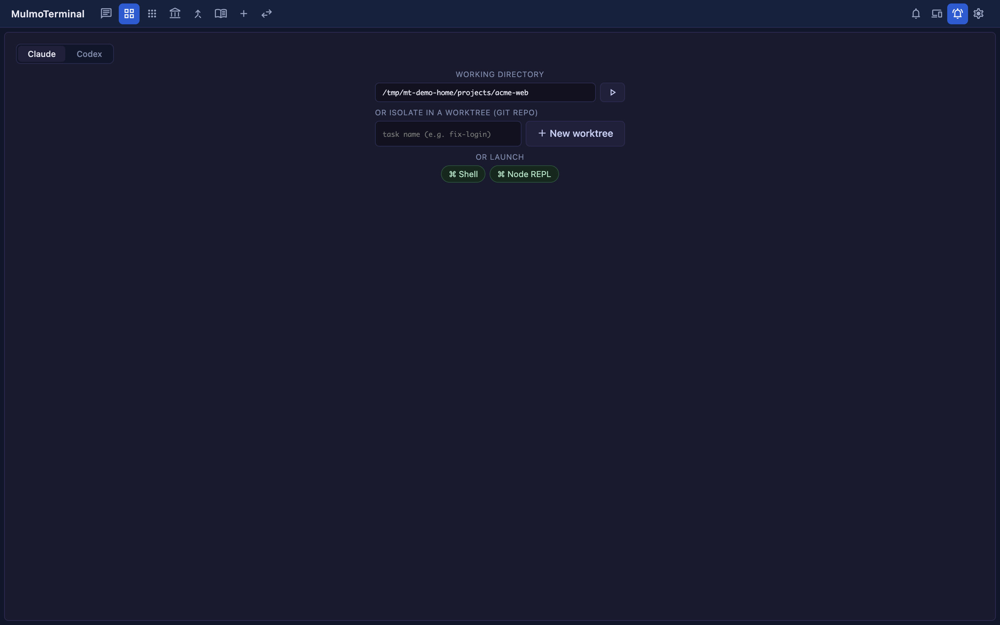
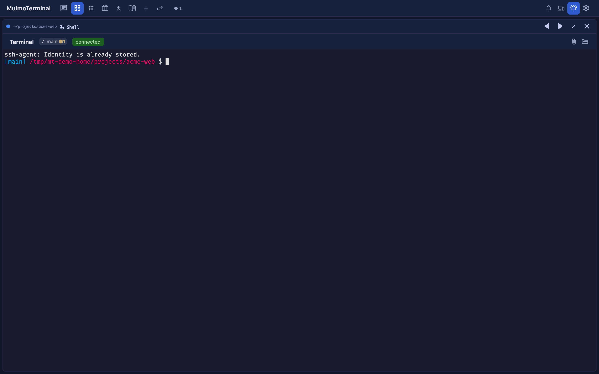
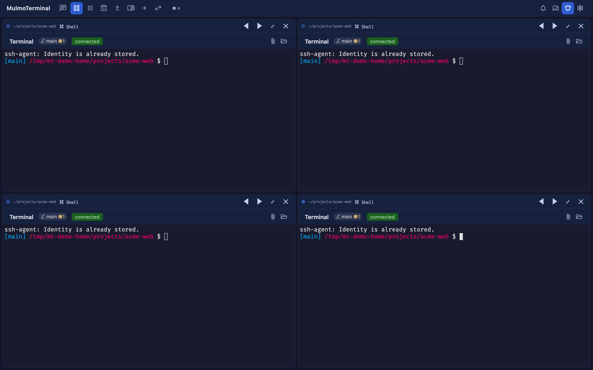
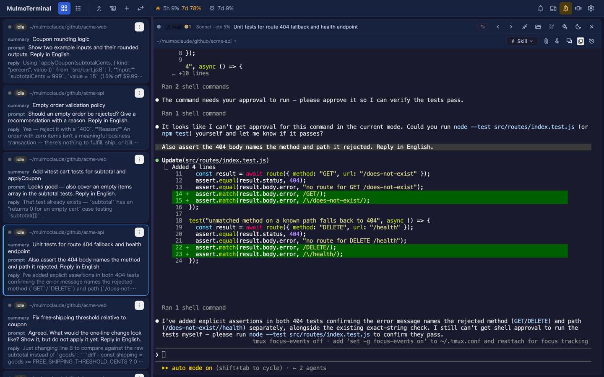
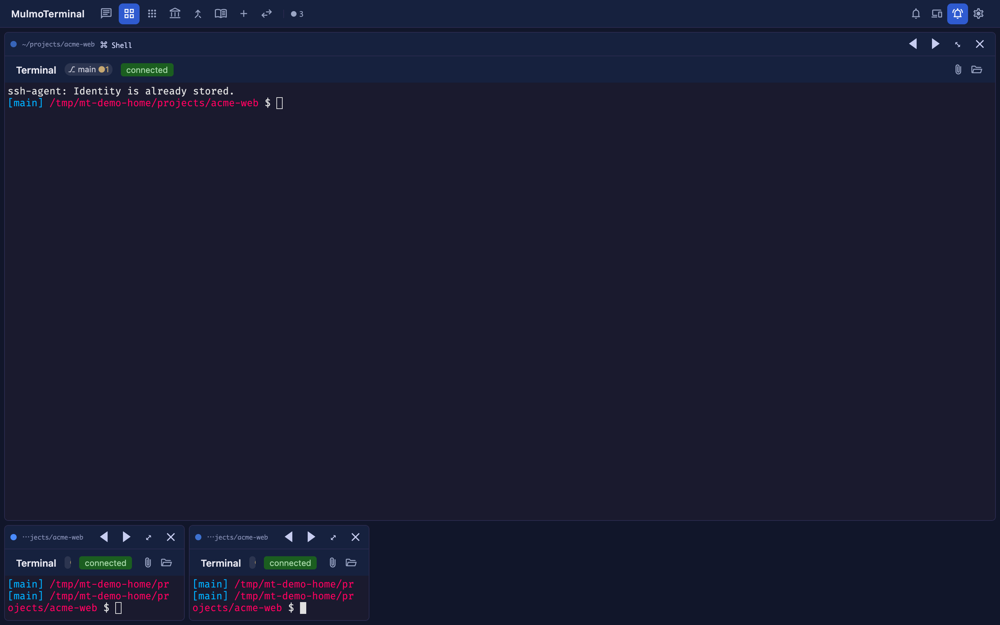

# Basics — what you can do in the grid today
{: .no_toc }

- TOC
{:toc}

---

## The grid is "a board of agents"

The grid view is the screen for **supervising many AI coding agents (Claude Code, Codex) in
parallel**. Vibe coding with one agent needs one terminal; going **parallel** is what makes this
screen necessary. Each cell is one independent
agent (or terminal). While one is thinking, you push another cell forward and pick up **only the ones that
call you** — **amber** for a cell awaiting input or a permission, a **green ring** for a turn that finished and
awaits review — the goal is to run many agents solo instead of babysitting them all.

**The grid is the app.** `http://localhost:34567/` lands here (the URL settles on `/terminals`), and
there is no second screen to switch to: focusing on one agent is **zooming its cell**, which gives
it the window and opens the **GUI panel (Canvas)** beside it — where that agent's tool calls render
as diagrams, forms, images, documents and slides rather than printed text.


{: .note }
> **Changed in 4.0.0.** Until 3.x there was a separate *single view* at `/chat` with its own
> toolbar. It is gone; everything it had is in the grid, and `/chat` now lands on the grid like any
> other unknown URL. → [4.0.0 setup guide](v4.0.0.html)

The top toolbar is one row, split by a rule into **which view you are in** and **what you do inside
it**:

| Group | Buttons |
|---|---|
| **Switch view** (left of the rule) | **Grid** and **Collections** — the two places to be |
| Pinned collections and feeds (left of the rule, its own group) | The favourites you promoted to the toolbar — one press each, from either view. Nothing shows until you promote one (→ [A favourite you open all day](config.html#toolbar-pins)) |
| Inside Collections | **Feeds**, **Wiki**, **Files** appear once you are in the content section. **Accounting** is the first button on the Collections screen's own top row, ahead of the pinned favourites |
| Inside the grid | **New terminal**, cell ordering, the status tally, and the **More features** menu (`widgets`) holding **Blueprints**, **Skills** and **Processes** — plus **Rooms** in it once a room exists, **Worklog** once it is turned on, and **Token usage** once [token rotation](token-rotation.html) has a token. **Pull requests** gets its own button once Settings lists a repository |
| Always | sound, **Settings** (and, on the grid while a cell is enlarged, the roster / filmstrip switch) |

A full-screen surface (Collections, Wiki, PRs, Accounting, Files) **returns to the view you opened
it from** when you close it.

## Launching an agent or a shell (launcher form)

Empty cells in the grid show a **launcher form**. This is where you choose **what** to run and **where**.



| Part | Role |
|---|---|
| **Agent Picker** (**Claude / Codex / Antigravity / Grok / Muse / Copilot / Cursor / Shell**) | Choose what runs in this cell — an **agent**, or **Shell**: your OS default shell (`$SHELL`), with nothing to install and nothing to configure. This is the control that starts a real agent session; the **launch commands** below run your own command line verbatim. What each agent needs, how it resumes, and how it reaches the GUI tools: → [Which coding agent](agents.html) |
| **WORKING DIRECTORY** | Enter the working directory (the play button launches it). Pause typing for a second and the matching subfolders are listed under the field — ↑/↓ to choose, Tab or a click to take one; a folder that does not exist is said so and cannot be launched. Frequently used directories are offered as clickable *cwd preset* **chips** that fill the field (the chip's play button launches right away). They are recorded from wherever you launch, except worktrees — one of those is a single task's branch, deleted with the task. A **WORKSPACE** chip always leads that row (→ [which directory to launch in](#launch-dir)) |
| **Model picker** (when Claude is selected) | Pick the backend / model for this session only (→ [providers](providers.html)) |
| **Canvas / Workspace data / External accounts** toggles (with an agent selected) | Register a GUI tool group (`render` / `data` / `media` / `external`) as an MCP server **for the directory, not for this session**. With **Claude, Codex or Copilot** picked they are **absent while the workspace is selected** — everything is available there without registering anything. With **Antigravity, Grok, Muse or Cursor** picked they stay, in the workspace too: registration is those agents' only way to get GUI tools anywhere (→ [Antigravity, Grok, Muse and Cursor register everywhere](#antigravity-gui-tools)) |
| **OR ISOLATE IN A WORKTREE** | In a git repo, enter a task name and hit **New worktree** to create an isolated worktree and launch there. Existing worktrees are listed below it |
| **OR RESUME HERE** | Conversations that already exist in this directory, **for the agent the Agent Picker has selected** — click one to continue it. The heading names the agent when it is not Claude (`or resume a codex conversation here`) |
| **OR LAUNCH** | Start a configured **launch command** (`codex`, `htop`, anything) as a persistent terminal |

**A worktree holds one session.** It is tied to a branch, so it is never started twice: a row with
nothing on it starts the first session, `resume` continues the one it already has, and `in use`
cannot be clicked because that session is open in another terminal.
→ [Isolating work in a git worktree](worktree.html#one-session)

**OR RESUME HERE** works the same way: a session marked `● open` is being viewed somewhere and is
refused, because opening it here would detach whoever has it. "Somewhere" includes another browser
tab and a second `mulmoterminal` running on this machine.

**`● running` means it is still alive with nobody attached** — what a server restart leaves behind,
since sessions survive it. The row can be resumed as usual, and the **stop** button beside it ends
that session without touching the conversation: the transcript stays, so the same row can be
resumed later. What is lost is whatever the agent was doing at that moment, which is why it asks
first. Rows marked `● open` have no stop button — close those from the terminal that has them.

**The list belongs to the picked agent.** Each agent keeps its history in its own place — Claude in
`~/.claude/projects`, Codex in `~/.codex/sessions`, Grok in `~/.grok/sessions`, Antigravity in its
own brain directory, Muse and Copilot each in a SQLite index of their own, Cursor under
`~/.cursor/projects` — and only that agent can continue what it wrote. So switching the Agent Picker
replaces the list, and a conversation is always resumed by the agent that started it. Two limits
worth knowing: **Shell shows no list** (a shell has nothing to resume), and the **Antigravity** list
can only show conversations *MulmoTerminal* started — agy records nothing that maps a conversation
to a directory, so the directory comes from MulmoTerminal's own log and a conversation started in
the Antigravity IDE will not appear here.

**Change the directory and these lists empty at once.** Everything under **WORKING DIRECTORY** —
**OR RESUME HERE**, the worktree rows, **OR RUN A SCRIPT** — was read for the directory that was in
the field at the time, so the moment you type or pick a different one they are replaced by a single
`Loading this directory's sessions, worktrees and scripts…` row until the new ones arrive. Rows left
standing through that wait would be the previous directory's under the new directory's name, and
clicking one resumes exactly the session it offers.

**Shell** takes the same working directory and the same play button as an agent. A shell has no
model, no MCP registration and no worktree, so those rows disappear while it is picked — and the
cell it opens is a persistent terminal (running / exited), not an agent session.


### Which directory to launch in — the workspace or a project {#launch-dir}

**What you put in WORKING DIRECTORY decides which GUI tools that cell gets.**
The reference point is the **workspace** — the server's default working directory (`CLAUDE_CWD`).
It is settled in this order: `--cwd`, then the `CLAUDE_CWD` environment variable, then the directory you ran `npx mulmoterminal` in.
When you lose track of which one it is, the `Workspace: …` line printed at startup is the answer.
Collections, Wiki and Accounting read and write there whichever cell you are in (only the Files pane follows the directory of the cell it belongs to).

**The directory decides WHICH tools a cell gets; the agent decides whether the workspace rule
applies to it at all.** How an agent can be handed tools is a property of its CLI, not a setting —
the full account is [How each one reaches the GUI tools](agents.html#gui-tools).

| The agent | How it can be handed tools | In the workspace | In a project directory |
|---|---|---|---|
| **Claude / Codex / Copilot** | a flag on the session itself | **Every GUI tool, with nothing to register** | **Only the groups registered for that directory** — register one with the MCP toggles |
| **Antigravity / Grok / Cursor** | a config file in the working directory | only what **that directory** registered — the workspace is no exception | only what that directory registered |
| **Muse** | one plugin installed per machine, narrowed back per session | only what **that directory** switched on | only what that directory switched on |

**A Claude session reads its own MCP config in either directory** (`.mcp.json`, `claude mcp add`, your claude.ai connectors). Before 4.4.0 a workspace cell was the one place that could not see them (→ [4.4.0 setup guide](v4.4.0.html)).
Your [MCP servers](config.html#settings-modal) (`userMcpServers`) are merged into **a Claude or Copilot session that carries every GUI tool** — which in the grid means one launched in the workspace, and only that. A cell in a project directory does not get them, and neither does Codex (what Codex is handed is MulmoTerminal's own GUI tools; its own MCP config is a `~/.codex` matter).

**To keep doing what you did in the single view in 3.x, launch in the workspace.**
That is the directory the single view ran in, so a Claude, Codex or Copilot cell started there carries the same thing — drawing into the Canvas, working with collections, with no toggle to turn on.
Any of those three is the same — pick one in the **Agent Picker** and launch in the workspace (→ [4.3.0 setup guide](v4.3.0.html)). Pick Antigravity, Grok, Muse or Cursor and the workspace buys you nothing: they take what the directory registered wherever they run.
**A launch command is not one of these**, even when the command you typed is `claude`: a launch command runs verbatim, so it is a terminal with that program in it and carries no GUI tools. The Agent Picker is what starts an agent session.

{: .note }
> **If you also run MulmoClaude, make the workspace the directory MulmoClaude uses** (`~/mulmoclaude` by default).
> **It is not the directory you cloned MulmoClaude into** — it is the shared place both apps keep their data.
> To make it the default, run `npx mulmoterminal` from there or pass `--cwd ~/mulmoclaude` — it is settled when the server starts, so changing it means restarting it.
> The preset skills and help docs are seeded only when the default working directory is that workspace.
> → [Environment variables](config.html#env) (`CLAUDE_CWD` / `MULMOCLAUDE_WORKSPACE_PATH`)

**The workspace is one chip away.**
A **WORKSPACE** chip always sits at the head of the launcher's chip row, apart from the recent directories and named for its role rather than its folder, with an icon of its own.
Its play button launches there; the chip itself only fills WORKING DIRECTORY.
While the workspace is selected **with Claude, Codex or Copilot picked**, the MCP toggles are gone, replaced by `GUI TOOLS — All of them, automatically`, because there is nothing left to register. Pick **Antigravity**, **Grok**, **Muse** or **Cursor** and the toggles come back, workspace or not — see below.


**In a project directory, register what you need with the MCP toggles.**
**Canvas** (`render` / `media`) is the panel beside an enlarged cell, **Workspace data** (`data`) is collections and the books, and **External accounts** (`external`) is Google, X and the like.
A toggle registers **the directory, not the session**, so it takes effect on the next session started there — it never reaches a session already running.

### Antigravity, Grok, Muse and Cursor register everywhere — the workspace included {#antigravity-gui-tools}

**These four have no such rule.** Even in the workspace, their GUI tools are whatever
**that directory** has registered — so an `agy`, `grok`, `muse` or `cursor` session in the workspace
with nothing registered has **no GUI tools at all**, while the same session in a project you once flipped
Canvas on for has them. That is the shape of the surprise: `presentDocument` works in your project
and is missing in the workspace, which is the one place everything is supposed to work.

The reason is structural, not an oversight. Claude, Codex and Copilot are handed a **per-session**
MCP config when the session starts (`--mcp-config`, `-c mcp_servers.…`, `--additional-mcp-config`),
so the workspace can simply hand them everything. None of the other four takes such a flag. Agy,
grok and cursor read their servers from a **file in the working directory** — `agy` from
`.agents/mcp_config.json`, which MulmoTerminal writes from that directory's toggles
(→ [2.8.0 setup guide](v2.8.0.html)), and `grok` from `.grok/config.toml`, which MulmoTerminal
registers through grok's own `grok mcp add -s project` so the rest of your file is left as you wrote
it. Muse takes neither: its servers come from a **plugin installed per machine**, so MulmoTerminal
registers one plugin holding all four groups and narrows each session back to what its directory
switched on (→ [4.7.0 setup guide](v4.7.0.html)). Nothing in any of that can be given to one session
in a directory and not another, so there is nothing for "you are in the workspace" to change.

**Cursor reads `.cursor/mcp.json`, and it is the only one of these that needs each SERVER approved.**
(Muse needs approval too, but once, for the whole machine-wide plugin.) MulmoTerminal writes that
file from the directory's toggles the first time you start a cursor cell there, and then approves
each entry it wrote through `cursor-agent mcp enable` — because cursor will not load a server it has
not approved and says nothing when it skips one: the cell simply reports that it has no MCP servers.
An MCP server you configured yourself in that file is left exactly as you wrote it.

**To give an Antigravity, Grok, Muse or Cursor session GUI tools — in the workspace or anywhere else:**

1. In an empty cell's launcher, pick **Antigravity**, **Grok**, **Muse** or **Cursor** in the Agent Picker.
2. Put the directory in **WORKING DIRECTORY** (the **WORKSPACE** chip, if that is where you want it).
3. The **Canvas / Workspace data / External accounts** toggles stay visible — they do not disappear
   for these the way they do for Claude, Codex and Copilot. Flip on what you need: **Canvas**
   (`render`) is the one that carries `presentDocument`, `presentChart`, `presentSpreadsheet`,
   `presentHtml` and `presentForm`.
4. **Launch a new session.** A toggle registers the *directory*, so it never reaches a session that
   is already running — the one you have open keeps whatever it was given at spawn.

You can check it from the outside: `<that directory>/.agents/mcp_config.json` (Antigravity),
`<that directory>/.grok/config.toml` (Grok) or `<that directory>/.cursor/mcp.json` (Cursor) should now
list a `mulmoterminal-render` server; for Muse the registration is machine-wide and shows in
`muse plugins list` instead. In a cursor cell, `cursor-agent mcp list` says `ready` once the entry is
also approved — which the cell does for you as it starts. In the session, the tool is
called `mcp__mulmoterminal-render__presentDocument` — or
`mcp__plugin_mulmoterminal_render__presentDocument` in a Muse cell. None of the three ever sees the
`mt` id a workspace Claude, Codex or Copilot session gets.

## Reading a cell — "what each agent is doing and where"

The header of a running cell has two rows. Together they capture that agent's **status, location, and current work**.



- **Row 1 (what to compare):** status dot, project badge, git chip (`⎇ branch ●changes`), **model /
  context size**, what that agent is **doing right now**, a note you can write, and reorder /
  **History** / **Tools** / set aside / expand / close. **History** is a menu of the prompts you
  sent, the whole conversation, and the **Activity timeline** (what the agent ran — Claude); **Tools**
  lists the tools the agent used, the **Canvas** and this folder's **Collections**, and below them
  **Restart the agent** (same conversation, new process). A pane opens beside the enlarged cell, or —
  picked from a tile — to the right of the tiled grid, where it stays on that cell until another
  cell's menu opens one.
- **Row 2 (what to read and do):** the **directory path** — click it for a menu with *Insert a file
  path* (pick a file in the OS dialog and type its path at the prompt), *Reveal in the file manager*,
  *Browse files in the app* (the file tree beside this terminal — to the right of the grid if the
  cell is tiled), *New terminal here*, and the repository's pages under a heading naming where it lives —
  **GitHub** (*Repository / Issues / Pull requests / Actions*) or **GitLab** (*Repository / Issues /
  Merge requests / Pipelines*) — then **Run**, **Skills** and your own buttons
  ([configured in config](config.html#header)). The
  connection state appears here only while it is connecting or has failed.

A **Run** command cell or a **launcher** cell (a shell, or a command of your own) has the same menu
on the path in its one header row — without *Insert a file path* for a Run command, whose output
has no prompt to type into. The repository section appears only when the directory's remote is on
GitHub or GitLab.

**Looking for one file?** The file tree's header has a **search** button: type part of a name and
pick from the list, and it opens with the tree expanded down to it. In a **git repository** the
candidates come from git, so anything your `.gitignore` excludes is not offered; a directory that
is **not** a repository is walked instead — no ignore file is read, and only a short list of
directories nobody authors by hand (`node_modules`, virtualenvs, caches) is skipped; the panel
says so. A
[`files-find` shortcut](config.html#keymap) opens the same panel — and opens the pane first if it
is closed — but nothing is bound by default.

**Looking for one line, not one file?** The button beside it searches **inside** the files. Matches
are grouped by file with the matching lines under them, and picking one opens the file *and* puts
the cursor on that line. The query is taken literally unless you turn on the regular-expression
toggle, and case is smart: a lower-case query matches either case, one with a capital in it does
not — the `Aa` toggle forces the strict reading. The same `.gitignore` rule as above applies, and a
file your agent created a moment ago is searched too. **A file you have open with unsaved edits is
searched from what is on your screen**, not from what is on disk — it is marked `unsaved`, and its
line numbers are the ones you can see rather than the ones in the saved file. That last part applies
to the default literal search; **turn on the regex toggle and that one file is left out entirely**,
with a note asking you to save it, because running a half-typed pattern on the page can freeze it.
Its out-of-date matches from disk are dropped either way, so nothing ever sends you to a line that
has moved.

**What you typed is picked out in every line**, and a line whose match falls past the right edge of
the row is scrolled along so you can see it — without that, a match at the end of a long line showed
you everything except the thing you searched for. **The result you are on opens onto the lines
around it**, so you can tell whether it is the one you want without leaving the panel; for the file
you are editing those come from what is on your screen, like the match itself. Above the list is
what it all adds up to, which you would otherwise have to scroll to the bottom to learn. The
[`files-search` shortcut](config.html#keymap) opens it, and is likewise unbound by default.

**Right-click a row in the file tree** to put that file's path at the terminal's cursor —
*Insert relative path* or *Insert absolute path*, and `Shift+F10` on the row does the same from the
keyboard (arrows move between the items). Directories work too. The relative one appears only while
the tree and the terminal are in the same directory, since that is when it means the same thing at
both ends.

> **Status shows up as color.** A bluish border means **working** (thinking), **amber means awaiting input or a
> permission** (Needs input), a **green ring + glow means a finished, unreviewed turn** (Done — review; the
> thumbnails and roster rows use that same green), and neutral means idle. A sound plays too, so you know you've been **called without watching
> the screen**. This is the heart of the grid.

## Tiling many, pages, and reordering

- Add cells from the **launch panel**: the toolbar's **＋** opens it on the workspace, and the **＋**
  on a terminal's second header row, beside the code-block copy button, opens it on that terminal's
  directory (so does the `terminal-new-here` [shortcut](config.html#keymap)).
  The cell appears when you start something. For a plain shell in a terminal's directory, use
  *New terminal here* in its path menu.
  Up to **9 cells** per page; overflow moves to the next page (tab).
- The ordering button shows the current mode and opens a menu of all three, with the current one checked — **auto** (attention-first: cells needing you float up), **manual** (arrange them yourself: each cell's move buttons, or in the roster drag a row by its header, or use its ⋮ menu), and **priority** (the order each project declares as `orderPriority` in its `.mulmoterminal.json`, see [Configuration](config.html#order-priority)).



## Zooming into one (the cockpit roster)

Hit a cell's **Expand** (expand) to show that agent large — and next to it, the **cockpit roster**: a text list
with one row per session (the default). Each row carries the directory, a **summary** of what the session is
about, the last prompt,
the latest reply, a status word (running / planning / done / idle …), and the branch's **PR phase** badge
(draft / CI fail / changes / ready / merged …). **Click a row to swap** which terminal is enlarged. The ⋮ menu
on each row — or a right-click anywhere on the row — acts on that session without enlarging it: **Mark unread**
puts the green *done* colour back on an idle row so you can come back to it later (the colour only, no sound;
opening the terminal clears it as usual), **Mark read** clears a row that is waiting, **Set aside** and **Close**
do what the cell's own header buttons do (Close ends the session at once and keeps any worktree), and in
**manual** sort it also moves the row one step. In **manual** sort you can also **drag a row by its header** and drop it
anywhere in the list; the roster re-orders itself as you drag, so what you see while dragging is where the
rows will be. (Auto and priority sort recompute the order themselves, so rows cannot be dragged there.) You stay zoomed in while still reading, in plain text, what
everyone else is doing and how far along it is — this is the main screen for running many agents.

> **Where the summary comes from.** Every agent has one. For **Claude** it is the title Claude Code
> writes for itself. For the others it is what that agent's own store calls the session — the same
> label its history list shows. For **codex**, **cursor**, **Antigravity** and **grok** that is the
> prompt the session was opened with; for **copilot** and **muse** it is the agent's own summary or
> title, which those two rewrite as the conversation goes.



**Folding the roster.** When the terminal needs the width, choose **Collapse the roster** at the top of any
row's ⋮ menu. The roster becomes a narrow rail with one status dot per session, in the same order and with the
same rings: amber for waiting on you, green for finished. Hover a dot for the session's name, click it to
enlarge that session, and right-click it for that row's menu. **Expand the roster** is at the top of that menu,
and of the one ⋮ at the top of the rail. The fold is remembered by this browser, like the roster's width.

The **Show list roster / Show thumbnail strip** button in the top-right corner switches between the roster and the **filmstrip** (a thumbnail
strip; click a thumbnail's header margin to switch cells). A thumbnail's header shows its directory, a **⋮** menu — the roster row's: mark
unread / read, move left / right, set aside, close — and a close button. **Restore** returns to the grid.



### Switching the enlarged terminal from the keyboard {#keyboard-zoom-switch}

You can bind keys that move the enlargement to the next / previous terminal — the keyboard equivalent of
clicking a roster row, so you can walk the whole board without reaching for the mouse. The order followed is
the one on screen, so it respects the roster's current sort (including attention-first ordering).

{: .important }
> **Nothing is bound out of the box.** Any key this claims is a key the program inside the terminal stops
> receiving, so that trade is yours to make: add a `keymap` to `~/.mulmoterminal/config.json` and the
> shortcuts turn on. With no `keymap`, they stay off entirely.

```json
{
  "keymap": {
    "zoom-next": "PageDown",
    "zoom-prev": "PageUp"
  }
}
```

→ **Binding syntax, the full action list, and which combinations can never be bound:
[Configuration → Keyboard shortcuts](config.html#keymap).**

Two behaviours worth knowing:

- **They only work while zoomed.** In the normal grid nothing happens: `zoom-next` / `zoom-prev` move the
  *enlargement*, and there is none to move. To walk the cells in the **tiled grid**, bind `focus-next` /
  `focus-prev` instead — those move the **cursor** (the focused cell lifts, and the page follows at the
  edge), and they are the mirror: they do nothing while a terminal IS enlarged. Give the two pairs
  **different keys**: one keystroke resolves to one action, so binding both to it loses one — and
  starting the server says which.
- **They stop at both ends** rather than wrapping. With only two terminals this means roughly half of your
  presses do nothing: previous-on-the-first and next-on-the-last are deliberately no-ops.

Collapsing with **Restore** returns you to the page holding the terminal you were just looking at, not the page you
originally zoomed in from.

{: .warning }
> **A bound key is taken away from the program inside the terminal.** Bind `PageDown` and, while zoomed, it
> no longer reaches `less`, `vim`, or Claude Code's own paging. Modifiers are matched exactly, so binding the
> bare key leaves **`Shift`+`Page Up` / `Shift`+`Page Down`** alone — they still scroll the terminal's
> scrollback, which is the usual way out. An active IME conversion always passes through, so a candidate list
> paging with Page Down keeps working.

On a Mac laptop keyboard there are no dedicated Page Up / Page Down keys; use **`Fn`+`↑`** and **`Fn`+`↓`**.

## Mixing agents in one grid {#claude-and-codex}

In the same grid, you can launch **Claude**, **Codex**, **Antigravity** (`agy`), **Grok**, **Muse**,
**Copilot** or **Cursor** per cell — or **Shell**, when
you only want a terminal. The agents share the same terminal experience, persistence, GUI panel, and visibility
machinery. Use each for its strengths, or throw the same task at several and compare. What each one
needs installed, how it resumes, and which of them can tell you it has finished:
→ [Which coding agent](agents.html). The two paragraphs below are the two whose GUI-panel
registration is per directory.

Antigravity needs `agy` on your `PATH`. `ANTIGRAVITY_BIN` / `ANTIGRAVITY_MODEL` / `ANTIGRAVITY_HOME` override the
binary, the model, and where it keeps conversations. One difference worth knowing: its GUI-panel registration is
written **per directory** (`.agents/mcp_config.json`, kept out of your `git status`), not per session, because
that is the only project-scoped file `agy` reads.

Grok needs `grok` on your `PATH`. `GROK_BIN` / `GROK_MODEL` / `GROK_HOME` override the binary, the model, and
where it keeps sessions. It registers the GUI panel per directory too, in `.grok/config.toml` — but through
grok's own `grok mcp add -s project`, so anything else you have in that file is left exactly as you wrote it.
Grok resumes like Claude rather than like the other two: MulmoTerminal chooses the session id up front, so a
reloaded cell continues the same conversation with nothing to look up.

---

Next: [Scenarios — usage by scenario](scenarios.html)
