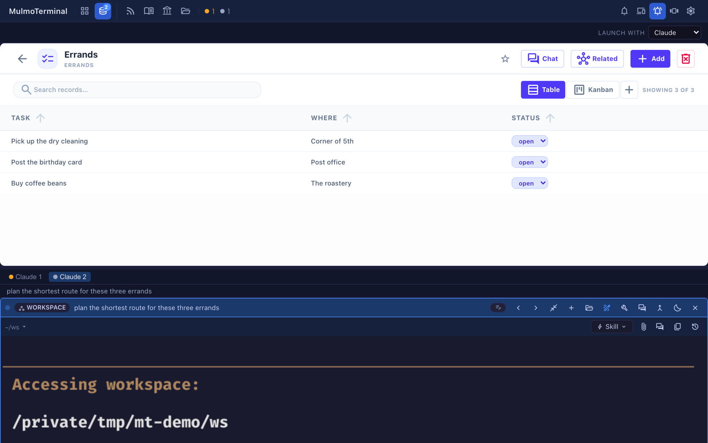
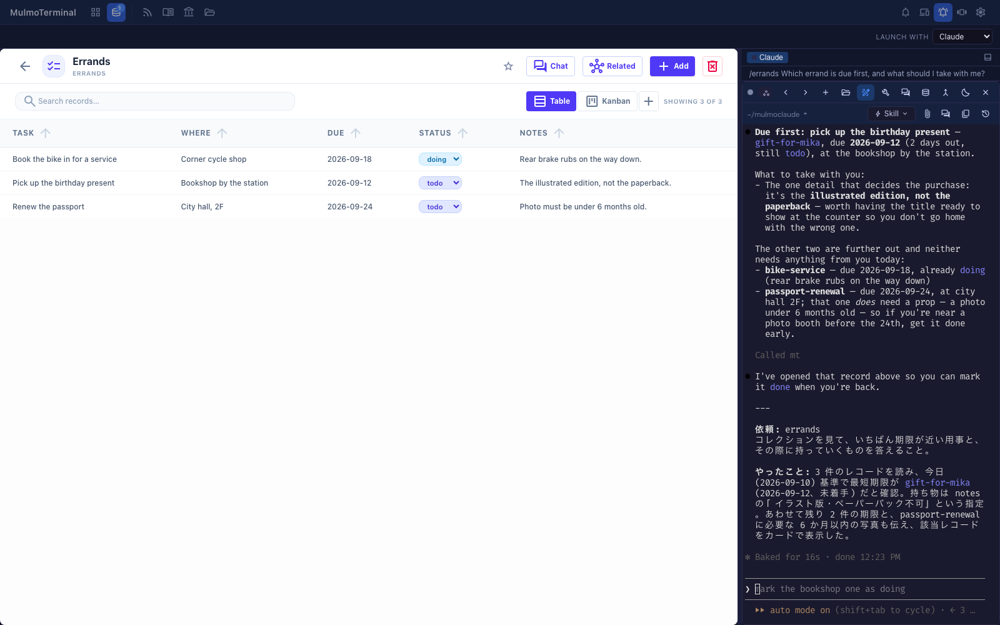

# Feature reference
{: .no_toc }

MulmoTerminal — a browser terminal for parallel coding agents — organized by the **four pillars** (Supervise / See / Automate & investigate / Extend). For how to use them, see [Basics](basics.html) and [Scenarios](scenarios.html).

- TOC
{:toc}

---

## 1. Supervise — a cockpit for parallel agents

| Feature | Description |
|---|---|
| Parallel terminals | Up to **9 cells** per page; overflow adds a new **page (tab)**. Cells auto-sort by state (needs-you first) |
| Status colors + sound | Working (blue) / **awaiting input (amber)** / **done, review it (green ring)** / idle. Know you've been "called" without watching |
| Cockpit roster | While zoomed with **Expand**, a **one-row-per-session text list** beside the terminal (directory, AI summary, prompt, latest reply, status word). Click a row to swap; **Show list roster / Show thumbnail strip** toggles the thumbnail filmstrip |
| Keyboard: switch the enlarged terminal | While zoomed, bound keys walk the enlargement along the on-screen order. **Opt-in — nothing is bound by default**; add a `keymap` to `config.json` ([config](config.html#keymap)) |
| Rate-limit gauge | The **5h / 7d** windows your Claude (and Codex) subscription shares across every session, always visible in the grid header. Running many agents is what burns them fastest, and nothing else in the app showed them. Shown only once an agent reports; hover for when each window resets. Whenever more than one thing is on the row, each set of figures carries its tool's mark, so `claude usage n/a` beside a `7d` figure cannot be mistaken for Claude's own. **When it cannot be shown, it says why** — no `claude` on PATH, an account with no windows (API-key billing), a check waiting on Claude Code's trust prompt (run `claude` once in the check's own folder, `~/.mulmoterminal/probe`, and accept it), or one that got no answer and is retrying. A reading it can no longer vouch for is dropped rather than drawn as current. With [a second subscription](accounts.html) configured (beta), each account's windows sit beside the default login's, named with the account |
| Machine load | The **load average** of the machine your sessions run on, beside those windows, as a **percentage of its cores** — `load 334%` is a 20-core machine with 66.8 runnable processes. 100% means every core has work queued and starting another agent slows the ones already running (amber); 200% means everything is waiting for a core (red). Hover for the raw 1 / 5 / 15-minute figures, the core count and the multiplier (`3.3x`). Refreshed every 10 seconds. A host that keeps no load average — Windows — shows nothing rather than 0%. Switch it off in Settings under **Grid header read-outs** |
| Search box | Off by default. Switch on **Search box** in Settings under **Grid header read-outs** and the middle of the top bar shows, on every screen, a search box that opens the command palette — the same palette the Commands button and its key open |
| Add / close / reorder cells | **New terminal**, each cell's close button, and **Move left / Move right** in reorder mode. Ordering is **auto** (attention first), **manual**, or **priority** (what each project declared in `orderPriority` — [config](config.html#order-priority)) |
| Set a terminal aside | The bed button (a person asleep) in a cell's header **sinks it** — the tile, its filmstrip thumbnail and its roster row all fade, and the working dot stops pulsing. It stays **connected and keeps its whole history**: this is the alternative to `/clear`-ing a cell you are done with for now, which resets the conversation to change how the cell looks. Survives a reload. **Enlarging it keeps it faded**, so you can read a set-aside session without waking it — the roster row keeps its blue "you are here" edge either way. **Typing into it wakes it** — clicking or scrolling to read it does not, even though a mouse-tracking agent receives those as input. Nothing has to be undone by hand. A cell that **stops for a permission prompt comes back to full strength on its own**; a merely finished turn does not, since that is what setting it aside leads to |
| Seven kinds of notification sound | Besides finished and input-waiting: a Run cell succeeding or failing, a session exiting, a PR going red, and a hidden background worker that ended without finishing. **Only the first two are on by default**; the rest are opt-in ([config](config.html#sounds)) |
| Worktree isolation | Git worktrees so many agents can run on the same repo without colliding (→ [Worktrees](worktree.html)) |
| Session persistence (tmux) | If tmux is available, each session runs inside tmux and **reconnects** across reloads and server restarts |
| Phone companion (RemoteHost) | **Web Push to your phone** on finished / input-waiting turns, plus **watch, reply, and start a new terminal** from the phone — with your own one-tap chips (→ [From your phone](phone.html)) |

## 2. See — what each agent is doing and where

| Feature | Description |
|---|---|
| That agent's current work | The header shows "what it's doing right now" |
| Session note | Your own one line about **what a cell is for** — everything else in the header is what the agent said, which stops telling cells apart once several are open. The pencil beside the header text opens a box (Enter saves, Esc cancels); while a note is set it replaces the header line, and the title it displaced moves to the tooltip. The note is also the session's name in the launcher's session list and on the phone. Kept per session: close the cell, restart the server, resume that session and it comes back |
| Conversation name | The name you give a Claude conversation with `/rename` is its name here too — on the cell header, the roster row, the launcher's resume list, the command palette and its recently-closed entries. Your own session note still comes first, and the name it displaces moves to the tooltip. Renaming replaces it, `/rename` with nothing after it removes it, and a `/clear`ed conversation starts without one |
| Git status chip | `⎇ branch ●changes ↑ahead ↓behind`, always shown |
| PR phase / work phase | Each roster row badges the branch's **PR state** (draft / CI fail / changes / ready / merged …) and the work phase (planning / editing) |
| Model / context size | e.g. `Opus · ctx 35%` — the active model and how full the context is |
| Activity timeline | Tool-call history (Bash / Read / Edit …) shown newest-first in a modal — in the cell header's **History** menu, with the prompts and conversation panes below |
| Prompts pane | The prompts **you** sent this session, newest first, in a pane beside the cell (or to the right of the tiled grid) — the mirror of the timeline above (what the agent ran vs. what you asked for). Read-only, keeps up while left open, Claude and Codex |
| Conversation pane | The session's **conversation as turns**, in place of the terminal — read from the agent's own transcript, not the screen, so a Claude cell's alternate screen no longer means "what scrolled past is gone". **Scroll up to walk back to the first turn**, a page at a time. A frame per speaker (you / the agent, named), the reply as **rendered markdown**, and the tool traffic **folded to one line** saying what ran. A snapshot with a reload, not a live tail. Claude, Codex, Cursor, Copilot |
| Copy the last code block | A cell-header button puts the **last fenced block of the latest reply** on the clipboard, taken from the agent's own transcript rather than the screen — so no line wrapping or leading spaces come with it and it pastes cleanly into Discord / Slack / email. Where the browser blocks clipboard access (any address that is not https or localhost, i.e. from your phone) it shows the block selected for copying by hand instead |
| Cost (estimated) | Approximate **session / today / this month** cost in settings |
| Worktree diff badge | Shows the amount of change on a worktree cell; click for the diff panel (→ [the diff badge](worktree.html#diff-badge)) |
| GUI panel | Renders diagrams, forms, images, and documents — plus HTML, **video/slides (MulmoCast)**, collections, and accounting — from the agent's tool calls (Claude / Codex both supported). Scenes Claude Code writes as Remotion components need packages you install: [MulmoCast videos](mulmocast.html#remotion) |
| Clickable file paths | A **file path an agent prints** in the terminal becomes a link (on Windows, `\`-separated ones such as `C:\work\a.ts` too; one with a space in a folder name when it is inside quotes, backticks or brackets, as in `Read(/Users/me/My Docs/a.md)`), and **what it opens is chosen by extension**: `.md` renders, `.json` is indented, `.csv` / `.tsv` become a table (each in a new tab with a toolbar that switches to the file's source and copies either), `.html` shows as the rendered page (in a new tab), source and `.txt` open in the app's own **Files** view for editing, and images / PDF / video open as-is. A line after the path — `src/a.ts:42`, `:42:7`, or tsc's `(12,5)` — opens the file as text at that line wherever it opens in the Files pane or view (an image, PDF, video or audio file still opens as itself); a new tab ignores it. **Anything a tab cannot display** — an `.xlsx`, a `.zip`, a `Makefile` — also goes to the **Files** view, where it offers **Open in OS** rather than starting a download nobody asked for. **While a grid cell is enlarged, or a file pane is open beside the tiled grid, that pane takes the click instead**, so the file opens next to the terminal that printed it — an image shows as a picture, a PDF in a frame, a video or audio file in a player, an HTML page in its Preview — and only for files under the directory of the cell the pane belongs to. A file outside the session's working directory opens too; an HTML page, an image, a PDF, a video or an audio file there opens in a new tab through a link to that one file ([routing table](https://github.com/receptron/mulmoterminal#clicking-a-file-path)) |
| Cross-repo PRs / Issues view | All registered repos' **open PRs and issues** in the toolbar's full-screen Pull requests view |
| Wiki / Collections / Accounting / Files | In-app views: a Wiki (with a graph view), collections, accounting (opened from the top row of the Collections screen), and a **file explorer + editor** |
| Work from a collection | A chat started from a collection card runs **under the collection** instead of taking the screen to the grid. It is the same terminal either way — whichever view you have open drives it → [working from a collection](#collection-chat) |
| Summary when it hands back | A Claude session ends its reply with **what was asked, what it achieved, and what it left** whenever it finishes or stops to ask. Coming back to a cell later, that is the current state without scrolling back |
| See why a setting isn't working | Settings' **Directory settings** shows what each directory's `.mulmoterminal.json` actually puts in force, which file it came from, and **the keys dropped or never read** ([config](config.html#dir-settings-preview)) |
| Update notice | When a new version ships, the header shows an **update badge**; click it for the update command that fits your install (npm / git clone) |
| Question pane (opt-in) | When a Claude session stops to ask you something, its choices appear as **buttons in a pane** beside the enlarged terminal → [answering a question from the pane](#question-pane) |
| Stacked right panes | The right pane shows one pane at a time, but the panes you open **stack**: closing the one on top shows the one it covered (open the conversation over Files, close it, and Files is back). Opening a pane that is already in the stack moves it to the top. The stack survives a reload |

### Working from a collection
{: #collection-chat }

Pressing a collection's card action or a template used to start the chat **and take you to the
grid**, closing the collection you were reading. Now it opens in a pane under the collection, and
you stay where you were.

It is not a copy. The chat is an ordinary grid cell, and the pane borrows it: whichever view you
have open is the one you type into, and switching between them keeps the scrollback, the input line
and everything else exactly as you left it. There is no "move it back" button because it never
left.



- **Several chats per collection.** Asking a second thing while the first is still working adds a
  tab. Each tab carries a dot in the grid's own colours — amber when the agent is waiting on you,
  grey while it works — and the one you are looking at shows a line of what it is doing.
- **The Collections button counts them**, so a chat running behind that door is visible from the
  grid.
- **Under the collection or beside it.** The button at the right of the tab strip moves the
  terminal between the two: under it when the collection is a list you are scanning, beside it when
  you are reading one record and talking about it. The choice is remembered, and each position keeps
  its own size.

  

- **Drag the divider** to give the terminal more or less room; the size is remembered per position.
  Arrow keys work on it too — up and down under the collection, left and right beside it.
- **Closing** is the cell's own power button (`power_settings_new`), in the pane or in the grid —
  the same terminal, so the same button.
- **A reload keeps them.** The chats are grid cells and survive it anyway; the collection they
  belong to is remembered alongside.

### Answering a question from the pane
{: #question-pane }

A Claude session that stops to ask something puts a dialog in the terminal that you answer with the
arrow keys. Turn on **Settings → Terminal keys → Question pane** and the same choices also appear as
buttons beside the enlarged terminal.


The pane opens by itself on the enlarged cell the moment the question arrives, and closes as soon as
it is answered, showing again whichever pane it covered. A question that arrives while its cell is tiled opens when you enlarge that cell —
there is no button for it, because there is nothing to open when nothing is being asked.


**The dialog does not go away, and the pane does not replace it.** Picking here presses the arrow
keys and Enter in the real dialog on the left, so whichever end you answer at wins and someone who
prefers the keyboard notices no difference. That is also why the pane can only offer what the
dialog's own list holds: **Chat about this** stays in the terminal.

**Answering in your own words** works when there is a single question and it takes one answer: a
text box appears under the buttons, and what you write goes into the dialog's own **Type something**
row. It is not offered for several questions at once, or for a multi-select one — the keystrokes
would stop somewhere that is not an answer.

- **Claude sessions only.** The choices arrive on Claude Code's own hooks, so a codex or shell cell
  never opens the pane.
- **One question is answered by the click.** Ask several at once — as the screenshot does — and each
  gets its own group, multi-select questions take as many as you like, and **Send** goes when every
  question has an answer.
- Off unless you turn it on: it lets a pane type into your terminal, which is not something to
  arrive by default.

### Editing files beside a terminal

Enlarging a grid cell (**Expand**) puts a **folder** toggle in its header. It splits the enlarged
area in two: terminal on the left, the file explorer + editor on the right, rooted at that
cell's directory and unable to reach above it. Drag the divider to resize, or focus it and use
←/→, Home, End. It works in both zoomed layouts, follows the enlargement as you move between
terminals, and remembers **whether it was open, how wide, which file you had open, and which
folders you had expanded** — so **a page reload puts the file back**. That restore is handed out
once per directory, so a second terminal in the same repository still starts on its own empty tree.

**More than one file, as tabs.** A plain click replaces the file you are on. **Cmd+click** a file
(Ctrl+click on Windows and Linux), or pick **Open in a new tab** from its right-click menu, to keep
both: a row of tabs appears under the header. A path clicked in a terminal works the same way:
Cmd+click (Ctrl+click) opens it in a new tab instead of replacing the one in front. Switching tabs saves the file you leave, and each tab
comes back where you were in it. The tree follows the tab in front, opening its folders. Close a
tab with its **×**, a middle click, or **Delete**.

**New, rename and delete from the tree.** A row's right-click menu ends with **New file…** and
**New folder…** (in that folder, or beside a file), **Rename…**, and **Move to Trash**. A renamed
file keeps its tab under the new name; a trashed one's tab closes. Delete goes to the system Trash
(macOS, and the freedesktop Trash on Linux), so nothing is gone for good: on Linux the file manager
restores it, and on macOS you drag it back out of the Trash (Finder's Put Back does not know where it
came from). Where the Trash is not known
(Windows), there is no delete in the menu. Everything stays inside the pane's folder: a link that
points outside is renamed or trashed as a link, and nothing is made through it.

**The tree shows what git sees.** In a git repository, changed files are marked as in VS Code —
`M` modified, `A` added, `U` untracked, `R` renamed — and a folder holding changes gets a dot, so you
can see where an agent has been writing without opening every folder. In the editor, a bar beside
each line marks what changed since the last commit (green new, amber changed, a notch where lines
went); **Changes** in the header shows the removed lines in place too. **History** lists the earlier
versions kept of the file — taken when it is opened here, when a change on disk reloads it, and before
a save replaces it; the newest few — and each can be
**compared** (the marks are then drawn against that version, with a banner saying so) or **restored**
(the text becomes that version as an edit you can undo; unsaved edits are kept as a version first). A file an agent rewrote without it ever being open here has no version from before.

The same editor still opens full-screen from a **Files** header button or by clicking a file
path an agent printed.

**Copy the whole file.** The copy button in the header (the two-sheets icon) puts the file's text on the clipboard — what the editor holds, unsaved edits included — and says so with its line count and first line. A selection you drag with the mouse across the line numbers copies the numbers rather than the text, so use this button for the whole file.

**Recently opened files.** The clock button in the header lists the files opened in this folder, newest first, with the one open now marked — so a file whose tab you closed is one click away. The list is kept in this browser, per folder, across reloads. It is not **History**, which lists earlier versions of the one file that is open.

**The editor colours the language it is showing.** Markdown, JS/TS and JSON are always ready;
HTML (including `.vue`, `.svelte` and `.astro`), CSS/SCSS, YAML, XML/SVG, Python, Rust, Go,
Java/Kotlin, C/C++/Objective-C, PHP and SQL are fetched the first time you open one — so such a
file may appear as plain text for a moment before the colours arrive. Anything else stays plain.


**An outline of a Markdown file.** The **Outline** button (the list icon) in the header lists the file's headings, indented by level — in the editor, the one you are reading is marked — and picking one puts it at the top: the line in the editor, or the heading in the Preview. Headings inside code fences, HTML comments and the front matter are not listed, nor are headings inside quotes or lists.

**Editor and Preview side by side.** For a Markdown file, the button beside **Preview** (the split icon) shows the editor on the left and the Preview on the right. As you scroll the editor, the Preview follows the heading you are under — by heading, not by line, so within a section the two scroll on their own. The Preview shows the file as saved: an edit reaches it on the next save. Press the button again to go back to the editor alone. With the **Canvas** view on, the same button puts the editor beside the Canvas view instead; it shows the saved file too, and redraws when you save. A MulmoScript in the Canvas view also redraws when something outside the app rewrites the file — an editor, git, or the agent — while an edit you make in the view itself does not redraw it under you.

**HTML pages, images, PDFs, video and audio open in the pane.** An `.html` file gets a **Preview** that shows the page
itself (sandboxed: its scripts run but cannot fetch; images beside it load, a relative stylesheet or
script does not); an `.svg` previews as its picture; a PNG, JPEG, GIF or WebP shows as the image; a PDF shows in a frame, and a video or audio file plays
with the browser's controls (seeking works whatever its size). A text file too large to edit still
offers **Open in OS**.
A `.csv` or `.tsv` previews as a table in the app's colours, and a `.json` as indented JSON. Clicking such a path in a terminal
opens it here, drawn, when the pane is up.

**Hand the selected lines to the agent.** The **@** button in the header (or the `files-insert-selection` key) puts the selected lines at the prompt of the terminal beside the pane as `@src/a.ts#L10-20` — the form Claude Code's IDE integration uses. Nothing is sent, so you can go on to say what to do with them. With nothing selected — or in Preview — it inserts the file alone. Unsaved edits are saved first, so the line numbers match the file the agent reads. It is Claude Code's form; another agent sees it as plain text.

**Canvas shows the open file inside the pane.** For a Markdown, HTML, MulmoScript or ShapeScript (`.shape`) file, **Canvas** in the pane's header (or **Open in the Canvas** on a row) switches the file to the view the Canvas draws it with, with the tree still beside it (a `.json` counts as a MulmoScript only when its top level has a `$mulmocast` key; any other JSON keeps the editor and its Preview); press **Canvas** again to go back to the editor. Unsaved edits are saved first. Nothing is added to the cell's own Canvas. Only in the pane beside a cell — the full-screen file view keeps Preview.

**A folder as a gallery.** Right-click a folder and choose **Open as gallery** to see its pictures (SVG too), videos, sounds and PDFs at once, in name order. Only that folder's own files are shown, not its subfolders, and a large folder shows a page at a time with **Show more**. Videos and sounds play inside their tile, one at a time. Click a tile (or its name) to see it large: **←** / **→** move through the folder, **Esc** goes back to the grid and **Esc** again closes the gallery. Opening a file closes it too.

**With no file open, the file area shows a folder.** At first it is the pane's own folder; click a folder in the tree and it shows that one (a click while a file is open is remembered and shown when the last tab closes). **List** shows each entry with its size: a folder row shows that folder and opens the tree down to it, where its row is highlighted as the open file's is, a file row opens the file (**Cmd**/**Ctrl**+click opens it in a tab of its own). **Gallery** shows the pictures, videos, sounds and PDFs as tiles, like **Open as gallery** but in place, so **Esc** does not close it. The choice is kept in this browser. **Include subfolders** also reads the folders a few levels below, up to a limit and skipping dot-folders and `node_modules`, each under its own heading; in the large view **←** / **→** walk across all of them. **Up one folder** goes to the folder above, and the header's reload button reads the folder again.

**Edit a video by asking.** Ask the agent to cut a part out, join clips, change the speed, even out or replace the sound, make it vertical, add subtitles made from what is said, or put a title or a name on screen; the bundled `mulmoterminal-video-edit` skill carries the procedure. It uses `ffmpeg` (`brew install ffmpeg`), and for subtitles from speech `whisper-cli` (`brew install whisper-cpp`) with a model — the one voice input downloads is reused, and the agent asks before downloading one. The original is never changed: the result is a new file beside it, opened in this pane, with the subtitles (`.srt`) and on-screen text (`.ass`) beside it for you to edit and have drawn on again. The speech is transcribed on this machine.

**Decide a plan on a page.** Ask the agent for a plan you can look at — "plan this as HTML", "mock up the options" — and the bundled `mulmoterminal-html-plan` skill lays it out as a page in this pane: what is settled, what it assumed, and each open choice as mockups or controls you can try. Pick, adjust and type notes on the page, then press its Send button: the decisions reach the agent as your next message, and a short "Sent to the conversation" appears. A page the agent opened from a file rather than writing for this, or a second press within a few seconds, shows a bar above the page with exactly what will be sent instead; you can edit it there, and it is sent only when you press **Send** in that bar. If the terminal cannot take the text, it stays in that bar with the reason. Reloading the page drops anything that was waiting to be sent.

**The agent can show you a file, or ask you to check its work.** With the Canvas tools on (the `render` group), an agent has two tools for your terminal's right pane. `showInPane` opens a file in the Files pane in a given view (editor, Preview, Canvas view, or the editor beside the Canvas view) and at a given line. `requestCheck` puts a checklist over the terminal: each item can open its file in one click, you mark it **OK** or **NG** with a note, and **Send** types the results into the terminal as your next message, so the agent can fix what was NG. A cell that is not on screen keeps the request until you enlarge it; with nothing enlarged, the cell is enlarged for you. Paths stay inside the terminal's directory. What each tool does, how to turn it on and what to ask for: [The agent drives your right pane](pane-tools.html).

**The agent can put a spreadsheet and charts on the Canvas.** With the Canvas tools on, `presentSpreadsheet` shows a spreadsheet with real formulas: change a cell and everything that depends on it recalculates, and the change is saved to a file the agent can read back. Several sheets, number formats, and **Excel** download. `presentChart` draws charts (line, bar, scatter, pie and more) with a **PNG** download. Since the agent has a shell, it can build them from a CSV, your git history or a command's output. The functions the sheet has, the limits, and what to ask for: [Spreadsheets, charts and data analysis in conversation](spreadsheet.html).

**A Markdown file can be read in Preview.** Relative images are shown, a YAML front matter block
is left out, and external links open in a new browser tab. A link to another file (`./b.md`,
`../README.md`) opens it in a new tab of the pane — in Preview when it is Markdown; a link that
climbs above the pane's folder says so instead. A ` ```mermaid ` fence is drawn as a diagram,
with its code folded under it (open **Diagram source** to see or copy it), and `$…$` / `$$…$$`
maths is typeset, in the full-screen view too. A code block is coloured for its language (the
editor's languages — JavaScript/TypeScript, Python, JSON, CSS, HTML, YAML, XML, Rust, Go, Java,
C/C++, PHP, SQL, Markdown; others stay plain). The small copy button at a block's top right copies
the block as the file has it — read from the file, not from the page — and a notice at the bottom
shows its first line and line count. A Markdown file controls how its Preview looks, so check that
first line before pasting. A block holding characters you cannot see (invisible, control or
direction-changing ones) opens in a dialog of the app's own instead, with each written out as
`<U+…>`, and so does every block where the browser will not let the app write to the clipboard.

**Editing is safe against the agent working in the same directory.**

| What happens | Why |
|---|---|
| **Leaving an open file saves it** — switching files, switching to **Preview**, moving the zoom, closing the pane, navigating away, closing the tab | The editor sits beside a terminal you are working in; a `Discard unsaved changes?` dialog would interrupt that flow every time the enlargement moved |
| A save is **refused (409)** if the file changed on disk since you opened it | An agent rewriting the file you have open is normal here. A banner then offers to reload the disk's copy or to overwrite deliberately |
| Opening a file, and replacing one, keep **three generations** under `~/.mulmoterminal/backups/` | Not asking is only defensible if what a save replaced can be fetched back. Outside the project, so no `.bak` reaches `git status` or the agent |
| If neither the save nor the backup can be written, nothing moves on | With no copy anywhere, walking away is the one outcome that loses what you typed |
| A file that changes on disk is picked up **without waiting for your save** — instantly from Claude's write hook, and within 30 seconds otherwise | A clean buffer just takes the new content, so the pane reads as a live view; a dirty one raises the banner instead of choosing for you. The poll is what covers Codex, git, builds and other editors |

Two gaps are worth knowing: closing the **full-screen** view outright cannot keep the buffer if
the backup store is also failing, and on tab close the browser caps the request at **64 KB**,
so a very large unsaved buffer may not get out.

## 3. Automate & investigate

| Feature | Description |
|---|---|
| File attach | **Drag & drop** a file onto the terminal, or use **Insert a file path** in the path menu to pick one in the OS dialog — the **absolute path is inserted** |
| Screenshot paste | **Paste an image** straight into the terminal: it is saved where a dropped file goes and its **absolute path is inserted**. Saves the trip through a file — a screenshot never has to be written somewhere and picked back up. PNG / JPEG / GIF / WebP; pasting text is unchanged |
| Script execution | Run a command from that directory's `script.json`. From a running session's **Run** menu it launches in **a spare cell next door**, so the conversation isn't interrupted (an empty cell's launcher runs it in place) |
| Skill menu (**Run a skill in the current session**) | Lists the skills available in that directory (`.claude/skills`); picking one runs its `/<slug>` **in the current session**. Working-dir skills show first; narrow the list with `skills` in `.mulmoterminal.json` |
| Skills viewer | **More features** → **Skills** (also from the command palette and the `screen-skills` action). **This machine** lists the skills in `~/.claude/skills`, each enabled plugin and the `.claude/skills` of each folder a terminal ran in, in three columns with search, and reads a `SKILL.md`; a folder skill that overrides yours is marked. **skills.sh** searches the public directory and shows a skill you do not have yet — its `SKILL.md`, every file it brings and the ones that can run code — before you install it. Nothing is installed from here (copy the `npx skills add …` line and run it yourself); your search words go to skills.sh only when you press **Search** |
| Mulmo menu (**Show a deck from this directory**) | Lists this project's mulmoScript **decks** and shows the picked one in the **Canvas** beside the cell. A viewer: nothing is typed into the session and the agent is not asked, so it costs no tokens. Two named sources and no search — the workspace's `artifacts/stories`, plus the paths you list in `decks` in `.mulmoterminal.json`. Works in any directory, wherever the deck itself lives; a deck you can see in the file tree is reachable from its **Open in the Canvas** too, as long as the pane knows the directory it is rooted at (it shows that path in its header) |
| Git actions | One click from a worktree cell: **commit (ask Claude) / push / Open PR** |
| Copy & paste | **`copyOnSelect`** copies the moment you finish selecting (off by default), and copy / paste can be bound to keys (`keymap`). Both are opt-in, because a bound key stops reaching the program inside the terminal ([config](config.html#copy-on-select)) |
| Summarize output (AI) | Pass terminal output to `claude -p` and summarize **errors / warnings / cause / how to fix** |
| Copy as prompt | Copy command + directory + summary + follow-up and paste it into any session |
| Cross-terminal talk | **Bring another terminal's last turn** brings another cell's last turn into this one; **Exchange** does an **automatic round-trip** — send, wait for the other agent's answer, bring it back (great for Claude ↔ Codex mutual review) |
| Plain shell | The launcher's **Shell** toggle runs your OS default shell (`$SHELL`) in the chosen directory as a **persistent terminal** — nothing to install, nothing to configure |
| Filter the resume list | Once the launcher's **or resume here** list is long, a **Filter by title** box sits above it: a conversation stays listed when every word you typed is in its title, in any order. The box empties when you change the directory or the agent |
| Launch commands | Start any other interactive command (`codex`, `htop`, …) as a **persistent terminal** |
| Voice input | Dictate into the prompt via microphone transcription. Settings picks **the language you dictate in** (per browser) — your browser's, per-clip detection, or a fixed one; speaking a language the mic isn't expecting comes back **translated** into the one it is |
| MCP servers | Join your own HTTP MCP servers to sessions via the MCP SERVERS setting |
| `/mulmoterminal-bug-report` | Something looks broken? The bundled skill hears the symptom, checks whether it is actually configuration or by design (reading your real config and version), searches the existing issues, and only then helps you file one — with the environment collected and secrets masked |
| `/mulmoterminal-help` / the toolbar's help icon | Ask anything about MulmoTerminal — what it can do, how a feature or a part of the screen works, how to set something up, what is new in your version and in the latest one — answered from the shipped guide, changelog and source, with the place each fact was checked. The icon next to the gear opens it in one press; it changes nothing |


## 4. Extend — a DSL to fit you

| Feature | Description |
|---|---|
| Header action buttons | Add `input` (send text) / `open` (URL, file manager, in-app views, file picker, new terminal, PR) / `shell` (run a command) via `buttons`, with `${variables}` and `when` conditions |
| Header display chips | Reorder / hide built-in chips plus custom chips via `chips` (→ [Header reference](header-reference.html#chips)) |
| Name badge / colors | Per-directory name and per-element colors in `.mulmoterminal.json` |
| Launchers / cwd presets / PR repos | Extend launch commands, working-directory suggestions, and cross-repo PR targets in settings |
| Themes | Midnight / Nord / Daylight / Solarized Light |
| Terminal font size | Adjustable in settings (per browser), or pinned per directory with `fontSize` in `.mulmoterminal.json` |
| Terminal scroll speed | Adjustable in settings (per browser, 0.25x-3x) — one control for both a shell's scrollback and a full-screen app like Claude Code; turn it down if a Mac trackpad swipe scrolls past what you were reading |
| Leave history view | A shell or Codex cell that is scrolled back with the wheel (or dragged) is in tmux's **copy-mode**, where keys move through the history instead of reaching the program. The cell says so with a **"Viewing history" banner** and a **Back to input** button (`q` works too). If the banner covers what you are reading, untick **Show the "Viewing history" banner** in Settings under Terminal scroll speed; it is per browser and `q` still leaves. Leaving sends nothing to the program |
| Return to the latest on send | Pressing Enter (or a send button) takes a scrolled-up terminal back to the bottom, the way an ordinary terminal does. A shell already behaves this way; a full-screen agent like Claude Code keeps its own scroll position, so this unwinds exactly the scrolling you did. On by default, switchable in settings (per browser) |
| Terminal font | `fontFamily` in the global config, or per directory — CJK faces are in the default stack, so Japanese no longer falls back to whatever the browser picks |

> **Do nothing and it works as before** — buttons/chips/colors only take effect for what you add, and the default look is unchanged.
> For details, see [Configuration](config.html).

---

Next: [Configuration](config.html)
