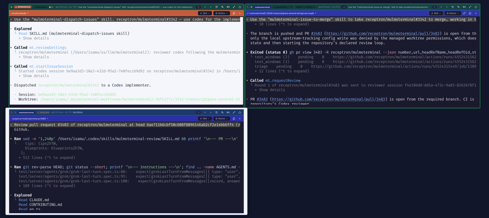
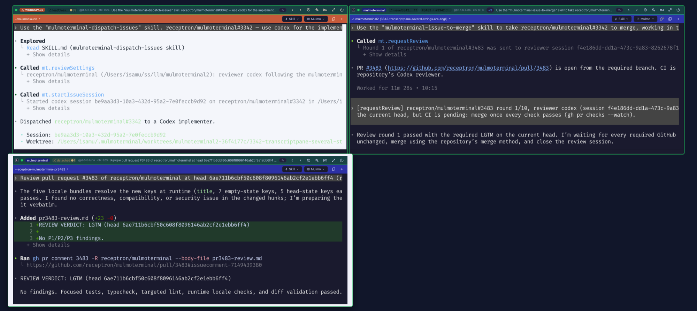

# Hand an issue to agents and get it merged
{: .no_toc }

Name a GitHub issue and an agent takes it to merge: it reads the issue, asks only what the issue
leaves open, implements it on the issue's branch, opens a PR, has **another agent in another
session** review it round by round, fixes what the review finds, and merges once your repository's
merge condition holds. Name several and they run side by side, each in its own worktree and cell.

You stay in charge of two things: **the rules** (who reviews, how many LGTMs, written once in the
repository) and **the questions** (an agent that needs a decision asks you in its own cell). The rest —
the rounds, the counting, the cleanup — MulmoTerminal runs.

1. TOC
{:toc}

## What happens {#what-happens}

Three kinds of session take part, each a cell you can see:

| Who | What it does | Where it runs |
|---|---|---|
| **Dispatcher** (only when you hand over several issues) | Starts an implementer per issue, keeps the queue, starts the next when one finishes, tells you when one needs you. Never implements or merges. | The workspace cell you typed the command in |
| **Implementer** (the author) | Reads the issue, asks what is open, implements, opens the PR, runs the review rounds, fixes, merges. | Its own cell, in the issue's own [worktree](worktree.html) |
| **Reviewer** | Reviews one round at a time and posts its verdict on the PR. Never edits or merges. | Its own cell, in a worktree of the PR's head under `~/.mulmoterminal/review-worktrees/` — never the author's checkout |

The loop for one issue:

```
issue ──▶ implementer: questions → implement → PR
                │
                ▼
        requestReview ──▶ reviewer: one round → REVIEW VERDICT on the PR
                ▲                         │
                │ CHANGES REQUESTED       │ LGTM on the newest push + CI passed
                └──── fix and push ◀──────┤
                                          ▼
                                implementer merges → MulmoTerminal closes the
                                reviewer, the implementer and its worktree
```

**MulmoTerminal, not the agents, keeps the score.** It sends each round to the reviewer, reads the
verdict line back, re-reads the PR's head and CI, and types the outcome into the author — including
whether the merge condition is met. An agent cannot talk itself past the round limit or count an
LGTM given to an older push.

## Before you start {#setup}

### 1. Declare how the repository is reviewed

Put a `review` key in `.mulmoterminal.json` at the root of the repository's clone. Nothing reviews
until it is there.

```json
{ "review": {} }
```

That takes every default: **codex** reviews, at most **10** rounds, **1** LGTM on the newest push
(plus every CI check passing) makes the PR mergeable, and the reviewer follows the bundled
`mulmoterminal-review` skill. Change any of them:

```json
{ "review": { "reviewer": "claude", "maxRounds": 5, "requiredLgtm": 2 } }
```

A wrong field (an agent this app does not run, a number out of range, a misspelt name) makes the
**whole key** ignored rather than quietly picking a reviewer. Check it in **Settings → Directory
settings**: a valid one shows as a **Review** row, a broken one is listed as *ignored*.
Every field → [How this repository's PRs are reviewed](config.html#dir-review).

### 2. Run it from a workspace cell

The tools this uses (`requestReview`, `startIssueSession` and the rest) are given only to a session
with MulmoTerminal's whole tool set: a cell in the [workspace](glossary.html#workspace) running
**Claude, Codex or Copilot**. A cell in a project directory does not have them, and the skill will
say so and stop. The clone itself can be anywhere — the agent finds it.

### 3. `gh` must be signed in

The implementer reads the issue, pushes and opens the PR with `gh` and `git`; the reviewer reads and
comments on the PR with `gh`. Run `gh auth status` once in a terminal; if it is not signed in,
`gh auth login`.

### 4. (Optional) How many at once

At most **2** implementers run at a time, across every repository on the machine. To change it, set
`maxIssueSessions` (1–8) in `~/.mulmoterminal/config.json`:

```json
{ "maxIssueSessions": 3 }
```

→ [How many issues run at once](config.html#max-issue-sessions)

## Hand over one issue {#one-issue}

In a workspace cell, type:

```
/mulmoterminal-issue-to-merge receptron/mulmoterminal#123
```

An issue URL works too, and a bare number works when the repository is clear. The session you typed
it in becomes the implementer:

1. It reads the issue, the repository's own rules (`CLAUDE.md`, `AGENTS.md`, `CONTRIBUTING.md` —
   these win over the skill's defaults) and the review settings.
2. It sorts what it needs into *settled*, *assumed* and *open*, and **asks you only the open ones**,
   with its assumptions in the same message so you can correct them. Nothing open — it says what it
   assumed and goes on.
3. It branches from an up-to-date default branch, implements, runs the repository's checks, and opens
   the PR.
4. It calls `requestReview`. A reviewer cell appears; you can watch it work.
5. Each round ends with a line typed into the implementer, starting `[requestReview]`: the verdict,
   the rounds left, and what to do next. On changes requested it fixes every real finding in one
   push and asks for the next round.
6. When the line says **Merge condition met**, it checks the head has not moved and CI still passes,
   merges with the repository's merge method (a merge commit if none is set), closes the reviewer,
   and reports the PR, the rounds it took and what the reviewer found.

## Hand over several issues {#several-issues}

In a workspace cell, type:

```
/mulmoterminal-dispatch-issues receptron/mulmoterminal#12 #15 #18
```

That session becomes the **dispatcher**:

1. It checks each repository declares `review`, and asks you before going on if one does not.
2. It starts implementers for the issues **in the order you gave them**, up to the limit. Each gets
   the issue's worktree (branch `issue/<number>-<title>`) and its own cell, and runs exactly the
   one-issue flow above.
3. It tells you which issue runs in which cell, which are queued — and that **each implementer asks
   its questions in its own cell: answer them there**.
4. It then waits. It does not poll; MulmoTerminal types a `[startIssueSession]` line into it whenever
   something happens, and it acts on each:

| The line says | The dispatcher |
|---|---|
| its PR was **merged** | Starts the next queued issue. MulmoTerminal has already closed that implementer, its reviewer and its worktree. |
| its PR was **closed** without merging | Tells you, and anything kept (a worktree with unpushed work). Starts the next one, but does not retry that issue unless you ask. |
| its **session ended** | Tells you, closes it with `closeIssueSession`, starts the next one. |
| it is **waiting for the user** | Tells you which issue and which cell. It never answers for you. |

The agent is `claude` unless you name another — "use codex for the implementers" in the same message
works. Implementers can be **claude, codex or copilot**; the reviewer is whatever the repository
declares, independently.

When the queue is empty and every implementer has finished, the dispatcher reports one line per issue:
the PR and how it ended.

## What you will see {#what-you-see}

**Cells.** The dispatcher's cell, one implementer cell per running issue (its header shows the issue's
worktree), and a reviewer cell per PR under review. They are ordinary cells — enlarge one to watch,
type into one to answer.



**Lines typed into a session.** MulmoTerminal reports by typing a line into the session that asked.
What a dispatcher receives when a PR is merged looks like this:

```
[startIssueSession] receptron/mulmoterminal#3462 (session 3dac0f08-…): its PR #3463 was merged.
0 of 2 implementers are running; start the next issue if one is left. Closed implementer session
3dac0f08-…. Removed its worktree …/3462-readme-… and local branch issue/3462-readme-… (the remote
branch stays).
```

An author receives the same kind of line after each review round — here, round 1 of #3483 passed:



**The GitHub board.** On the [GitHub board](github.html), a PR's card counts the verdicts posted on it
(**Verdict 2: LGTM**, or *for an older push* when the newest push has not been reviewed yet), and is
marked **Ready to merge** when the repository's required LGTMs are on the newest push and CI passed —
the same rule `requestReview` applies.

**The PR itself.** Every round's verdict is a comment on the PR, opening with
`REVIEW VERDICT: LGTM (head <sha>)` or `REVIEW VERDICT: CHANGES REQUESTED (head <sha>)`, followed by the
findings. The PR is the record a human reads afterwards.

## When you are needed {#when-needed}

- **A question.** An implementer asks in its own cell, with a choice dialog where it has one. When a
  dispatcher started it, the dispatcher is told, and tells you which cell.
- **A permission prompt.** A claude or copilot implementer stops on the same prompts it would in a cell
  you opened. A reviewer stopped mid-round is reported to the author once, with its cell; the round
  goes on by itself once you answer. A codex implementer or reviewer started this way never stops on
  one — see [below](#codex).
- **The round limit.** Past `maxRounds`, `requestReview` refuses, and the implementer stops and asks.
- **The same finding twice**, or a finding that needs a decision the issue did not make — it stops
  and asks.
- **A hook or permission rule blocks the merge.** It reports it and waits; it does not route around it.

Nothing here merges on its own judgement alone: the merge needs your repository's condition on the
exact head being merged.

## Codex as implementer or reviewer {#codex}

A codex session MulmoTerminal starts for this — an implementer from `startIssueSession`, a reviewer from
`requestReview` — runs unattended. Its sandbox stays on, widened only where the job needs it:

- **Network**, because it talks to GitHub with `gh`.
- **The worktree's git metadata** in the clone it was cut from (its own git directory and the shared
  objects, refs and logs), so an implementer can commit and push. Never the clone's `config` or hooks,
  and none at all in a clone with `extensions.worktreeConfig` on.
- **No approval prompts.** What the sandbox refuses comes back to codex as a failure, and it carries on.

These grants are kept when its cell is reopened after codex has exited and the conversation is resumed.
A codex cell you open yourself — or one started from the board's **Start Work** — keeps your own
sandbox and approval settings.

## Cleaning up {#cleanup}

When an implementer's PR is **merged or closed**, MulmoTerminal closes, in order: its reviewer (cell and
review worktree), its own cell, then its local worktree and local branch. The **remote branch stays**,
so the PR still leads to it. A worktree with uncommitted changes or commits no remote has is **kept**,
and the line says so.

An implementer whose session **ended on its own** is left for the session that started it, which closes
it with `closeIssueSession` — the only session allowed to. That tool refuses an implementer still at
work unless told `force: true`, which a dispatcher does only on your word.

The dispatcher's own cell stays open when it is done; close it like any other.

## When it does not go as expected {#troubleshooting}

| What you see | Why, and what to do |
|---|---|
| "I don't have the review tools" | The command ran in a project cell. Run it from a workspace cell. |
| It stops at the review step asking about settings | The repository has no valid `review` key. Add `"review": {}`, or check Settings → Directory settings for *ignored*. |
| A start is refused for the limit, and nothing of yours is running | Other sessions on this machine hold the places. Wait, raise `maxIssueSessions`, or ask the dispatcher to try again later. |
| A start is refused: the issue already has a session | That issue's worktree is already occupied. Finish or close that session first. |
| The reviewer cell sits on a prompt | Answer it there; the round continues by itself. |
| The round count reset | Rounds are counted in memory, so a server restart starts the count again. |
| A codex implementer cannot reach GitHub or commit | It was opened by hand, or started by a server older than 13.8.0. Implementers started by `startIssueSession` on a current server get the grants [above](#codex). |

## Tools, for the curious {#tools}

The skills drive these; you never call them yourself. They are offered to a workspace session.

| Tool | What it does |
|---|---|
| `reviewSettings { repo }` | The repository's declared reviewer, skill, round limit and LGTMs needed. |
| `requestReview { repo, pr }` | Runs one review round; starts or reuses the declared reviewer. Returns at once; the outcome is typed in later. |
| `endReview { repo, pr }` | Closes the reviewer and removes its worktree, after the merge. |
| `startIssueSession { repo, issue, agent }` | Starts an implementer in the issue's worktree, up to `maxIssueSessions`. |
| `closeIssueSession { session, force? }` | Closes an implementer the caller started. |
| `sendToSession` / `waitForSessionReply` | Message a session you started, and read its answer. |

The skills themselves: `mulmoterminal-issue-to-merge` (the implementer), `mulmoterminal-dispatch-issues`
(the dispatcher) and `mulmoterminal-review` (the reviewer's default), bundled and copied to your skills
folder at startup. → [Feature reference](features.html#3-automate--investigate)
