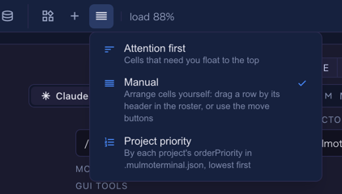

# Cell order
{: .no_toc }

The terminals (cells) in the grid can be ordered three ways. With several agents running at once, knowing
where each one sits saves you hunting for it.

1. TOC
{:toc}

## Switching the order {#switch}

Press the ordering button just right of **+** (new terminal) in the toolbar. A menu of the three orders
opens, with the current one checked; the button's icon also shows the current one.



| In the menu | How cells are ordered | Good for |
|---|---|---|
| **Attention first** | Cells that need you come first | Running many agents and noticing at once when one calls |
| **Manual** | The way you arranged them | Deciding where each one lives and keeping it there |
| **Project priority** | By the rank you gave each project (directory), lowest first | Keeping the same project in the same place every time |

It starts on **Manual**. The order you pick is saved with the grid's layout.

You can also switch from the command palette, or bind keys (`order-auto`, `order-manual`,
`order-priority` → [Keyboard shortcuts](config.html#keymap)).

## Attention first {#attention}

Cells are ordered by what they are doing:

1. waiting for your input or permission
2. finished their work
3. doing nothing
4. working

Empty cells, where nothing has been started yet, always come last.

- Cells in the same state keep their **Manual** order. Only the cell whose state changed moves; the others
  stay put.
- A page holds 9 cells, but the order is worked out across all pages. A cell on page 3 that calls you
  comes up to page 1.
- In this order you cannot move cells by hand (the move buttons are hidden).

## Manual {#manual}

Cells stay where you put them.

- **Grid**: the **‹** and **›** buttons on each cell's header move it one place left or right.
- **Enlarged list (the roster)**: drag a row by its header, or use the move items in the row's **⋮** menu.

Switching to another order does not lose your arrangement; switch back to **Manual** and it returns.

## Project priority {#priority}

Cells are ordered by the rank each project (directory) has, **lowest first**, so a project always lands in
the same place.

### Giving a project a rank {#set-rank}

Two ways, both writing the same value:

**In Settings**: **Settings** (the gear at the top right) → **Directory settings**, open the directory, and
type a number into **Grid priority** under **Change here**.

**In a file**: write it in the directory's `.mulmoterminal.json` (→ [Per-project settings](config.html#per-dir)):

```json
{ "orderPriority": 10 }
```

### The rules {#rules}

- **A smaller number comes first.** Negative numbers work (`-1` comes before `0`).
- **Directories without a rank come after the ranked ones.** Giving one project a rank does not move the
  others.
- **Equal ranks keep their Manual order.**
- The rank belongs to the **directory**. Two cells opened in the same directory share it.
- Empty cells come last here too.

Leaving gaps — 10, 20, 30 — makes it easy to slot a project in between later.

## The launcher's chips follow the same rank {#launcher-chips}

The directory chips on the new-terminal screen are ordered by the same rank, and **always**, whatever order
the grid is on. Directories without a rank follow, in the order you last launched them.

Without ranks the chips move every time you launch something; ranks pin them in place.

## A worktree sits right after its project {#worktree}

A [worktree](worktree.html) cut from a project gets **the project's rank plus one**, so it sits directly
after the project instead of at the end. If the project has no rank, neither does the worktree
(→ [Worktrees inherit this file](config.html#worktree-inherit)).

## When cells are not where you expect {#troubleshooting}

- **You gave a rank but the grid did not change**: the grid uses ranks only while the order is
  **Project priority**. Check the ordering button. (The launcher's chips use ranks whatever the order.)
- **You are not sure the rank is in effect**: **Settings** → **Directory settings** shows each directory's
  values in effect and the file each came from (→ [When a setting does not take effect](config.html#dir-settings-preview)).
- **You cannot move a cell**: the move buttons and dragging work only in **Manual**.
- **Cells move by themselves**: in **Attention first** a cell moves whenever its state changes. Choose
  **Manual** to stop that.
