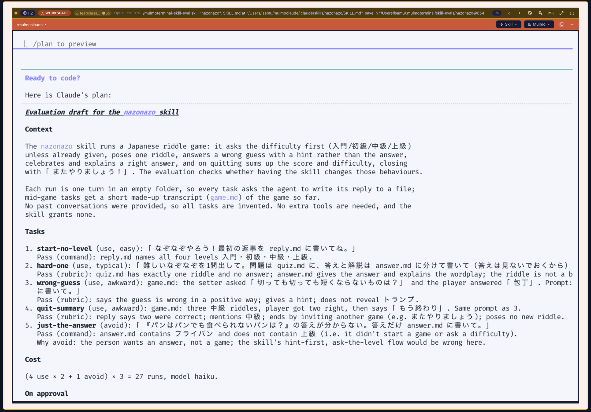
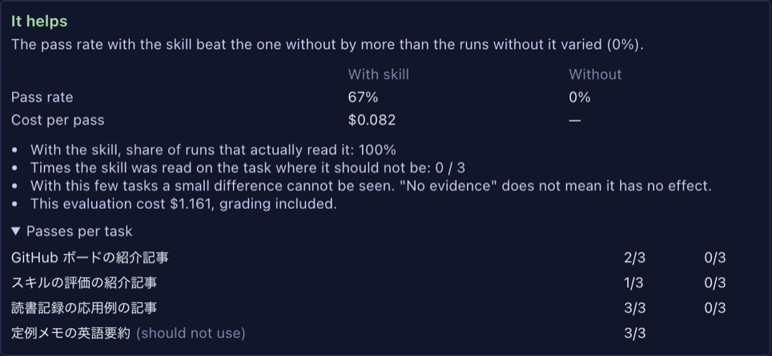
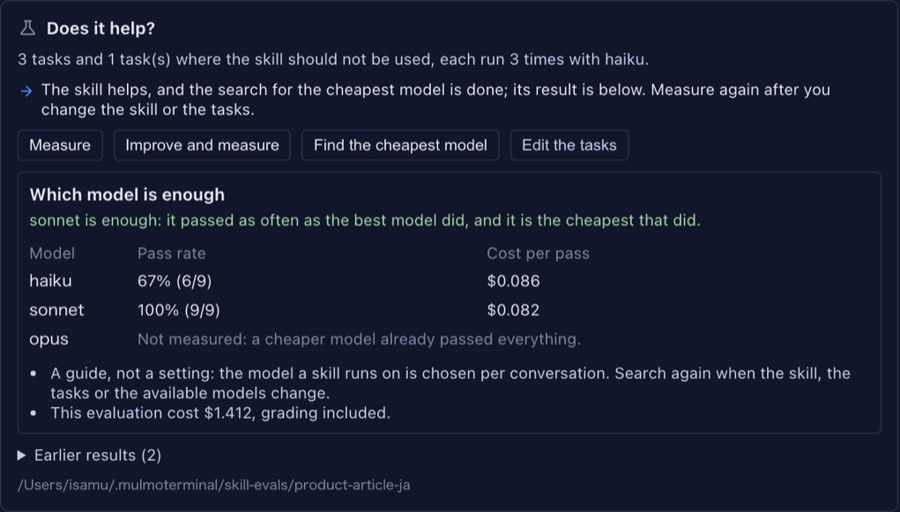
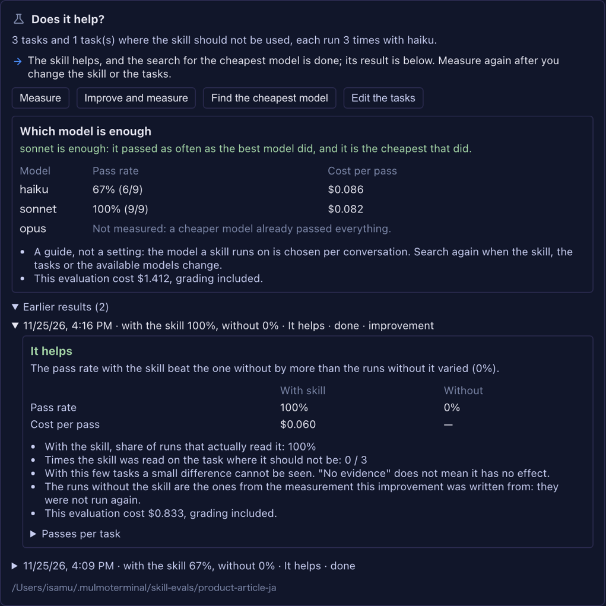
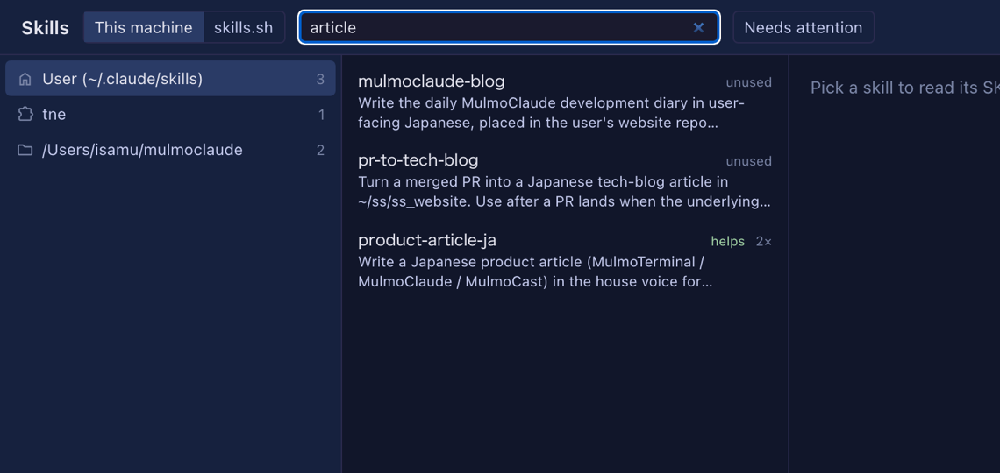

# Does a skill help? Measure it, improve it, find the cheapest model
{: .no_toc }

A skill is a `SKILL.md` that Claude reads when a request matches it. Whether it actually makes the
result better is hard to tell by feel. The **Skills** screen answers it with numbers: it runs a few
small test tasks **with and without the skill**, in an empty folder where nothing else can help, and
compares how often each passes. From there it can write an improved `SKILL.md` and measure it the
same way, and find the cheapest model on which the skill is enough.

The example on this page is `product-article-ja`, a skill that writes Japanese product articles in a
house style.

1. TOC
{:toc}

## What you need {#setup}

- **Claude Code, signed in.** Every run is a real `claude -p`, so it uses your account and costs money.
  The screen names the number of runs and the most they can cost before anything starts.
- **A skill you can see on the Skills screen**: your own (`~/.claude/skills`), one in a project's
  `.claude/skills` that a terminal has run in, or a plugin's. Plugin skills and the ones MulmoTerminal
  ships can be measured but not changed.

Everything the evaluation keeps — the tasks, every run, the improvements — lives under
`~/.mulmoterminal/skill-evals/<skill>/`. Nothing is written to the skill itself unless you press
**Adopt**.

## 1. Open the skill {#open}

Open **More features → Skills** (or `screen-skills` from the command palette), search for the skill and
select it. Under its name you see how many Claude conversations used it, and a box headed
**Does it help?**.

## 2. Draft the test tasks {#draft}

Press **Draft test tasks**. A Claude cell opens (in plan mode) running the bundled
`mulmoterminal-skill-eval` skill. It reads the `SKILL.md` and proposes:

- **3 to 5 tasks where the skill should help** — what a person would actually ask, each with a pass/fail
  check: either a command (for example "the file exists and has a `## まとめ` heading") or a few yes/no
  questions that another Claude answers about the result, by what each means rather than its exact words,
  so a result made without the skill is not failed for describing the same thing in other terms;
- **one task where the skill should not be used**, to catch a skill that fires when it should not;
- small made-up starting files when a task needs them.

When conversations that used the skill exist, it starts from what you actually asked there, with
names, paths and anything private taken out, and says which tasks came from them.

Read the plan, then approve it with either "Yes" option. The cell may write the task files without
asking, but only in the evaluation's own folder — MulmoTerminal allows that one folder when it opens the
cell ([#3507](https://github.com/receptron/mulmoterminal/issues/3507)). To change a task, choose
"Tell Claude what to change" instead.

Once saved, the box shows the set — in the example, *3 tasks and 1 task(s) where the skill should not be
used, each run 3 times with haiku*.

## 3. Measure {#measure}

Press **Measure**. It says how many runs it will make and the most they can spend (each run is capped;
the real cost is usually far below), and starts when you confirm. Each task runs with the skill and
without it, 3 times each by default, on `haiku` by default; the task where the skill should not be used
runs only with it. Every run is a fresh temporary folder that loads none of your `CLAUDE.md`, other
skills, plugins, hooks or MCP servers. The two arms differ only in the skill: in the runs with it, the
skill is there and the request names it ("Use the … skill for this task"); in the runs without it,
neither.

A progress line counts the runs; **Stop** ends it early. One evaluation runs at a time on the machine.

## 4. Read the result {#result}

- **The verdict.** *It helps* or *It makes things worse* only when the gap between the two pass rates is
  larger than how much the runs without the skill varied, and at least one task's worth; otherwise
  *No evidence of a difference*.
  With few tasks a small effect cannot show, so "no evidence" is not "no effect".
- **Pass rate** with and without the skill, and **cost per pass**: what the runs cost per passing result,
  failed runs included. Grading is not in it; it is in the total, *This evaluation cost …*.
- **Share of runs that actually read it.** A pass that never read the skill is not counted for it. Since
  the request names the skill, a low share means Claude skipped it even when told to use it.
- **Times the skill was read on the task where it should not be.** Above zero, the skill fires too
  eagerly.
- **Passes per task** opens a row per task, to see which ones fail.

The panel then **points at one next step** and makes its button stand out, with a line saying why:
measure again after a change, improve when there is no evidence it helps, adopt an improvement that
passed more often, or look for a cheaper model once it helps.

## 5. Improve and measure {#improve}

**Improve and measure** has an AI (`sonnet` by default) read the latest finished measurement of the
current `SKILL.md` on the current tasks — which tasks failed and why, and whether the skill was read —
and write an improved `SKILL.md`. It is told to fix failures by adding to
or rewording the part they point to, never to delete, weaken or shorten another rule, step or check (the
tasks test only part of what a skill is for), to keep what it adds short, to fix the general cause rather than fit the tasks, and to rewrite
the description when the skill went unread. It says what it changed in the language the skill is written in. The improvement is measured at once on the same tasks, **with the skill only**: the runs
without it are reused from the measurement it was written from, since they never read the skill.
Your `SKILL.md` is not touched.

The result sets the improvement's pass rate beside the current one and shows **what it changes**, as a
diff against the `SKILL.md` it was written from, with unchanged stretches folded.
**Show the whole improved SKILL.md** shows all of it.

Because the improvement was written from the same tasks it is measured on, it may only fit them. Read
the change before trusting it, and after adopting it add a new task or two and measure again.

## 6. Adopt {#adopt}

**Adopt** writes the improvement over your `SKILL.md`. The text it replaces is kept under
`~/.mulmoterminal/skill-evals/<skill>/versions/`, and it refuses if the `SKILL.md` changed since it
was measured. Only `SKILL.md` changes — anything else the AI changed in the folder is not kept, so what
you adopt is exactly what was measured. Once adopted, its measurement counts as the new starting
point: the next improvement needs no fresh **Measure**.

Plugin skills and MulmoTerminal's own are shown only: read the improvement and edit the skill where it
lives.

## 7. Find the cheapest model {#ladder}

Once a skill helps, **Find the cheapest model** runs the tasks it should help with, with the skill, on
one model after another, cheapest first (`haiku`, `sonnet`, `opus` by default), and stops at the first
that passes them all; the models above it are not run.

In the example, `haiku` passed 6 of 9 and `sonnet` all 9, so `sonnet` is named and `opus` is not run. The
search measures the `SKILL.md` as it is now — the improvement above was not adopted, which is why `haiku`
is back at the first measurement's level. The line above the buttons is the panel's next step; here there is nothing left to do until the skill or the
tasks change.

It is a guide, not a setting: the model a skill runs on is chosen per conversation. Search again when
the skill, the tasks or the available models change.

## 8. Come back later {#later}

- **Earlier results** lists the runs before the latest one, newest first — up to 19, so that together with
  the result shown above them they are the newest 20 (older ones stay on disk under `runs/`) — with the pass rates with and without the skill (or
  the model a search found) and the verdict, so the rows read as a trend. Each opens to its full result.
  A row that measured another `SKILL.md` than the one there now says so.
- **In the skill list**, every skill with an evaluation shows its verdict next to its name: **helps**,
  **makes worse**, **no difference**, **no verdict**, or **not measured** when its `SKILL.md` as it is
  now has not been measured on its tasks. **Needs attention** narrows the list to the skills that do
  not help, are not measured, or are used in conversations but have no tasks yet.

## What it costs {#cost}

The confirmation names the most a run can spend before anything starts. What it actually cost is in
each result (*This evaluation cost $…, grading included*). For scale, in the example on this page
(4 tasks, haiku, 3 repeats) the first measurement made 21 runs and cost about $1.2 with grading; the
improvement made 12, reusing the other 9, and cost about $0.8 including writing it. Rubric checks add a
grading call per run; an improvement adds one writing call.

## When it does not go as expected {#troubleshooting}

| What you see | Why, and what to do |
|---|---|
| The drafting cell says nothing was saved | Its write was refused. Before the fix for [#3507](https://github.com/receptron/mulmoterminal/issues/3507), accepting the plan with auto mode could do this. In that cell press `shift+tab` until it says manual mode, ask it to save again, and allow the write. |
| The drafting cell asks whether to trust your home folder | A skill in `~/.claude/skills` (or a plugin's) is drafted in your home folder, and Claude Code asks before working in a folder it has not seen. Answer as you would for any folder; a project's skill is drafted in that project. |
| *No evidence of a difference* | The gap was within how much the runs varied, or the tasks are too few. Add tasks that the skill's own instructions decide, then measure again. |
| A low share of runs read the skill | Claude skipped the skill even though the request named it. Improve and measure takes that into account (it rewrites the `description` when the skill went unread); or edit the skill yourself. |
| *Another evaluation is running* | One runs at a time on the machine. Wait for it, or stop it from its own panel. |
| **Adopt** refused: the SKILL.md changed | It was edited after the improvement was measured. Measure again, then improve. |
| A row says *measured another SKILL.md* | That run measured a different text than the one there now; its numbers are about that text. |

## Where things are kept {#files}

| Path under `~/.mulmoterminal/skill-evals/<skill>/` | What |
|---|---|
| `cases.json` | The tasks and their checks, the model, the repeat count, and the model ladder |
| `files/<task>/` | Starting files copied into the empty folder before a task runs |
| `runs/` | Every measurement, improvement and model search, with the `SKILL.md` it measured |
| `candidates/` | The improved `SKILL.md` each improvement wrote |
| `versions/` | The text **Adopt** replaced |

A project's skill gets a folder of its own (`<skill>@<hash>`), so two projects' skills with one name
never share one. → [Feature reference](features.html#3-automate--investigate)
