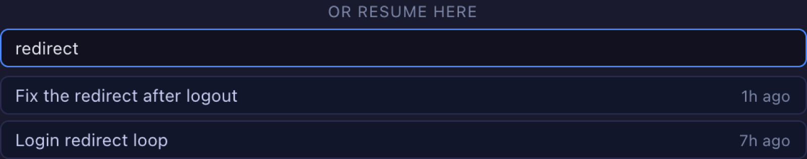
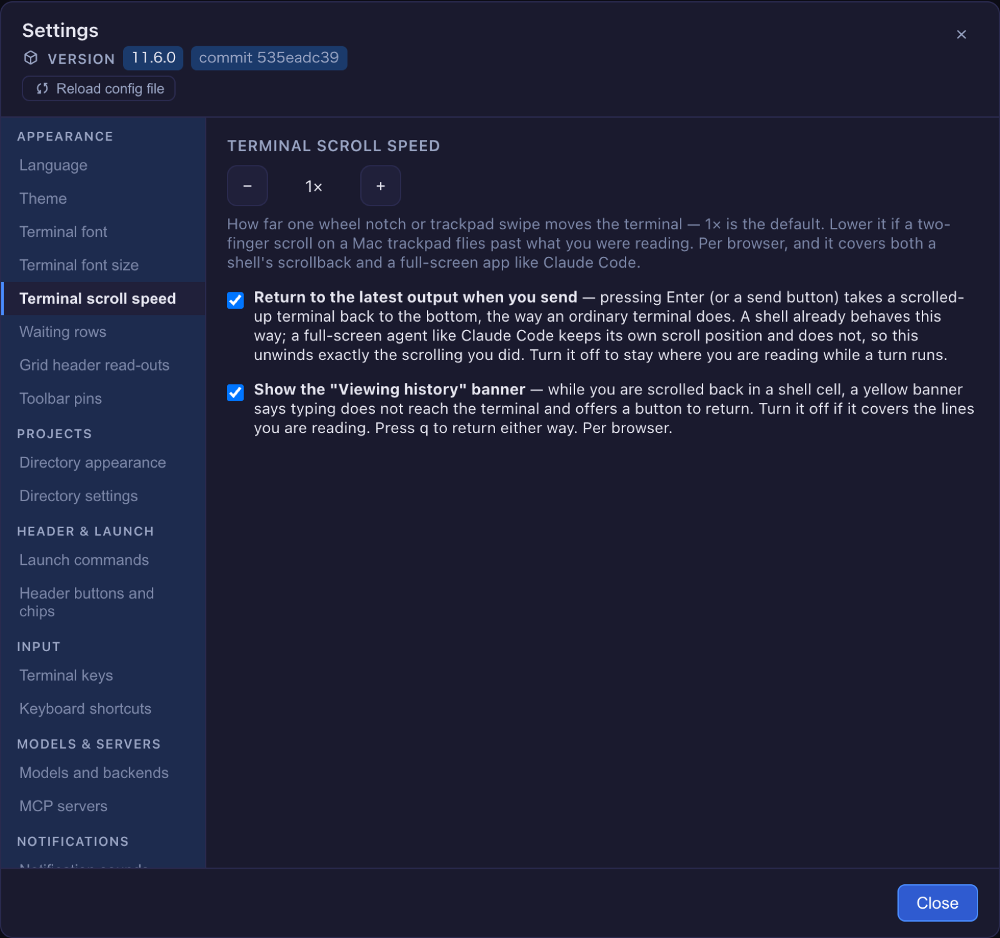

# 11.6.0 — Panes stack, and a conversation keeps the name you gave it

**A snapshot as of 11.6.0 (released 2026-11-02).** It will go stale as the app moves on — that is
expected, and the living reference is the guide each section links to.

## New features

### The panes beside a terminal stack

Beside a terminal there is room for one pane: Files, the conversation, Tools, History, the Canvas.
Until now opening one over another replaced it, so opening the conversation over Files and then
closing the conversation left nothing — Files had gone with it. The panes you open now **stack**:
closing the one on screen shows the one it covered
([#3217](https://github.com/receptron/mulmoterminal/pull/3217)).

Try it: open **Files** from a cell's header and expand a folder, then open the **conversation**.
Close the conversation. Files is back beside the terminal, the folder still expanded. Opening a pane
that is already in the stack moves it to the top, so each pane is in the stack once, and the stack
is kept when you reload the page. The question pane is not part of it: when Claude asks you
something, its pane covers whatever is on top until you answer, and then that pane is back.
Nothing to set up. More: [Features](features.html) under "Stacked right panes".

### A conversation keeps the name you gave it

In a Claude cell, type `/rename` followed by a name, as you would in Claude Code anywhere. That
name is now the conversation's name in MulmoTerminal: on the cell's header, in the roster row of
the enlarged view, in the launcher's **or resume here** list, and in the command palette, both its
resume entries and its recently-closed ones
([#3226](https://github.com/receptron/mulmoterminal/pull/3226),
[#3231](https://github.com/receptron/mulmoterminal/pull/3231)). Before, those places showed the
title Claude had made up, or the last prompt, and `claude -r` outside MulmoTerminal was the only
place the name showed.

Your own **session note** (the pencil beside the header text) still comes first, and the name it
displaces moves to the tooltip. Renaming again replaces the name, `/rename` with nothing after it
removes it, and after `/clear` the new conversation starts without one. One thing to know: the
header reads the name when the cell is opened, reconnected or a turn ends, so a name typed while
the cell is open appears at the next of those, not the moment you type it. More:
[Features](features.html) under "Conversation name".

### Filter a long resume list

The launcher's **or resume here** list, under the Working directory field, can run to dozens of
conversations in a folder you have worked in for a while. Once it holds six or more, a **Filter by
title** box sits above it ([#3232](https://github.com/receptron/mulmoterminal/pull/3232)). Type any
words: a conversation stays listed when every word is in its title, in any order and whatever the
case. When nothing matches, the list says so in one line. The box empties when you change the
directory or the agent, since the list underneath is another one, and it stays when the same list
reloads after you stop a session. With `/rename` names (above), the list is now yours to search.

### Switch off the "Viewing history" banner

When you scroll back in a shell or Codex cell, the cell is in tmux's copy-mode, where keys move
through the history instead of reaching the program, and a yellow **Viewing history** banner says so
with a **Back to input** button. If the banner covers the lines you are reading, open Settings,
find **Terminal scroll speed**, and untick **Show the "Viewing history" banner**
([#3223](https://github.com/receptron/mulmoterminal/pull/3223)). The banner is gone from then on in
this browser; `q` still returns to input. The setting is per browser, like the scroll speed beside
it, and leaving it ticked changes nothing. More: [Features](features.html) under "Leave history
view".

## What looks different

- **Reload in Files re-reads every folder you have opened**
  ([#3228](https://github.com/receptron/mulmoterminal/pull/3228)). The reload button at the top of
  the Files pane used to re-read only the top folder, so a file an agent (or you, in a terminal)
  added inside a folder you had expanded never showed up, and collapsing and re-opening the folder
  did not help either. It now re-reads every folder the pane has read so far, open or collapsed. How
  to tell: expand a folder, create a file in it from a terminal, press **Reload tree** — the file is
  there.
- **The PDF export draws mermaid diagrams**
  ([#3216](https://github.com/receptron/mulmoterminal/pull/3216)). A markdown document with a
  `mermaid` fence drew the diagram on the Canvas but printed it as a code block when exported to
  PDF. The PDF now shows the diagram, as the Canvas does; a fence mermaid cannot parse keeps its
  code block under the error line, as on the Canvas. Maths is not covered by this change.

## Under the hood

### Three timing problems around the pane, fixed with the stack

All three were there before this release; the stack made them easier to see. Nothing to do for any
of them.

- Moving the enlarged cell twice in quick succession, or there and straight back, could leave the
  pane on a cell that was no longer enlarged, and a pane button pressed while the pane was still
  saving could be undone by an older press. Only the latest of such requests now takes effect
  ([#3221](https://github.com/receptron/mulmoterminal/pull/3221)).
- A conversation opened at full width on one cell made the next cell's Tools cover its terminal
  after you moved the enlarged cell there. A pane reached by moving the enlarged cell, or by a
  reload, now starts beside the terminal; full width stays something you ask for on the cell it is
  on ([#3224](https://github.com/receptron/mulmoterminal/pull/3224)).
- Closing Files while a pane button pressed at the same moment was being applied could leave Files
  in the stack under that pane. Both are now applied, whichever finished first
  ([#3227](https://github.com/receptron/mulmoterminal/pull/3227)).

### Nothing to notice

- The launcher chips and the remote bot's jobs go through the same terminal relay as the agents,
  which removed a duplicated block the code scanner had flagged. The old and new code were run side
  by side to confirm nothing changed ([#3210](https://github.com/receptron/mulmoterminal/pull/3210)).
- The tests that generate their own inputs share one random generator whose arithmetic does not
  collapse; some of them had been checking far fewer cases than they counted
  ([#3222](https://github.com/receptron/mulmoterminal/pull/3222)).
- The 11.5.0 setup guide gained its screenshots
  ([#3208](https://github.com/receptron/mulmoterminal/pull/3208)).
