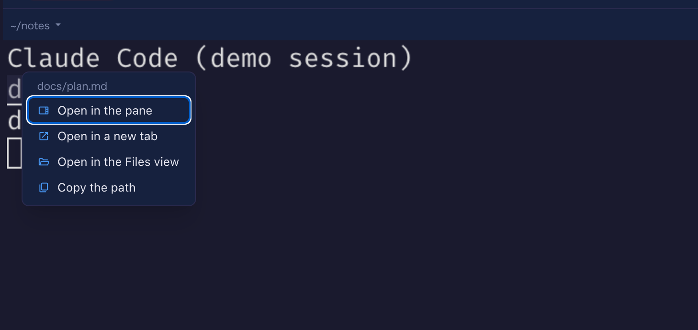
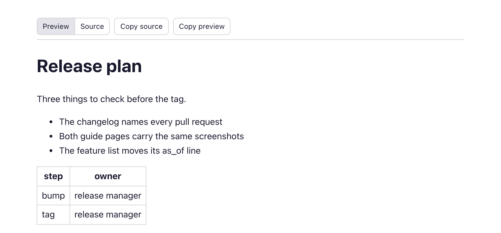
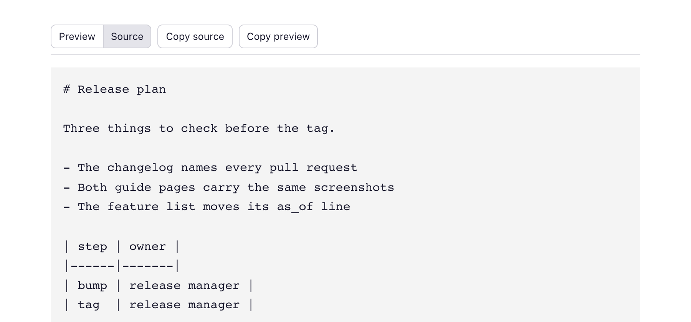
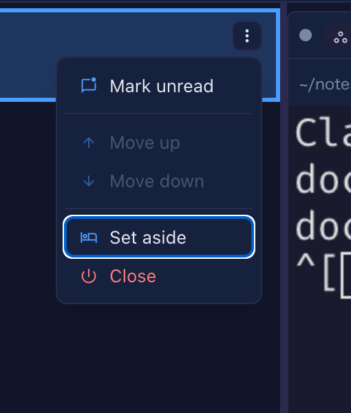

# 11.7.0 — Right-click a path to choose how it opens, and a tab shows the source too

**A snapshot as of 11.7.0 (released 2026-11-03).** It will go stale as the app moves on — that is
expected, and the living reference is the guide each section links to.

## New features

### Right-click a file path to choose how it opens

A file path an agent prints in a terminal has been a link for a long time, and a click decided for
you where it went: the pane beside the terminal when one was open, otherwise a tab or the Files
view by the file's extension. Now **right-click** the path instead and a small menu opens on it
([#3256](https://github.com/receptron/mulmoterminal/pull/3256)):

- **Open in the pane** — what a plain click does.
- **Open in a new tab** — the rendered document for Markdown, JSON and CSV/TSV, the Files view in a
  tab of its own for source code, and the one-file link for a picture or a PDF outside the cell.
- **Open in the Files view** — the full-screen Files view in this tab.
- **Copy the path** — the absolute path, ready to paste into a prompt or an issue. A relative path is
  resolved against the cell's directory, `.` and `..` included, and a Windows cell gets `\`
  separators. A short notice under the pointer says whether the copy worked.

Try it: have an agent print a path, or type one yourself in a shell cell, then right-click it. The
menu takes the focus: the arrow keys move between the items, Enter picks, Escape closes and the
terminal gets the keyboard back. Off a link the right-click is the browser's own menu, as before,
and Cmd/Ctrl+click still opens a new Files tab. One thing changed on purpose: a right-click used to
open the file as well, under the browser's menu, because the terminal fires a link on any button; it
no longer does. More: [Features](features.html) under "Clickable file paths".

### A document opened in a tab of its own has a toolbar

When a Markdown, JSON or CSV/TSV file opens in a **tab of its own** — from the menu above, or by
Cmd/Ctrl+click — the tab now starts with a toolbar
([#3252](https://github.com/receptron/mulmoterminal/pull/3252)): **Preview** and **Source** switch
between the rendering and the file as it is, **Copy source** puts the exact text on the clipboard,
final newline included, and **Copy preview** copies the rendering as text and as HTML in one go, so
pasting into a rich editor keeps the headings and the table and pasting into a plain field gives the
words. The toolbar says "Copied" for a moment when it worked. The preview beside a terminal is
unchanged — the pane has its own editor and copy button.

A Markdown file can carry its own HTML and its own stylesheet, and two cases in that first version
were fixed before this release shipped
([#3259](https://github.com/receptron/mulmoterminal/pull/3259)): a file whose stylesheet overrode
the browser's `hidden` rule could keep both views on screen, and **Copy preview** pressed while
Source was showing copied the rendering as hidden, which some editors then dropped on paste. Both
behave now; nothing to set up. More: [Features](features.html) under "Clickable file paths".

### The name other Claude Code sessions message a cell by

Claude Code sessions on one machine can message each other, and each one has a name for that —
the kind `myrepo-66` — which until now you could only see from inside another session. A Claude
cell's header now shows that name as a small chip; click it and the name is on the clipboard,
ready to paste into another session's prompt
([#3241](https://github.com/receptron/mulmoterminal/pull/3241)). Nothing to set up: the chip reads
what Claude Code already records about its running processes, and it appears once the session is up.
Only a session started in the cell's terminal counts: a program running `claude` from inside the cell
(a plugin, say) does not take over the chip
([#3245](https://github.com/receptron/mulmoterminal/pull/3245)). No screenshot here — the chip needs
a second real Claude Code session to be worth looking at. More: [Configuration](config.html#header)
under "Customizing the header", where the `peer` chip can be moved or hidden.

### Windows: backslash and drive paths are links too

In a cell whose directory is a Windows path, a tool prints `.claude\evidence\test.md` or
`C:\work\app\src\a.ts`, and those are now clickable like any other path
([#3243](https://github.com/receptron/mulmoterminal/pull/3243)): a backslash separates, a drive
letter stays on the path, and a `\\server\share` network path is left alone. The click goes where it
would for the `/` form of the same path, and the right-click menu above works on them too. Nothing to
set up; on macOS and Linux a backslash is still just a character in a file name.

## What looks different

- **A path with a space in it is linked whole** when it is enclosed in quotes, backticks or
  brackets — `Read(/Users/me/My Docs/a.md)`, say
  ([#3247](https://github.com/receptron/mulmoterminal/pull/3247)). Before, only the part after the
  space was underlined, and the click opened the wrong file. A path with a space and nothing around
  it is still cut at the space.
- **Files lists a linked folder as a folder**
  ([#3240](https://github.com/receptron/mulmoterminal/pull/3240)). A symlink, or a junction on
  Windows, that points at a folder showed as a file and could not be opened; it now opens like any
  folder. A link that points at something that is gone stays a file of size 0.
- **The roster's row menu works from the keyboard**
  ([#3260](https://github.com/receptron/mulmoterminal/pull/3260)). Enlarge a cell, press the ⋮ on a
  row of the roster beside it: the first item has the focus, the arrow keys move between the items
  and wrap around, Home and End jump, a direction the row cannot move in is skipped, Tab or Escape
  closes the menu and puts the focus back on the ⋮. Before, the keys did nothing in that menu.

## Under the hood

### Windows: stopping the server saves its state every way

Nothing to do, and you only notice it by what no longer goes missing: on Windows, stopping the
server with Ctrl+C, with `mulmoterminal stop`, with the Stop button in the browser, or by stopping
`yarn dev` ended the process before it could write queued session state to disk, so the last changes
to a session's notes and names could be lost
([#3251](https://github.com/receptron/mulmoterminal/pull/3251)). Every one of those now runs the
server's own shutdown first. For people running from source, `yarn dev` on Windows no longer
force-kills the backend on Ctrl+C either
([#3255](https://github.com/receptron/mulmoterminal/pull/3255)).

### Volta: `yarn` and `node` in a cell use your project's versions again

If you start MulmoTerminal under Volta, `yarn` in a cell could fail with
`Volta error: Node is not available.`, and `node` or `npm` could ignore the project's pinned version
([#3239](https://github.com/receptron/mulmoterminal/pull/3239),
[#3242](https://github.com/receptron/mulmoterminal/pull/3242)). A marker and a path entry Volta sets
for its own launcher leaked into the cells; both are now kept out. Nothing to do.

### Nothing to notice

- A leftover list of names the psmux multiplexer scrubbed from a cell's environment is gone; the
  shared rule covers it ([#3249](https://github.com/receptron/mulmoterminal/pull/3249)).
