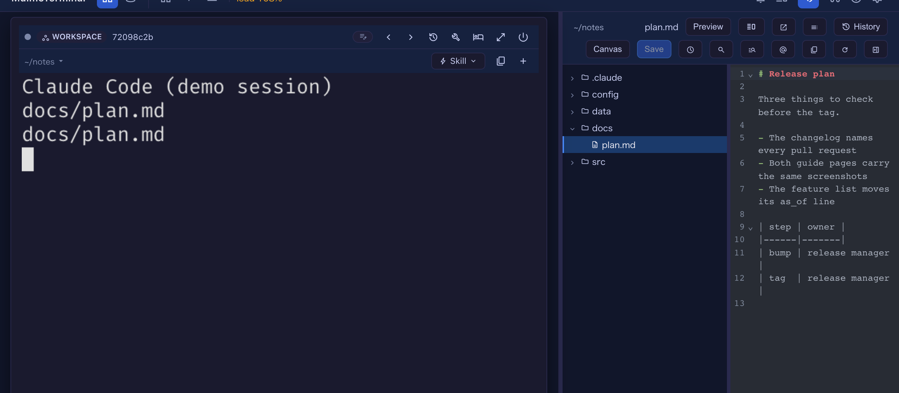
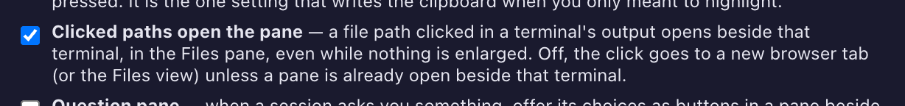
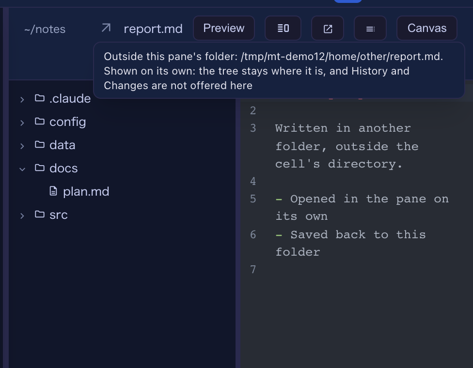
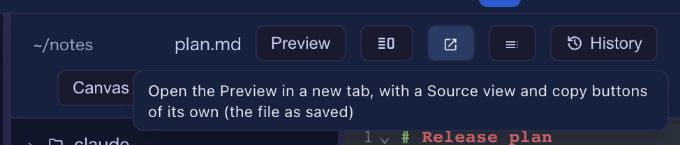

# 12.0.0 — A clicked path opens the pane beside its cell, outside files included

**A snapshot as of 12.0.0 (released 2026-11-03).** It will go stale as the app moves on — that is
expected, and the living reference is the guide each section links to.

This release finishes what 11.7.0 started (#3238): a file an agent prints opens **beside the terminal
that printed it** whenever the pane can show it, and a tab is for the files the pane cannot show
and for the moments you ask for one. The major number moves because the first point changes what a
plain click does on the tiled grid.

## New features

### A clicked path opens the Files pane beside its cell — on the tiled grid too

Until now a file path clicked in a terminal opened beside the terminal only while that cell was
enlarged (or while a pane already sat beside the tiles); on the plain tiled grid the click went to a
new browser tab or the full-screen Files view. Now the click opens the **Files pane beside the tile
that printed the path** ([#3263](https://github.com/receptron/mulmoterminal/pull/3263)) — the same
thing the tile's own menu does with **Files** — and shows the file in it. If the pane is already
beside another tile, it moves to the one you clicked in, saving what it was editing first.



Try it: with nothing enlarged, have an agent print a path — or type `docs/plan.md` yourself in a
shell cell — and click it. The pane appears beside that cell; the terminal keeps the keyboard.
Beside an enlarged cell nothing changed, and the right-click menu from 11.7.0 still offers every
other destination.

If one click rearranging the grid is not what you want, turn it off: **Settings → Terminal keys →
"Clicked paths open the pane"**, applied at once. With it off, a click on the tiled grid goes where
it went before — a new tab for Markdown, JSON, tables and pictures, the Files view for source —
unless a pane is already open beside that tile, which still takes it. In `config.json` the key is
`fileLinkOpensPane`, and `false` turns it off:

```json
{ "fileLinkOpensPane": false }
```



More: [Configuration](config.html#file-link-opens-pane) and [Features](features.html) under
"Clickable file paths".

### A file outside the cell opens in the pane on its own

A path can point outside the cell's directory — `../other/report.md`, an absolute path, `~/…` — and
such a Markdown, JSON, table or source file used to open in a tab or the full-screen view against its
own folder. Now it opens in the **Files pane, on its own**
([#3264](https://github.com/receptron/mulmoterminal/pull/3264)): the tree stays on the cell's
directory and the file has no row in it; an **arrow mark** before the name says the file is outside,
and hovering it shows the full path. You can read it, switch to its Preview, edit it and save it —
the save goes to the file's own folder, with the same protection as any other file: if something
else changed the file on disk in the meantime, the save is refused and the pane says so.



Try it: in a shell cell, print a path to a Markdown file outside the cell's folder and click it.
The pane has to be where the click can reach it: beside an enlarged cell always, and on the tiled
grid with "Clicked paths open the pane" on (the default); with it off, such a click goes to a new
tab as before unless a pane is already beside that tile.
History and Changes are not offered for such a file (they belong to the cell's folder), it is not
listed among the folder's recent files, and a link inside its Preview is not followed. An HTML page,
a picture, a PDF or a video outside the cell still opens in a new tab through its one-file link, as
before. More: [Features](features.html) under "Clickable file paths".

### The pane's header opens the Preview in a tab of its own

A Markdown, JSON or CSV/TSV file open in the pane has a new button in the header, beside the
**Edit / Preview** switch: the open-in-new arrow
([#3262](https://github.com/receptron/mulmoterminal/pull/3262)). It opens the file's Preview in a
new browser tab — the same document a clicked path opens in a tab, with the toolbar from 11.7.0 that
switches to the file's source and copies either. The tab shows the file as saved, so save first to
see an edit there.



Try it: open a Markdown file in the pane and press the arrow button. The button is there only for
files that have such a document; an HTML page or an SVG, which a tab shows as the file itself, has
none. More: [Features](features.html) under "Copy the whole file" and "The Preview in a tab of its
own".

## What looks different

- **A plain click on the tiled grid rearranges the grid**: the pane opens or moves beside the cell
  you clicked in. That is the change behind the major number, and the setting above turns it off
  ([#3263](https://github.com/receptron/mulmoterminal/pull/3263)).
- **A file outside the cell is marked** with an arrow before its name in the pane's header, and the
  tree does not follow it ([#3264](https://github.com/receptron/mulmoterminal/pull/3264)).
- **One more button in the pane's header** for Markdown, JSON and table files
  ([#3262](https://github.com/receptron/mulmoterminal/pull/3262)).

## Under the hood

### A folder that vanished is refused, not replaced by the workspace

Nothing to do. A file open on its own is read and polled against its own folder; if that folder
disappears, the server now answers "that directory is not there any more" instead of quietly reading
a same-named file from the default workspace in its place
([#3264](https://github.com/receptron/mulmoterminal/pull/3264)). The same holds for any browse
request that names an absolute folder that is gone — the right pane and the full-screen Files view
included — while a request that names no folder, or a relative one, still falls back to the
workspace as it always did.

### A root file printed as an absolute path stays a root file

A tool that prints `/Users/me/proj/src/a.ts` for a file under the cell's own directory now opens it
exactly as `src/a.ts` would — in the pane with History and Changes, in the Files view, or in a tab
([#3264](https://github.com/receptron/mulmoterminal/pull/3264)). A path printed relative is opened
as printed, so a backslash in a file name on macOS or Linux is still part of the name.
