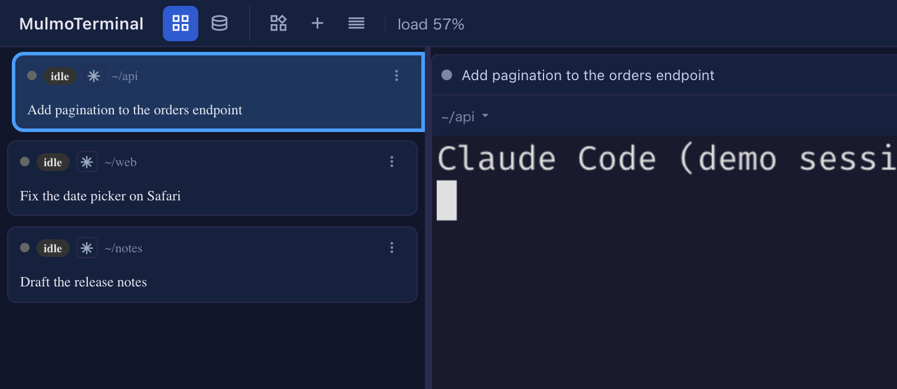
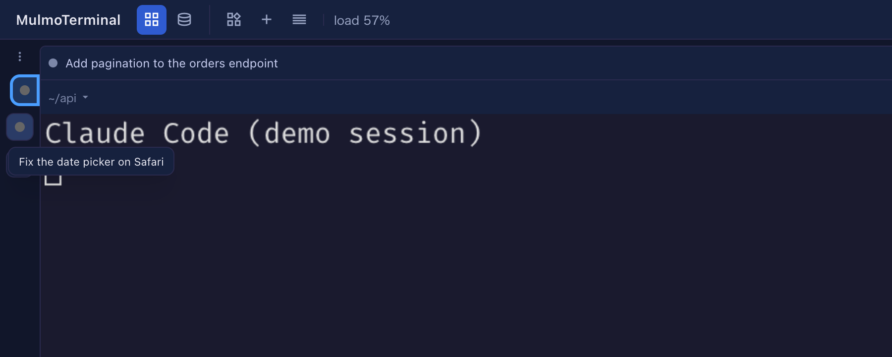

# 12.1.0 — A shorter roster, a roster you can fold, and a crashed cell that stays

**A snapshot as of 12.1.0 (released 2026-11-05).** It will go stale as the app moves on — that is
expected, and the living reference is the guide each section links to.

```bash
npx mulmoterminal@latest
```

Two of these changes are about the **roster**, the list of every session beside an enlarged
terminal: you can make it shorter, or fold it out of the way. The other two are about a cell whose
agent has ended.

## New features

### Compact rows: the header and the session's name only

Each roster row shows a header (status, directory, agent) and then up to four lines: your memo,
what the session is doing, your last prompt and the agent's reply. If you read the roster only to
tell sessions apart and see which one is waiting, those lines take the room.
([#3273](https://github.com/receptron/mulmoterminal/pull/3273))

To try it: open **Settings → Waiting rows** and tick **Compact rows: the header and the session
name only**. Every row shrinks to its header and **one line naming the session**: your memo if you
wrote one, else the session's title (the `/rename` name, then the AI's title), else your last
prompt — the same name the cell's own header shows. Hover the line for the whole text.



While it is on, the line-count steppers on the same page are greyed out, since there are no lines
left to shorten; turn it off and they work again. It is saved in `config.json` as
`"cockpitCompact": true`, so every browser gets the same roster.
More: [Compact rows](config.html#cockpit-compact).

### Fold the roster into a rail of status dots

When the terminal needs the width, open any row's **⋮** menu (or right-click the row) and choose
**Collapse the roster**, the new first item.
([#3275](https://github.com/receptron/mulmoterminal/pull/3275), [#3279](https://github.com/receptron/mulmoterminal/pull/3279))

The roster becomes a narrow rail with **one dot per session**, in the same order and with the same
rings as the rows: amber for waiting on you, green for finished. On the rail:

- **hover** a dot to see the session's name;
- **click** it to enlarge that session;
- **right-click** it for that row's menu, the same one the ⋮ opened.



To bring the roster back, choose **Expand the roster**: it is the first item of any dot's menu, and
of the one **⋮** at the top of the rail. This browser remembers whether the roster is folded, like
the roster's width; another browser keeps its own. More: [Zooming into one](basics.html) under
"Folding the roster".

## What looks different

### A cell whose agent crashed stays on screen with its exit code

Since 10.5.0 a cell whose agent ended closed itself and went to **Reopen**. That was meant for an
agent you quit (`/exit`), but a **crash** closed the cell the same way, so you never saw that
something went wrong. Now a cell whose agent exited with an error stays, with the red line
`[session ended — exit 137]` (the number is the agent's exit code) at the bottom of its terminal.
([#3274](https://github.com/receptron/mulmoterminal/pull/3274))

A normal quit still closes the cell, as before. This works when your sessions run under tmux; with
psmux on Windows nothing changes. Another agent CLI that exits with an error code on a normal quit
will now leave its cell too; close it as usual.

## Under the hood

### A cell whose session ended cannot start a talk

A cell left on screen after its session ended — the crash above, a worktree cell, a launch that
failed — still offered **Talk**, and starting a cross-talk or a round table from it sent the dead
session's last reply into the other cell. Those buttons now do nothing until the cell runs a new
session and it prints something. ([#3277](https://github.com/receptron/mulmoterminal/pull/3277),
[#3281](https://github.com/receptron/mulmoterminal/pull/3281)) Nothing to do.
