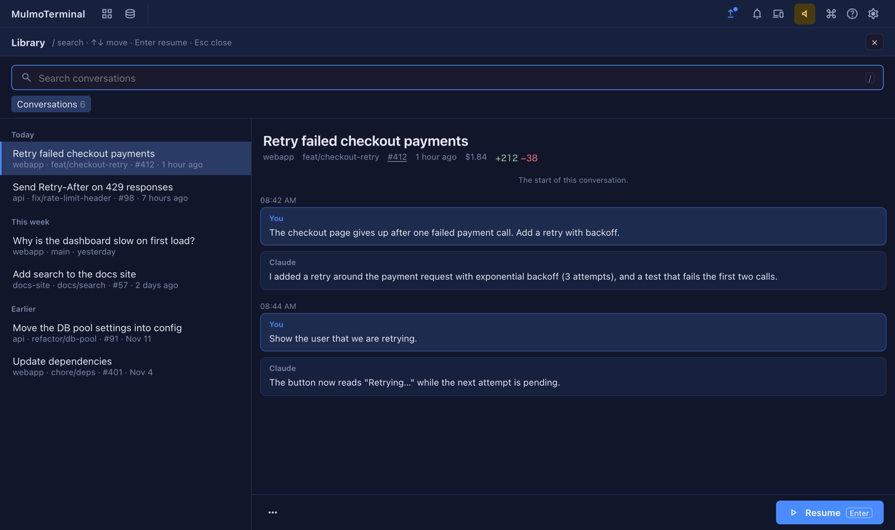

# 13.1.0 — The Library, and Restart keeps your conversation

**A snapshot as of 13.1.0 (released 2026-11-20).** It will go stale as the app moves on — that is
expected, and the living reference is the guide each section links to.

Upgrade:

```bash
npx mulmoterminal@latest
```

Nothing to configure: everything below works as soon as you upgrade.

## New features

### The Library: every Claude conversation, searchable

Open **More features** → **Library**. It lists every Claude conversation on this machine, newest
first, grouped into Today, This week and Earlier. Each row shows the title, then the project, the
branch, the PRs it made and when.



- **Search**: type in the box at the top (or press `/`). It searches what you and Claude said, and
  the titles, and shows the matching lines under each result.
- **Read**: click a conversation to read it on the right. The grey line under the title has the
  project, branch, PR numbers, cost and lines added and removed.
- **Resume**: press **Resume** (or `Enter`) to open the conversation in a terminal, in the
  directory it ran in. A conversation already open in a cell is not opened twice; the Library says
  so instead.
- **Pin and rename**: the **⋯** menu at the bottom pins a conversation to the top of the list, or
  gives it a name of your own. These are kept in `~/.mulmoterminal/library/marks.json`; the
  conversation's own file is never written.

Conversations started by `claude -p` or an SDK, and ones run in a temporary directory, are left out
so the list holds the conversations you had. The first time you open the Library it builds its
index in the background and shows its progress; after that it only reads what is new.

([#3337](https://github.com/receptron/mulmoterminal/pull/3337) design,
[#3338](https://github.com/receptron/mulmoterminal/pull/3338) index,
[#3341](https://github.com/receptron/mulmoterminal/pull/3341) the screen,
[#3344](https://github.com/receptron/mulmoterminal/pull/3344) pin and rename)

### Open a cell's conversation in the Library

A Claude cell's **History** menu now ends with **Open in Library**. It opens the Library on that
cell's conversation, even an old one that is not on the first page of the list
([#3345](https://github.com/receptron/mulmoterminal/pull/3345)).

### Go between a conversation and its PRs

In the GitHub view, a PR that one of your conversations made has a Library button beside it, which
opens that conversation. The other way round, the PR numbers under a conversation's title in the
Library open the PR ([#3346](https://github.com/receptron/mulmoterminal/pull/3346)).

More: [Feature reference — Library](features.html).

## What looks different

- **More features** has a new **Library** entry, and a Claude cell's **History** menu has **Open in
  Library** at the bottom ([#3341](https://github.com/receptron/mulmoterminal/pull/3341),
  [#3345](https://github.com/receptron/mulmoterminal/pull/3345)).
- The GitHub view shows a Library button beside a PR that one of your conversations made
  ([#3346](https://github.com/receptron/mulmoterminal/pull/3346)).
- **After an in-cell `/resume`**, the cell now shows the conversation you picked — its last prompt
  and reply in the header, its title, and its text in the conversation pane. Before, the cell went
  blank. Right after a `/clear` the cell is still blank until you send something, since the new
  conversation is empty ([#3349](https://github.com/receptron/mulmoterminal/pull/3349)).

## Under the hood

### Restart continues the conversation you moved to

After a `/clear`, or after picking another conversation with `/resume` inside a cell, restarting the
agent (the cell's **Tools** menu → **Restart the agent**) used to bring back the conversation you had left. The same happened when a cell reopened after the
machine restarted. It now continues the conversation you moved to, and the cell keeps its place
([#3340](https://github.com/receptron/mulmoterminal/pull/3340), fixing
[#3325](https://github.com/receptron/mulmoterminal/issues/3325)).

**How to tell you have the fix**: run `/clear` in a Claude cell, send one message, then choose
**Tools** → **Restart the agent**. The cell comes back on the conversation you started after
the `/clear`, not the one before it.

### One version per home

Running two different versions of MulmoTerminal with the same home folder (for example an older
`npx mulmoterminal@…` next to this one) is not supported: an older version undoes the fix above.
To try another version alongside, start it with its own `HOME`
([#3351](https://github.com/receptron/mulmoterminal/pull/3351);
[FAQ](faq.html#two-versions)).

### Windows: no more trust prompt for the drops folder

On Windows, Claude Code kept asking "Is this a directory you created or one you trust?" for
MulmoTerminal's drops folder on every Claude cell restart. The folder is now recorded the way
Claude Code looks it up, so the question stops after you upgrade
([#3323](https://github.com/receptron/mulmoterminal/pull/3323)).

### Dependencies

Minor and patch updates, including `@mulmoclaude/core` 7.2.1 and its plugins, `@google/genai`
3.6.1 and `puppeteer` 25.18.1. Nothing you need to do
([#3326](https://github.com/receptron/mulmoterminal/pull/3326)).
