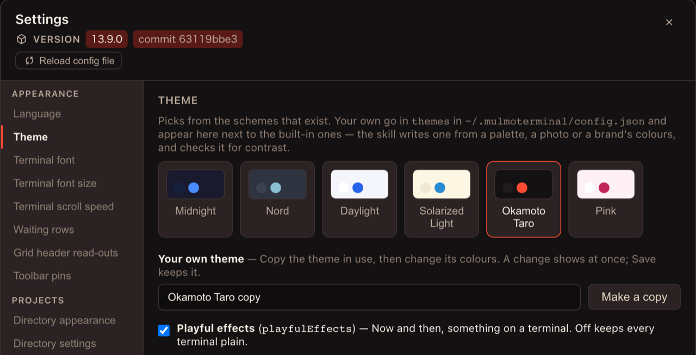
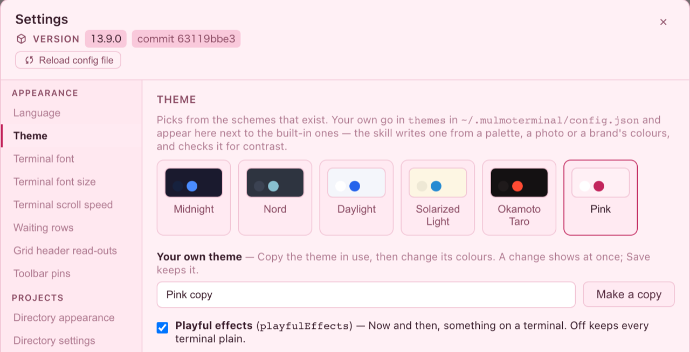

# 13.10.0 — Two new themes, Okamoto Taro and Pink

**A snapshot as of 13.10.0 (released 2026-11-27).** It will go stale as the app moves on — that is
expected, and the living reference is the guide each section links to.

Upgrade:

```bash
npx mulmoterminal@latest
```

Nothing to configure.

## New features

- **Two new built-in themes: Okamoto Taro and Pink.** Open **Settings** (the gear at the top right)
  → **Theme**. Next to Midnight, Nord, Daylight and Solarized Light there are now two more
  ([#3570](https://github.com/receptron/mulmoterminal/pull/3570)):
  - **Okamoto Taro** is dark and loud: a near-black background, a vermilion accent, and strong red,
    yellow and blue in the terminal.
  - **Pink** is light: a pale pink background, white panels and a deep rose accent.

  Click one and the whole app changes at once, the terminals included. Your choice is remembered.
  A project can also pin one in its `.mulmoterminal.json` with `"theme": "okamoto"` or
  `"theme": "pink"`. More: [Settings](config.html#custom-themes).

  

  

## What looks different

- **The theme picker has six built-ins instead of four**, and the sentence above it no longer says
  how many there are ([#3570](https://github.com/receptron/mulmoterminal/pull/3570)).

## Under the hood

- **If you made your own theme called `okamoto` or `pink`, rename it.** Built-in names cannot be
  used for your own themes, so a theme in `~/.mulmoterminal/config.json` with one of those two ids
  is no longer loaded, and Settings lists it as dropped. Give it another `id` and it comes back
  ([#3570](https://github.com/receptron/mulmoterminal/pull/3570)). More:
  [Make your own colour scheme](config.html#custom-themes).
