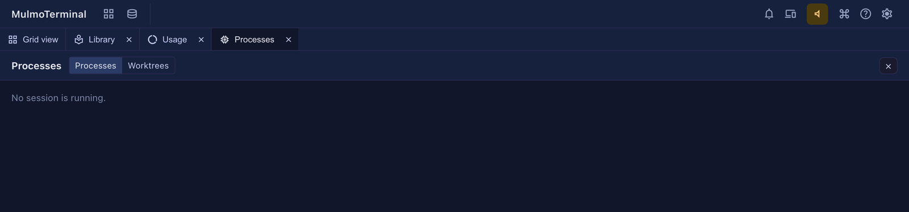

# 13.11.0 — Tabs for the screens you opened, and Japanese input that no longer doubles

**A snapshot as of 13.11.0 (released 2026-11-28).** It will go stale as the app moves on — that is
expected, and the living reference is the guide each section links to.

Upgrade:

```bash
npx mulmoterminal@latest
```

Nothing to configure. The new keys are optional and start unbound.

## New features

- **Tabs for the screens you opened.** Open a full-screen screen — the Library, Skills, Rooms,
  Files, the Wiki, Token usage, and so on — and a row of tabs appears under the toolbar. It lists
  every screen you opened since the page loaded, with **Grid view** first. Click a tab to go back
  to that screen; click its **×** to forget it, and the next tab (or the grid) comes to the front
  ([#3578](https://github.com/receptron/mulmoterminal/pull/3578)). More:
  [Features](features.html).

  

- **Keys for the Library, Processes and Usage screens, and a back-and-forth key.** Open
  **Settings** (the gear at the top right) → **Keyboard shortcuts**. Four new rows can each be
  given a key by pressing it ([#3577](https://github.com/receptron/mulmoterminal/pull/3577)):
  - `screen-library`, `screen-processes`, `screen-usage` open those screens. The Library can also
    be opened from the command palette now.
  - `screen-toggle` goes back and forth between the screen you opened last and where you opened
    it from. Before any screen has been opened it does nothing.

  A single key works on every screen; a two-key sequence works only on the grid. More:
  [Keyboard shortcuts](config.html#keymap).

## What looks different

- **A screen comes back as you left it.** Rooms, the Library, Blueprints, Skills, Processes and
  Usage are no longer rebuilt every time you open them. Close one and open it again, and the search
  text, the selection, the scroll position and the conversation you were reading are still there,
  while it refreshes in the background
  ([#3576](https://github.com/receptron/mulmoterminal/pull/3576)). A plain open of Rooms or
  Blueprints returns to the place inside it you were last at.
- **Screens start a little lower while the tab row is showing**, to make room for it
  ([#3578](https://github.com/receptron/mulmoterminal/pull/3578)).

## Under the hood

- **Japanese (and other IME) input no longer types the text twice when Cmd is pressed.** In a
  terminal cell, pressing Cmd while a word was still being converted (underlined) sent the word
  once at once and again when the input method confirmed it — `てすと` became `てすとてすと`. A
  common way to hit it is a Karabiner rule that sends 英数 / かな when Cmd is pressed alone
  ([#3586](https://github.com/receptron/mulmoterminal/pull/3586), reported in
  [#3584](https://github.com/receptron/mulmoterminal/issues/3584)). To check you have the fix: type
  a word in Japanese, press Cmd before confirming it, and it appears once.
- **Small fixes in the screens that now stay open**: a Blueprints answer you cleared is not filled
  back in, a typed draft is cleared when the question is asked again, a failed refresh no longer
  hides what is shown or reports "unreadable" over it, and a skill removed while you edit it no
  longer throws the editor away ([#3587](https://github.com/receptron/mulmoterminal/pull/3587)).
- **Work toward running terminals on another machine.** Not ready yet: it stays inactive unless
  configured, and is not documented yet. Nothing changes for you
  ([#3562](https://github.com/receptron/mulmoterminal/pull/3562),
  [#3567](https://github.com/receptron/mulmoterminal/pull/3567),
  [#3568](https://github.com/receptron/mulmoterminal/pull/3568),
  [#3571](https://github.com/receptron/mulmoterminal/pull/3571),
  [#3572](https://github.com/receptron/mulmoterminal/pull/3572),
  [#3573](https://github.com/receptron/mulmoterminal/pull/3573),
  [#3574](https://github.com/receptron/mulmoterminal/pull/3574),
  [#3579](https://github.com/receptron/mulmoterminal/pull/3579),
  [#3580](https://github.com/receptron/mulmoterminal/pull/3580),
  [#3581](https://github.com/receptron/mulmoterminal/pull/3581),
  [#3582](https://github.com/receptron/mulmoterminal/pull/3582),
  [#3583](https://github.com/receptron/mulmoterminal/pull/3583)).
