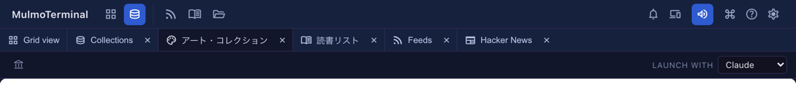

# 13.12.0 — A tab for each collection and feed you open

**A snapshot as of 13.12.0 (released 2026-11-28).** It will go stale as the app moves on — that is
expected, and the living reference is the guide each section links to.

Upgrade:

```bash
npx mulmoterminal@latest
```

Nothing to configure.

## New features

- **A tab for each collection and feed you open.** In 13.11.0 the Collections screen had one tab,
  so opening a second collection replaced the first. Now **Collections** and **Feeds** keep one
  tab for their list, and every collection or feed you open gets a tab of its own, right after
  that list's tab, with the collection's name and icon. Open one that already has a tab and you
  switch to it instead of getting a second one. The same name in two projects is two tabs
  ([#3600](https://github.com/receptron/mulmoterminal/pull/3600)). Rooms and Blueprints still keep
  one tab each. More: [Features](features.html).

  

- **The Library checks for a better guard before it writes a rule.** When you promote a
  conversation (or a repeated instruction) to a `CLAUDE.md` rule, the `mulmoterminal-library`
  skill first asks whether a structure, a type, a lint or CI check, or a test could hold the rule
  instead. If one could, it offers an issue for that check first, and the rule only for what the
  check cannot hold. Nothing is written until you approve, as before
  ([#3596](https://github.com/receptron/mulmoterminal/pull/3596)). More:
  [Features](features.html).

## What looks different

- **Collection and feed tabs are named after the collection**, not the screen. Until the list of
  collections answers, a new tab shows the collection's short id for a moment
  ([#3600](https://github.com/receptron/mulmoterminal/pull/3600)).

## Under the hood

- **Resume in the Library no longer takes over a conversation open elsewhere.** A conversation
  left open and idle in another tab or on another device could fall off the Library's list, and
  **Resume** then opened it again, knocking the other window off it. The Library now asks who
  holds the conversation before resuming it
  ([#3601](https://github.com/receptron/mulmoterminal/pull/3601), reported in
  [#3343](https://github.com/receptron/mulmoterminal/issues/3343)). It only mattered for a
  conversation older than the newest ones the list holds. Such a conversation open elsewhere is
  now refused the way one in the list always was, with *"This conversation is already open, or
  another window has it."*
- **Review rounds ask for evidence.** The bundled `mulmoterminal-review` skill, which a reviewer
  started by `requestReview` follows, now marks a finding without evidence (a run, a proof, or a
  quoted rule it breaks) as unverified, and such a finding no longer blocks approval
  ([#3591](https://github.com/receptron/mulmoterminal/pull/3591)).
- **Work toward running terminals on another machine.** A remote cell's Canvas can now draw
  documents, HTML pages, charts, models, spreadsheets and stories from the other machine, read
  only. Not ready yet: it stays inactive unless configured, and is not documented yet. Nothing
  changes for you ([#3592](https://github.com/receptron/mulmoterminal/pull/3592),
  [#3597](https://github.com/receptron/mulmoterminal/pull/3597),
  [#3599](https://github.com/receptron/mulmoterminal/pull/3599)).
- **A tool for checking changes in a running copy**, for people working on MulmoTerminal itself.
  Nothing changes for you ([#3594](https://github.com/receptron/mulmoterminal/pull/3594)).
