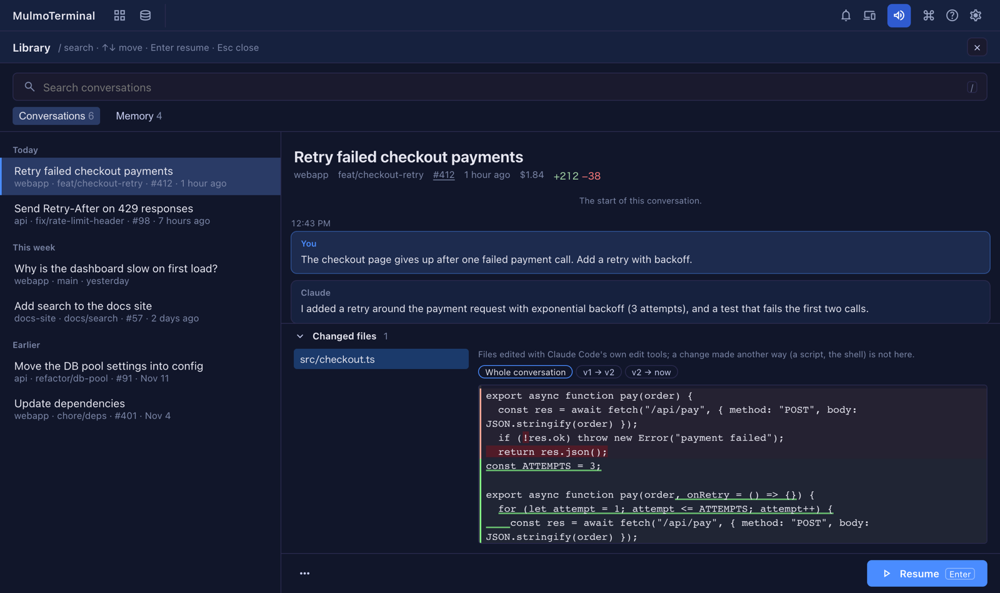
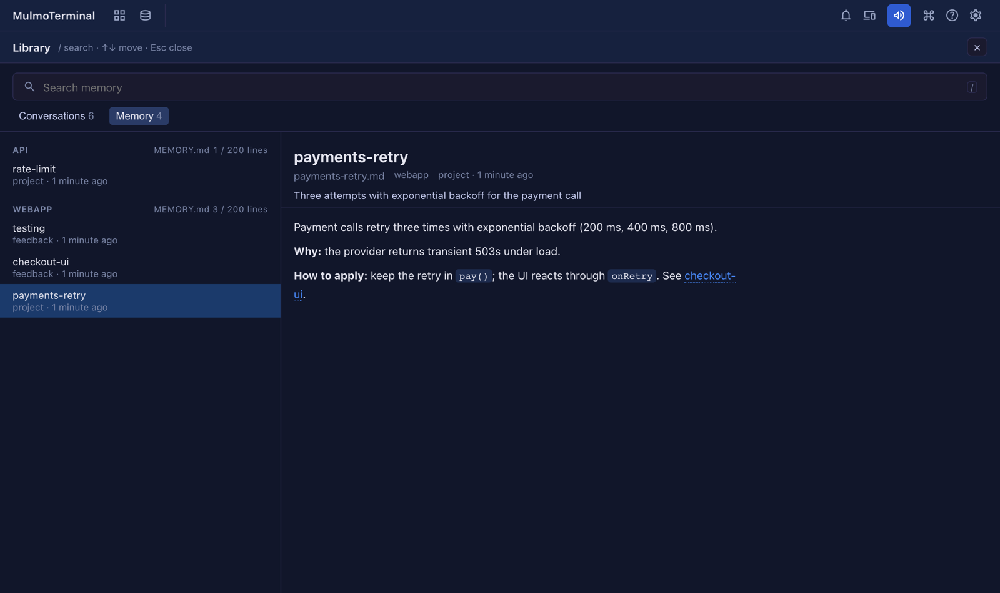

# 13.2.0 — Changed files and memory in the Library

**A snapshot as of 13.2.0 (released 2026-11-20).** It will go stale as the app moves on — that is
expected, and the living reference is the guide each section links to.

Upgrade:

```bash
npx mulmoterminal@latest
```

Nothing to configure: both additions are in the Library (**More features** → **Library**), which
arrived in [13.1.0](v13.1.0.html).

## New features

### The files a conversation changed

Open a conversation in the Library. At the bottom of the reader, a **Changed files** strip lists
the files that conversation edited. Open it and pick a file to see the change:

- **Whole conversation**: the file before the conversation first touched it, against the file as
  it is now.
- **v1 → v2**, **v2 → now**, …: one turn's change at a time.



This comes from the copies Claude Code keeps when it edits a file, so only files changed with
Claude Code's own edit tools are listed — a change made by a script or in the shell is not, and the
strip says so. It is read only: nothing is restored or written
([#3350](https://github.com/receptron/mulmoterminal/pull/3350)).

### Claude Code's memory, by project

A **Memory** tab sits beside **Conversations**. It lists Claude Code's automatic memory for every
project, grouped under the project's folder name.



- Each project heading shows **how full its `MEMORY.md` is** against what Claude Code loads at the
  start of a session, and warns when it is nearly full — past that, Claude Code stops reading the
  rest.
- Pick a memory to read it as formatted text. A `[[name]]` link opens the memory it names; one
  that names nothing in that project is shown as plain text.
- The search box narrows the list by name, description or file name, and the arrow keys move.

It is read only for now: editing comes later
([#3352](https://github.com/receptron/mulmoterminal/pull/3352)).

More: [Feature reference — Library](features.html).

## What looks different

- The Library has a **Memory** tab beside **Conversations**
  ([#3352](https://github.com/receptron/mulmoterminal/pull/3352)).
- The Library's reader has a **Changed files** strip at the bottom for a conversation that edited
  files ([#3350](https://github.com/receptron/mulmoterminal/pull/3350)).

## Under the hood

Nothing else changed. Neither addition writes to `~/.claude`: the changed files are read from
Claude Code's own file history, and the memory from each project's memory folder
([#3350](https://github.com/receptron/mulmoterminal/pull/3350),
[#3352](https://github.com/receptron/mulmoterminal/pull/3352)).
