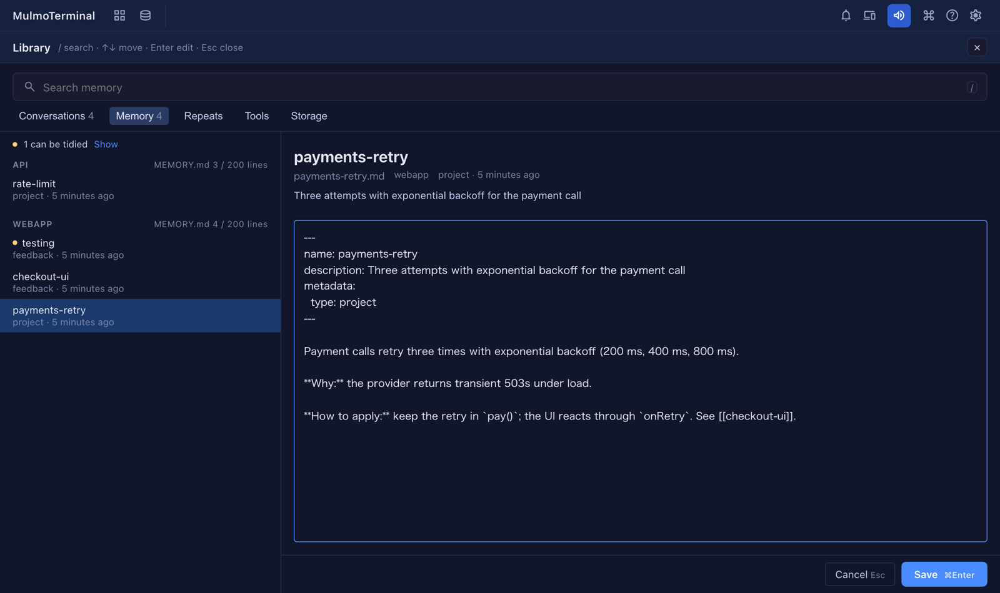
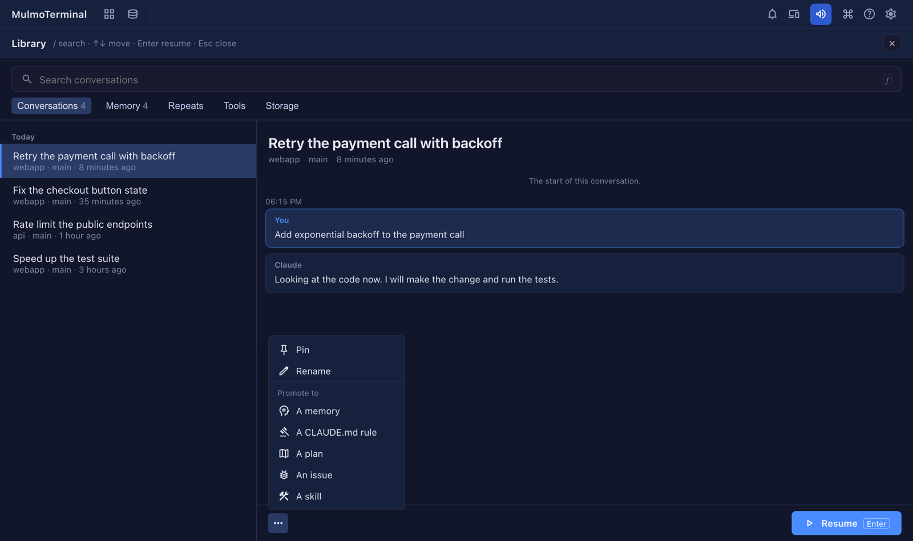
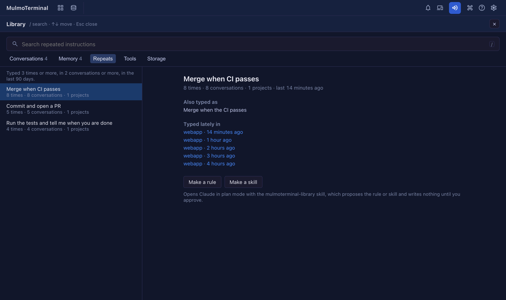
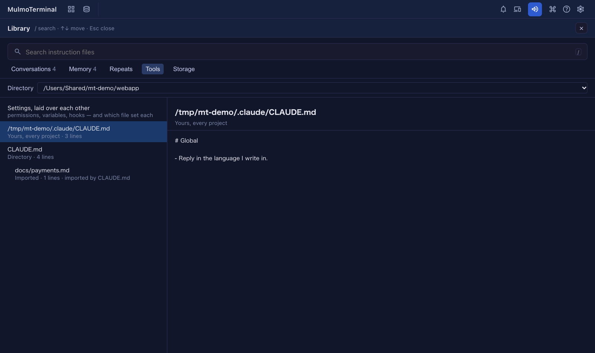
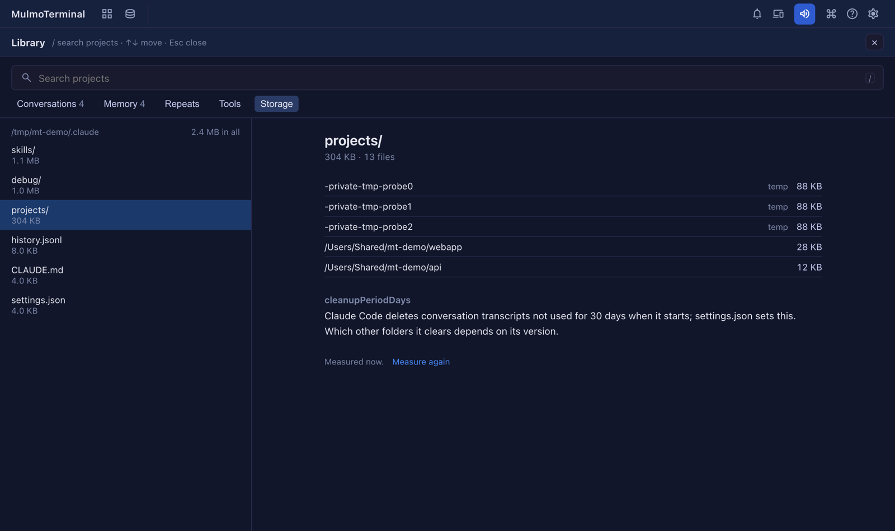

# 13.3.0 — The Library grows: memory you can tidy, promotion, tools, storage and repeats

**A snapshot as of 13.3.0 (released 2026-11-21).** It will go stale as the app moves on — that is
expected, and the living reference is the guide each section links to.

Upgrade:

```bash
npx mulmoterminal@latest
```

Nothing to configure. Most of this release is in the Library (**More features** → **Library**).
Its row of kinds under the search box now reads **Conversations · Memory · Repeats · Tools ·
Storage**.

## New features

### Memory: see what can be tidied, and fix it in place

In 13.2.0 the **Memory** kind could only be read. Now it can be changed — and it tells you what is
worth changing.



- **What can be tidied.** Above the list, **n can be tidied** counts the memories with a problem,
  and **Show** narrows the list to them. Each such row has a dot, and the reader says the problem in
  one sentence at the top: a memory not listed in `MEMORY.md`, frontmatter missing `name`,
  `description` or `type`, a `[[link]]` to no memory, a file it names that is gone, or a
  `MEMORY.md` that is missing, too long for Claude Code to read to the end, or lists a file that is
  not there ([#3353](https://github.com/receptron/mulmoterminal/pull/3353)).
- **Edit.** Press **Edit** at the bottom right of the reader (or `Enter`) to change the memory's
  whole text, frontmatter included. `⌘Enter` saves, `Esc` cancels. If Claude Code wrote the file
  while you were editing, the save is refused and **read it again** is offered, with your edit
  kept. A Claude session running in that project is warned of
  ([#3354](https://github.com/receptron/mulmoterminal/pull/3354)).
- **Move to Trash.** **⋯** → **Move to Trash** moves the memory to your system Trash together with
  its line in `MEMORY.md`. There is no confirmation: the notice that appears has **Undo**, which
  puts both back ([#3355](https://github.com/receptron/mulmoterminal/pull/3355)).
- **Merge into another memory.** **⋯** → **Merge into another memory** lists the project's other
  memories. Pick one, and it opens in the editor with this memory's text added at its end; combine
  them as you like and save. The memory you merged in goes to the Trash with its `MEMORY.md` line,
  and every `[[link]]` that pointed at it now points at the one you kept — the editor says how
  many before you save. **Undo** puts all of it back
  ([#3356](https://github.com/receptron/mulmoterminal/pull/3356),
  [#3358](https://github.com/receptron/mulmoterminal/pull/3358)).
- **The same memory in other work copies.** When another clone or worktree of the same repository
  keeps a memory of the same name, the reader says so — **Also kept in other work copies of this
  repository:** — and marks each copy **(the same)** or **(different)**
  ([#3357](https://github.com/receptron/mulmoterminal/pull/3357)). For one that differs,
  **Add its text here** opens the editor with that copy's text added, and **Write this text there**
  writes this memory's saved text over that copy, with **Undo**
  ([#3360](https://github.com/receptron/mulmoterminal/pull/3360)).
- **Written in.** Under a memory's title, **Written in** names the conversation that last wrote it;
  click it to open that conversation
  ([#3361](https://github.com/receptron/mulmoterminal/pull/3361)).

### Promote a conversation to a memory, rule, plan, issue or skill

Open a conversation in the Library and press **⋯** at the bottom. Under **Promote to** are
**A memory**, **A CLAUDE.md rule**, **A plan**, **An issue** and **A skill**.



Pressing one closes the Library and opens a Claude cell in plan mode, in the directory the
conversation ran in. It runs the bundled `mulmoterminal-library` skill, which reads the
conversation, drafts what it would write (for a rule it asks which `CLAUDE.md`; for a skill,
whether to make a new one or improve one you have) and **writes nothing until you approve the
plan**. Every file it changes is backed up first under `~/.mulmoterminal/library/backups/`, and it
tells you how to undo each change
([#3366](https://github.com/receptron/mulmoterminal/pull/3366)).

### Repeats: the instructions you keep typing

**Repeats** lists what you typed 3 times or more, in 2 conversations or more, in the last 90 days —
read from Claude Code's prompt history. Slash commands, `!` lines, pasted text, automated runs and
very short replies are left out, and the same words written slightly differently are grouped.



Pick one to see how else you typed it and the conversations you typed it in lately (click one to
open it). **Make a rule** or **Make a skill** opens Claude in plan mode with the
`mulmoterminal-library` skill, in the directory you typed it in most. It proposes the rule or skill
and writes nothing until you approve
([#3393](https://github.com/receptron/mulmoterminal/pull/3393)).

### Tools: what Claude Code loads in a directory

**Tools** asks for a **Directory** (one a conversation ran in) and lists the instruction files
Claude Code loads there, in the order it loads them: the organization's, yours, each `CLAUDE.md` and
`CLAUDE.local.md` from the root down, the project's rules, and the files they import with `@path`
— or `AGENTS.md` where there is no `CLAUDE.md`. Pick one to read it beside the list
([#3367](https://github.com/receptron/mulmoterminal/pull/3367)).



- **Paths that are not there.** Under a file, a line says which paths it names that do not exist
  — handy for a `CLAUDE.md` that still points at a file you moved
  ([#3385](https://github.com/receptron/mulmoterminal/pull/3385)).
- **Settings, laid over each other**, the row above the files, shows what is in effect there from
  your, the project's, the local and the organization's `settings.json`: permission rules
  (**Allowed without asking**, **Always asked**, **Denied**), environment variables, hooks and other
  settings, each naming the file that set it
  ([#3382](https://github.com/receptron/mulmoterminal/pull/3382)).

Read only: nothing here writes a file.

### Storage: what Claude Code's folder takes on disk

**Storage** shows each entry of `~/.claude`, largest first, with the total. Pick `projects/` to see
each project, largest first, with the ones from temporary directories marked **temp**; type to
narrow them. It also says what `cleanupPeriodDays` is, and so how long Claude Code keeps
conversation transcripts.



It is measured in the background, again when the last measurement is over an hour old, or when you
press **Measure again**. Nothing is removed
([#3384](https://github.com/receptron/mulmoterminal/pull/3384)).

More: [Feature reference — Library](features.html).

### Edit a skill's SKILL.md

In **More features** → **Skills**, one of your own skills or a project's now has an **Edit** button.
It opens the whole `SKILL.md`: `⌘Enter` saves, `Esc` cancels. As with memory, a save is refused if
the file changed since you opened it. Plugin skills and the ones MulmoTerminal ships stay read only.
A project's skill is in that project's `.claude/skills`, which is usually committed
([#3387](https://github.com/receptron/mulmoterminal/pull/3387)).
More: [Feature reference — Skills viewer](features.html).

### Bring everything since last time from another terminal

In a cell, **Tools** → **Talk to another terminal…** lists the other terminals. Each row now has a
list icon beside **Bring … last turn here**: it brings **every exchange since the last time this
directory received one** from that terminal, prompts and replies, without tool output. It is pasted,
not sent — you press Enter. The first time, it brings as much as fits
([#3392](https://github.com/receptron/mulmoterminal/pull/3392)).
More: [Feature reference](features.html).

### The last weeks, in Usage

**More features** → **Usage** now opens with **The last weeks**: what twelve weeks of conversations
cost, how many there were and how many PRs they made — by week, by project and by agent. It is added
up from the Library's index; a conversation counts in the week it started
([#3390](https://github.com/receptron/mulmoterminal/pull/3390)).
More: [Token usage](token-rotation.html#token-usage).

### The GitHub board follows your open terminals

In the GitHub view, **Open the board (experimental)**:

- **Only work with an open terminal**, in the board's header, keeps only the cards a terminal is
  open on. It is on from the start; turn it off to see everything. Your browser remembers it
  ([#3362](https://github.com/receptron/mulmoterminal/pull/3362)).
- A terminal you close leaves its card at once; one you open shows a few seconds later
  ([#3364](https://github.com/receptron/mulmoterminal/pull/3364)).
- A GitHub repository you have not registered shows too while a terminal is open in a clone of it,
  tagged **not registered** ([#3374](https://github.com/receptron/mulmoterminal/pull/3374)). The
  PR and issue lists show it the same way
  ([#3391](https://github.com/receptron/mulmoterminal/pull/3391)).
- A terminal on the default branch (`main` …) or on no branch shows in a row above that
  repository's columns, grouped by branch, instead of nowhere
  ([#3386](https://github.com/receptron/mulmoterminal/pull/3386)).

More: [GitHub — the board](github.html#board).

### More agents' turns can be brought over and read

- **Bring … last turn here**, **Exchange** and the round table now carry the answer of a Copilot,
  Antigravity or Grok cell. Before, they brought nothing from those agents. Copilot and Antigravity
  cells' finished-turn push now includes the answer too
  ([#3369](https://github.com/receptron/mulmoterminal/pull/3369),
  [#3371](https://github.com/receptron/mulmoterminal/pull/3371),
  [#3373](https://github.com/receptron/mulmoterminal/pull/3373)).
- A Grok or Antigravity session's conversation now shows in the Conversation pane and on the
  phone's conversation view ([#3381](https://github.com/receptron/mulmoterminal/pull/3381),
  [#3383](https://github.com/receptron/mulmoterminal/pull/3383)).

More: [Agents](agents.html).

## What looks different

- The Library's row of kinds has three more: **Repeats**, **Tools** and **Storage**
  ([#3393](https://github.com/receptron/mulmoterminal/pull/3393),
  [#3367](https://github.com/receptron/mulmoterminal/pull/3367),
  [#3384](https://github.com/receptron/mulmoterminal/pull/3384)).
- In **Memory**: a count of what can be tidied above the list with dots on the rows, **Edit** at the
  bottom of the reader, **Move to Trash** and **Merge into another memory** in **⋯**, and
  **Written in** under the title
  ([#3353](https://github.com/receptron/mulmoterminal/pull/3353),
  [#3354](https://github.com/receptron/mulmoterminal/pull/3354),
  [#3355](https://github.com/receptron/mulmoterminal/pull/3355),
  [#3356](https://github.com/receptron/mulmoterminal/pull/3356),
  [#3361](https://github.com/receptron/mulmoterminal/pull/3361)).
- A conversation's **⋯** menu has a **Promote to** section
  ([#3366](https://github.com/receptron/mulmoterminal/pull/3366)).
- The Skills viewer has an **Edit** button on your own and project skills
  ([#3387](https://github.com/receptron/mulmoterminal/pull/3387)).
- **Talk to another terminal…** has a list icon on each terminal's row
  ([#3392](https://github.com/receptron/mulmoterminal/pull/3392)).
- **More features** always has **Usage** now (it used to be **Token usage**, shown only with
  token rotation set up). The token table still shows only when there are tokens
  ([#3390](https://github.com/receptron/mulmoterminal/pull/3390)).
- **The GitHub board opens showing less than before**, because **Only work with an open terminal**
  is on from the start. Turn it off to see every card
  ([#3362](https://github.com/receptron/mulmoterminal/pull/3362)).
- The board and the PR / issue lists show a loading state until their first read answers, and the
  refresh button spins while they read again
  ([#3380](https://github.com/receptron/mulmoterminal/pull/3380)).

## Under the hood

- **The Library rebuilds its index once after you upgrade**, in the background as on its first
  open. Until it finishes, the conversation list fills in again and **Written in** is not shown
  ([#3361](https://github.com/receptron/mulmoterminal/pull/3361)).
- Merging a memory that contains an emoji no longer drops characters from the end of the draft
  ([#3365](https://github.com/receptron/mulmoterminal/pull/3365)).
- Developer notes on which Copilot versions write their turn records one turn late. Nothing you
  need to do ([#3388](https://github.com/receptron/mulmoterminal/pull/3388)).
