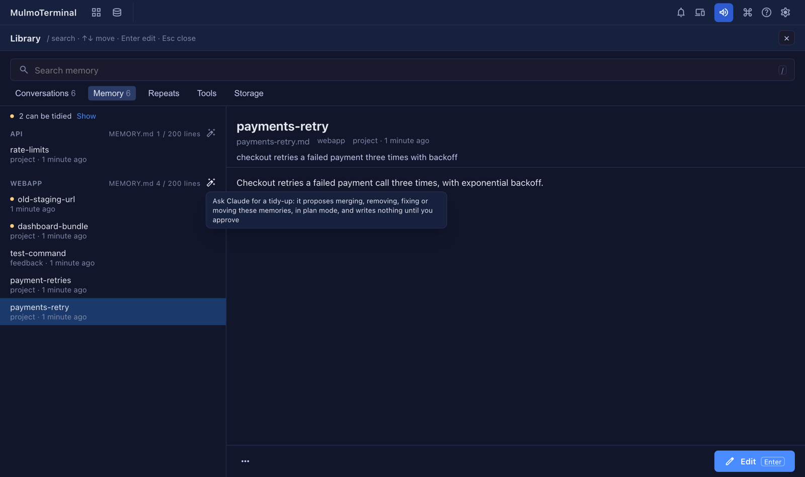

# 13.4.0 — Ask Claude to tidy a project's memory

**A snapshot as of 13.4.0 (released 2026-11-22).** It will go stale as the app moves on — that is
expected, and the living reference is the guide each section links to.

Upgrade:

```bash
npx mulmoterminal@latest
```

Nothing to configure.

## New features

### Ask for a tidy-up of a project's memory

13.3.0 let you fix memories one at a time in the Library. Now you can ask Claude to look at a whole
project's memory and propose what to do with it.



1. Open **More features** → **Library** → **Memory**.
2. Each project heading (**WEBAPP** above) ends in a wand button. Press it on the project you want
   tidied.
3. The Library closes and a Claude cell opens **in plan mode, in that project's directory**. It
   runs the bundled `mulmoterminal-library` skill on that project's memory folder.
4. Claude reads every memory, the project's `MEMORY.md` and what the Library's health check found,
   and proposes a plan:
   - **merge** memories that say the same thing into one,
   - **remove** memories that no longer hold — it checks the code before saying so,
   - **fix** what the health check marked (a memory missing from `MEMORY.md`, missing
     frontmatter, a `[[link]]` to no memory, and so on),
   - **move** a standing rule to a `CLAUDE.md` or a skill, where it belongs.
5. **Nothing is written until you approve the plan.** When you do, every file it changes or
   removes is backed up first under `~/.mulmoterminal/library/backups/`, and `MEMORY.md` is kept in
   step. To put a file back, copy it from there.

The button refuses, with a line under the heading, when the project's directory is not on this
machine, or when two directories the Library knows would both use that memory folder — Claude would
not know which code to check the memories against
([#3394](https://github.com/receptron/mulmoterminal/pull/3394)).

Reference: [Features → Library](features.html).

## What looks different

- Each project heading in the Library's **Memory** has a wand button at its end, beside the
  `MEMORY.md` gauge ([#3394](https://github.com/receptron/mulmoterminal/pull/3394)).

## Under the hood

- The Memory view now names a project's directory by the same rule Claude Code uses for its memory
  folder (the directory's real path, with `_` and other characters folded to `-`). A project whose
  directory name contains `_`, or that you reach through a link, now shows its directory where it
  used to show none. When two directories would share one folder, none is named rather than a
  guess. Nothing to do ([#3394](https://github.com/receptron/mulmoterminal/pull/3394)).
