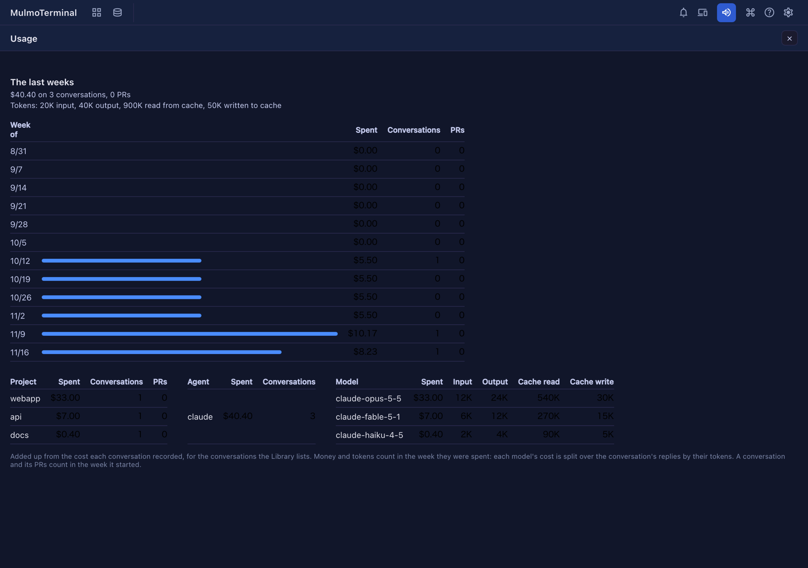

# 13.5.0 — Usage counts money when it was spent, by model

**A snapshot as of 13.5.0 (released 2026-11-22).** It will go stale as the app moves on — that is
expected, and the living reference is the guide each section links to.

Upgrade:

```bash
npx mulmoterminal@latest
```

Nothing to configure. After upgrading, the Library rebuilds its index once in the background (see
**Under the hood**).

## New features

### Usage: money and tokens in the week they were spent, and by model

Open **More features** → **Usage**. The retrospective of the last twelve weeks
([#3396](https://github.com/receptron/mulmoterminal/pull/3396)) now:



- **counts money in the week it was spent.** Before, a conversation's whole cost landed in the week
  it started, so one conversation that ran for two months showed up as one huge week. Now each
  model's cost is split over the conversation's replies by how many tokens each one used, and every
  reply counts in its own week.
- **shows tokens.** Under the total, a line reads **Tokens:** input, output, read from cache and
  written to cache.
- **adds a table by model** — how much each model cost, with its tokens. A cost Claude Code recorded
  without saying which model is shown as **(model not recorded)**.
- **keeps every count.** Claude Code sometimes starts counting a conversation's cost again from
  zero. The cost from before that used to be dropped; now it is added in. So a long conversation's
  cost in the Library can be higher than what Claude Code's own `/cost` shows for the current
  session — the difference is what came before it started counting again.

Conversations and PRs still count in the week the conversation started.

Reference: the retrospective is described under **More features** → **Usage** in the
[README](https://github.com/receptron/mulmoterminal#readme).

## What looks different

- **Usage** has a token line under its total and a **Model** table beside **Project** and **Agent**
  ([#3396](https://github.com/receptron/mulmoterminal/pull/3396)).
- The weekly bars are flatter for long conversations, since their cost is now spread over the weeks
  they ran.

## Under the hood

- **The Library rebuilds its index once after you upgrade**, in the background as on its first
  open; on a large history this takes a few minutes, and the conversation list fills in again
  meanwhile. Nothing to do ([#3396](https://github.com/receptron/mulmoterminal/pull/3396)).
