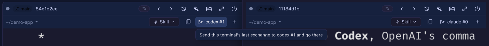

# 13.6.0 — Send a turn to the terminal beside you

**A snapshot as of 13.6.0 (released 2026-11-22).** It will go stale as the app moves on — that is
expected, and the living reference is the guide each section links to.

Upgrade:

```bash
npx mulmoterminal@latest
```

Nothing to configure. The new button appears on its own when there is someone to send to.

## New features

### A send button on each terminal

Open two agent terminals in the same repository — for example Claude in one and Codex in the other,
in the same folder or in two worktrees of it. Once both have started a conversation, each one's
header shows a button with the other's name on its second row, such as **codex #1**
([#3400](https://github.com/receptron/mulmoterminal/pull/3400),
[#3401](https://github.com/receptron/mulmoterminal/pull/3401)).



Press it, and this terminal's last exchange — your question and the agent's answer — is pasted into
the other terminal's input, and that terminal comes forward with the keyboard. **Nothing is sent**:
read it, add a line of your own, and press Enter yourself. That is the point — you stay the one in
the middle who decides what goes across.

- With several possible partners the button reads **2 terminals** (and so on) and asks which one.
- With nobody to send to, there is no button.
- To hide it, untick **Send button on each terminal** in Settings → **Header buttons and chips**.

Reference: [Conversation → A button for the hand-off you do all day](conversation.html#send),
[`cellSendButton`](config.html#cell-send-button).

### Send everything since last time

The built-in button sends one exchange. To send everything this terminal has said since it last
sent to that folder, open the wrench menu (**Tools**) → **Talk to another terminal…** and press the
inbox icon on the partner's row ([#3398](https://github.com/receptron/mulmoterminal/pull/3398)).
Each row now has four icons:

| Icon | What it does |
| --- | --- |
| list | Bring that terminal's exchanges since last time here |
| paper plane | Send this terminal's last exchange there |
| inbox | Send this terminal's exchanges since it last sent to that folder |
| arrows | Trade one turn automatically (the only one that presses Enter) |

The first time, it sends as much as fits.

### The hand-offs as buttons and keys

The four hand-offs are now actions you can put on a header button (`run: "action"`), a key in
`keymap`, or find in the command palette
([#3398](https://github.com/receptron/mulmoterminal/pull/3398)):
`terminal-send-turn`, `terminal-send-since`, `terminal-bring-turn`, `terminal-bring-since`.

For example, a button for sending everything since last time, in `~/.mulmoterminal/config.json`:

```json
{ "buttons": [
  { "id": "send-since", "icon": "forward_to_inbox", "label": "Send since last time", "run": "action", "action": "terminal-send-since" }
] }
```

Your `buttons` list replaces the default buttons, so keep the ones you want in it. The partner is
found the same way as for the built-in button: one is acted on, several open **Talk to another
terminal…**, none shows a message on the cell.

Reference: [Customizing the header](header.html), [Conversation](conversation.html#send).

## What looks different

- The second row of an agent terminal's header can show a send button with a partner's name
  ([#3400](https://github.com/receptron/mulmoterminal/pull/3400),
  [#3401](https://github.com/receptron/mulmoterminal/pull/3401)).
- **Talk to another terminal…** has two more icons on each row: the paper plane and the inbox
  ([#3398](https://github.com/receptron/mulmoterminal/pull/3398)).
- Settings → **Header buttons and chips** has a **Send button on each terminal** checkbox (on).

## Under the hood

- **Pasted hand-offs name the branch.** The first line now reads like
  `Another terminal (codex · feat/login) just finished the exchange below.`, since a partner in another worktree does not have
  your files ([#3398](https://github.com/receptron/mulmoterminal/pull/3398)).
- **A hand-off is not sent back where it came from.** When a question you sent was itself a pasted
  hand-off, only the words you added after it go across, for bringing as well as sending
  ([#3398](https://github.com/receptron/mulmoterminal/pull/3398)). Nothing to do.
