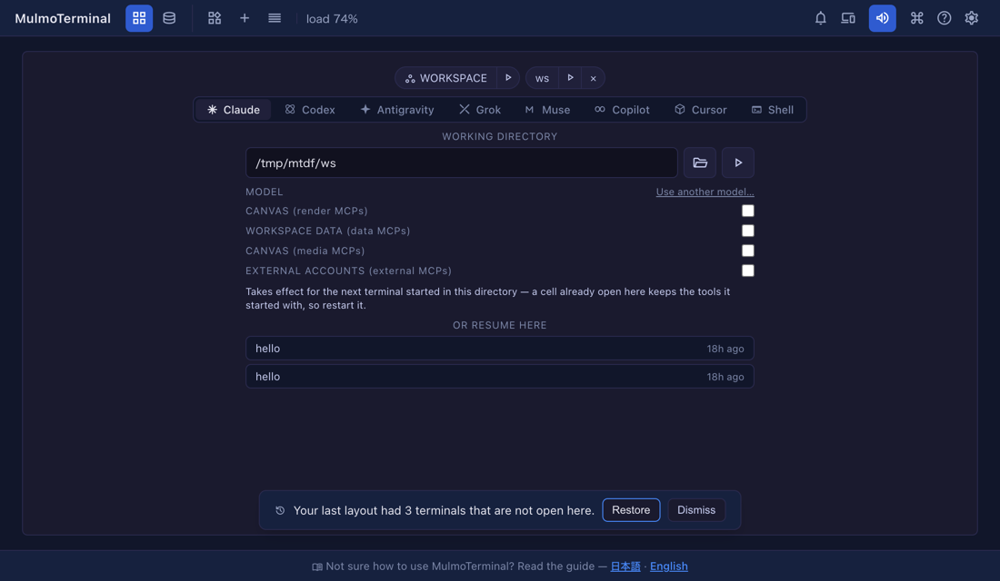

# 13.7.0 — Hand an issue to an agent, and measure your skills

**A snapshot as of 13.7.0 (released 2026-11-25).** It will go stale as the app moves on — that is
expected, and the living reference is the guide each section links to.

Upgrade:

```bash
npx mulmoterminal@latest
```

The skill measurement and the layout copy need nothing. The issue and review tools need one block
in the repository's `.mulmoterminal.json`, shown below.

## New features

### Take an issue to merge, reviewed by another agent

Four new bundled skills work together. Run them in the **workspace** terminal, where the tools they
use are available.

1. Declare how the repository's PRs are reviewed, in `.mulmoterminal.json` at its root
   ([#3408](https://github.com/receptron/mulmoterminal/pull/3408),
   [#3429](https://github.com/receptron/mulmoterminal/pull/3429)):

   ```json
   { "review": { "reviewer": "codex", "maxRounds": 10, "requiredLgtm": 1 } }
   ```

   `skill` names what the reviewer follows; it defaults to the bundled `mulmoterminal-review`. A
   field that is wrong drops the whole block, so a typo never picks a reviewer for you. Settings →
   **Directory settings** shows the result as a **Review** row.
2. Type `/mulmoterminal-issue-to-merge 123`. The agent reads the issue, asks only what it leaves
   open, implements it on a branch and opens a PR
   ([#3411](https://github.com/receptron/mulmoterminal/pull/3411)).
3. For each review round it calls `requestReview`. MulmoTerminal starts the reviewer itself, as a
   cell of its own, in a worktree checked out at the PR's newest push, reads its verdict and CI, and
   tells the author whether the **merge condition** is met
   ([#3410](https://github.com/receptron/mulmoterminal/pull/3410),
   [#3430](https://github.com/receptron/mulmoterminal/pull/3430)). If the reviewer stops on a
   question, the author is told which cell to answer in
   ([#3431](https://github.com/receptron/mulmoterminal/pull/3431)). Nothing merges on its own: the
   author merges only once the condition is met, and `endReview` closes the reviewer.

To hand out several issues at once, type `/mulmoterminal-dispatch-issues #12 #13 #14`
([#3418](https://github.com/receptron/mulmoterminal/pull/3418)). Each issue goes to an implementer
in its own worktree through `startIssueSession`
([#3416](https://github.com/receptron/mulmoterminal/pull/3416)). The dispatcher is told when a PR
merges or closes, or when an implementer is waiting on you
([#3417](https://github.com/receptron/mulmoterminal/pull/3417)), and starts the next issue as one
merges. A merged implementer's cell and worktree are closed for you, and `closeIssueSession` closes
one by hand ([#3433](https://github.com/receptron/mulmoterminal/pull/3433)). At most two run at once;
raise it with `maxIssueSessions` in `~/.mulmoterminal/config.json`.

More: [How this repository's PRs are reviewed](config.html#dir-review),
[How many issues run at once](config.html#max-issue-sessions).

### A session can talk to a session it started

`sendToSession` types into a session the caller started and presses Enter, and
`waitForSessionReply` waits for that session's answer to it. `spawnBackgroundChat` can now start any
agent ([#3405](https://github.com/receptron/mulmoterminal/pull/3405),
[#3406](https://github.com/receptron/mulmoterminal/pull/3406)). These are what the skills above are
built on.

### Does a skill help? Measure it

Open **More features → Skills** and select a skill.

- Each row shows how many Claude conversations used it (**3×**, or **unused**), and the detail says
  when it was last used ([#3442](https://github.com/receptron/mulmoterminal/pull/3442)).
- The **Does it help?** section: **Draft test tasks** opens a terminal where the bundled
  `mulmoterminal-skill-eval` skill drafts a few small tasks with a pass or fail check and shows them
  to you before saving. **Measure** runs each one with and without the skill and shows the pass rate,
  the cost per pass and a verdict — *It helps*, *No evidence of a difference*, or *It makes things worse*
  ([#3443](https://github.com/receptron/mulmoterminal/pull/3443)). It runs real `claude -p`, so it
  asks you to confirm the cost first.
- **Improve and measure** writes an improved SKILL.md from the latest measurement and measures it on
  the same tasks. **Adopt** installs it and keeps the old one as a backup
  ([#3450](https://github.com/receptron/mulmoterminal/pull/3450)). Since the improvement is written
  from the same tasks it is measured on, read it before adopting.
- **Find the cheapest model** runs the tasks on haiku, then sonnet, then opus, and stops at the first
  that passes everything ([#3456](https://github.com/receptron/mulmoterminal/pull/3456)). It only
  advises; nothing is written to your config.

More: [Features → Automate & investigate](features.html).

### Your grid comes back after a full disk

The grid's layout used to live only in the browser. It is now also kept at
`~/.mulmoterminal/grid-layout.json`, and a grid that opens empty — the browser could not save on a
full disk, its data was cleared, or you opened another address — shows a bar at the bottom:
**Your last layout had 3 terminals that are not open here.** **Restore** reopens them, each resuming
its conversation; **Dismiss** keeps the empty grid
([#3432](https://github.com/receptron/mulmoterminal/pull/3432)).



More: [Features → Supervise](features.html).

## What looks different

- An agent cell that ended without leaving a record of how it ended — which is what a full disk does —
  now stays, with a red line `[session ended — how it ended was not recorded; is the disk full?]`.
  It used to be taken as a clean exit, and every cell closed itself
  ([#3426](https://github.com/receptron/mulmoterminal/pull/3426)).
- Launcher chips for a folder you deleted disappear; the folder is dropped from `config.json` a day
  later. A folder that may only be unreachable — an unplugged drive, a broken link — is hidden until
  it is back, and Settings still lists it
  ([#3415](https://github.com/receptron/mulmoterminal/pull/3415)).
- The GitHub board's verdict badge reads **Verdict 2: LGTM** instead of **Codex 2: LGTM**, since any
  reviewer can write it now, and a card gets **Ready to merge** when its repository's required LGTMs
  are on the newest push and CI passed
  ([#3412](https://github.com/receptron/mulmoterminal/pull/3412)).
- An implementer or reviewer cell that MulmoTerminal closed leaves the grid instead of staying as
  `[session ended]` ([#3447](https://github.com/receptron/mulmoterminal/pull/3447)).

## Under the hood

- A codex implementer or reviewer started by MulmoTerminal can reach the network, commit in its
  worktree, and never stops on an approval prompt nobody is watching — a refused command comes back
  to it as a failure. Codex cells you open yourself keep your settings
  ([#3452](https://github.com/receptron/mulmoterminal/pull/3452),
  [#3455](https://github.com/receptron/mulmoterminal/pull/3455),
  [#3461](https://github.com/receptron/mulmoterminal/pull/3461)).
- The dispatcher no longer reports an earlier attempt's closed PR as this attempt's
  ([#3441](https://github.com/receptron/mulmoterminal/pull/3441)).
- A skill measurement on Windows no longer stops partway when a file is briefly locked, and a stopped
  one says why ([#3460](https://github.com/receptron/mulmoterminal/pull/3460)).
- The jinglescript tool renders audio again, into a `jinglescript/` folder of the calling session's
  directory ([#3436](https://github.com/receptron/mulmoterminal/pull/3436)).
- Dependencies updated ([#3419](https://github.com/receptron/mulmoterminal/pull/3419)); this
  repository declares its own review settings
  ([#3439](https://github.com/receptron/mulmoterminal/pull/3439)); the README's API table lists the new
  tools ([#3422](https://github.com/receptron/mulmoterminal/pull/3422),
  [#3445](https://github.com/receptron/mulmoterminal/pull/3445),
  [#3457](https://github.com/receptron/mulmoterminal/pull/3457),
  [#3463](https://github.com/receptron/mulmoterminal/pull/3463)). Nothing to do.
