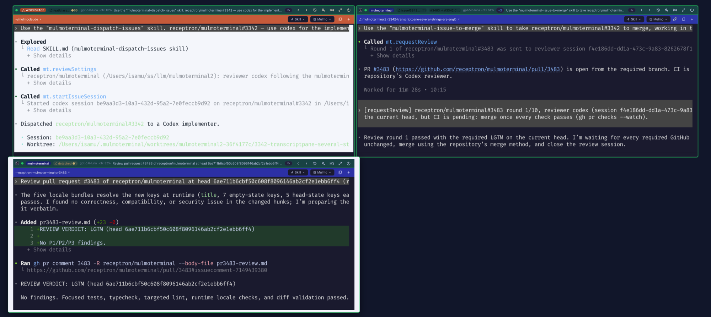

# 13.8.0 — The issue-to-merge guide, and skill evaluation you can follow

**A snapshot as of 13.8.0 (released 2026-11-25).** It will go stale as the app moves on — that is
expected, and the living reference is the guide each section links to.

Upgrade:

```bash
npx mulmoterminal@latest
```

Nothing to configure for anything below.

## New features

### One page on handing issues to agents

13.7.0 shipped the tools for taking an issue to merge — an implementer in its own worktree, a reviewer
in another session, rounds until the repository's merge condition holds. They now have their own
guide page: what to set up, the command to type for one issue or several, what you will see in each
cell, when you are needed, and what to do when it does not go as expected, with screenshots of a real
run ([#3487](https://github.com/receptron/mulmoterminal/pull/3487)).



Read it: [Hand an issue to agents and get it merged](issue-to-merge.html).

### See which skills need attention

Open **More features → Skills**. Each skill that has an evaluation shows its result next to its name:
**helps**, **makes worse**, **no difference**, **no verdict** or **not measured**. The
**Needs attention** button narrows the list to the skills worth looking at: the ones an evaluation
found not helping, the ones whose current SKILL.md has not been measured on its tasks, and the ones
conversations use that have no test tasks yet
([#3481](https://github.com/receptron/mulmoterminal/pull/3481)).

More: [Features → Automate & investigate](features.html#3-automate--investigate).

### The evaluation panel says what to do next

The **Does it help?** section now highlights the one button to press next, with a line saying why —
measure first, improve when there is no evidence the skill helps, adopt an improvement that passed
more often, or look for a cheaper model once the skill helps
([#3478](https://github.com/receptron/mulmoterminal/pull/3478)).

### Earlier results open, and read as a trend

**Earlier results** lists each run with its pass rates with and without the skill and its verdict, and
each row opens to that run's full result. A row that measured a different SKILL.md from the one on
disk now is marked **measured another SKILL.md**
([#3480](https://github.com/receptron/mulmoterminal/pull/3480),
[#3484](https://github.com/receptron/mulmoterminal/pull/3484)).

### Test tasks drafted from how you really use the skill

**Draft test tasks** now gives the drafting cell your recent conversations that used the skill. The
tasks it proposes start from requests you actually made, with names, paths and anything private
removed, and it tells you which ones came from them before you approve
([#3482](https://github.com/receptron/mulmoterminal/pull/3482)). With no such conversations it drafts
as before.

## What looks different

- An improvement is shown as its change to the SKILL.md it was written from — removed lines in place,
  unchanged stretches folded — instead of the whole new text. **Show the whole improved SKILL.md**
  still shows all of it ([#3479](https://github.com/receptron/mulmoterminal/pull/3479)).
- The Conversation pane's labels and messages appear in the app's language instead of always in
  English ([#3483](https://github.com/receptron/mulmoterminal/pull/3483)).

## Under the hood

- A codex implementer or reviewer started by MulmoTerminal keeps its network access, its permission to
  commit in its worktree and its no-prompt setting when its cell is reopened after codex has exited and
  the conversation resumes. Before, a resumed implementer could not reach GitHub or commit
  ([#3471](https://github.com/receptron/mulmoterminal/pull/3471),
  [#3474](https://github.com/receptron/mulmoterminal/pull/3474)). To tell you have it: a resumed codex
  implementer pushes and merges without asking.
- **Improve and measure** runs only the attempts with the skill; the attempts without it are taken
  from the measurement the improvement was written from, since they never read the skill. It costs
  less and takes less time ([#3476](https://github.com/receptron/mulmoterminal/pull/3476)).
- An improvement changes SKILL.md only, so what **Adopt** installs is exactly what was measured, and
  after adopting, its measurement counts as the new starting point: the next improvement needs no
  fresh **Measure** ([#3477](https://github.com/receptron/mulmoterminal/pull/3477)).
- On Windows, pinning or naming a conversation in the Library no longer leaves the next pin or name
  waiting and then failing, when two saves met at the same moment
  ([#3490](https://github.com/receptron/mulmoterminal/pull/3490)).
- Test-only fixes for specs that failed now and then on CI
  ([#3486](https://github.com/receptron/mulmoterminal/pull/3486)). Nothing to do.
