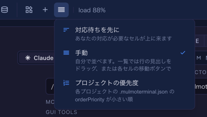

# セルの並び順
{: .no_toc }

グリッドに並ぶターミナル（セル）の順番は、3 つの並べ方から選べます。いくつものエージェントを同時に
動かすとき、「どのセルがどこにあるか」が決まっていると、目で探す手間が減ります。

1. TOC
{:toc}

## 並び順を切り替える {#switch}

ツールバーの **＋**（新しいターミナル）のすぐ右にある並び順ボタンを押すと、3 つの並べ方のメニューが開きます。
今の並べ方には印が付いています。ボタンの絵柄も、今の並べ方を表します。



| メニューの名前 | 並び方 | 向いているとき |
|---|---|---|
| **対応待ちを先に** | あなたの対応が要るセルが前に来る | 多くのエージェントを動かしていて、呼ばれたらすぐ気付きたい |
| **手動** | 自分で並べたとおり | 置き場所を自分で決めて、動かしたくない |
| **プロジェクトの優先度** | プロジェクト（ディレクトリ）ごとに付けた順位の小さい順 | いつも同じプロジェクトを同じ位置に置きたい |

最初は **手動** です。選んだ並べ方は、グリッドの配置と一緒に保存されます。

コマンドパレットからも切り替えられます。キーを割り当てることもできます（`order-auto`・`order-manual`・`order-priority`、
→ [キーボードショートカット](config.html#keymap)）。

## 対応待ちを先に {#attention}

セルの状態を見て、次の順に並べます。

1. あなたの入力や許可を待っているセル
2. 仕事を終えたセル
3. 何もしていないセル
4. 作業中のセル

まだ何も起動していない空のセルは、いちばん後ろです。

- 同じ状態のセルどうしは、**手動** で並べた順のままです。状態が変わったセルだけが動き、ほかのセルは入れ替わりません。
- グリッドは 1 ページに 9 セルまでですが、並べ替えはすべてのページをまとめて行います。3 ページ目のセルが
  あなたを呼ぶと、1 ページ目に上がってきます。
- この並べ方の間は、セルを手で動かせません（移動ボタンは出ません）。

## 手動 {#manual}

自分で並べた順のまま動きません。

- **グリッド**: 各セルのヘッダーにある **‹**・**›** のボタンで、左右に 1 つずつ動かします。
- **拡大中の一覧（ロスター）**: 行の見出しをドラッグするか、行の **⋮** メニューの移動を使います。

ほかの並べ方に切り替えても、手で並べた順は消えません。**手動** に戻すと、その順に戻ります。

## プロジェクトの優先度 {#priority}

プロジェクト（ディレクトリ）ごとに付けた順位の、**小さい順** に並べます。同じプロジェクトはいつも同じ位置に来ます。

### 順位を付ける {#set-rank}

付け方は 2 通りあり、どちらも同じ値を書きます。

**設定画面から**: **Settings**（右上の歯車）→ **ディレクトリ設定** でディレクトリを開き、
**ここで変える** の **グリッドの優先順** に数字を入れます。

**ファイルに書く**: そのディレクトリの `.mulmoterminal.json` に書きます（→ [プロジェクトごとの設定](config.html#per-dir)）。

```json
{ "orderPriority": 10 }
```

### 順位の決まり {#rules}

- **小さい数ほど前** です。負の数も使えます（`-1` は `0` より前）。
- **順位を付けていないディレクトリは、付けたものの後ろ** に並びます。1 つのプロジェクトに順位を付けても、
  ほかのプロジェクトの並びは変わりません。
- **同じ順位どうしは、手動で並べた順のまま** です。
- 順位は **ディレクトリ** に付きます。同じディレクトリで開いたセルが 2 つあれば、2 つとも同じ順位です。
- 空のセルは、ここでもいちばん後ろです。

迷ったら、10・20・30 のように間を空けて付けておくと、あとから間に入れやすくなります。

## 起動画面のチップも同じ順 {#launcher-chips}

新しいターミナルを開く画面に並ぶディレクトリのチップも、この順位で並びます。こちらは、グリッドの並べ方が
どれでも **いつも** この順位です。順位を付けていないディレクトリは、付けたものの後ろに、最後に起動した順で並びます。

チップは本来「最後に起動した順」なので、起動するたびに並びが変わります。順位を付けると、チップの位置も固定できます。

## worktree はプロジェクトのすぐ後ろ {#worktree}

プロジェクトから [worktree](worktree.html) を切ると、その worktree には **プロジェクトの順位 + 1** が付きます。
だから worktree は、末尾ではなく元のプロジェクトのすぐ後ろに並びます。プロジェクトに順位が無ければ、worktree にも付きません
（→ [worktree はこのファイルを引き継ぐ](config.html#worktree-inherit)）。

## 思ったとおりに並ばないとき {#troubleshooting}

- **順位を付けたのにグリッドが動かない**: グリッドがこの順位で並ぶのは、並び順が **プロジェクトの優先度** のときだけです。
  並び順ボタンを確かめてください。（起動画面のチップは、並べ方に関係なく順位で並びます。）
- **順位が効いているか分からない**: **Settings** → **ディレクトリ設定** でそのディレクトリを開くと、効いている値と、
  それがどのファイルから来たかが出ます（→ [設定が効かないとき](config.html#dir-settings-preview)）。
- **セルを手で動かせない**: 移動ボタンとドラッグは **手動** のときだけ使えます。
- **セルがひとりでに動く**: **対応待ちを先に** では、状態が変わるたびにセルが動きます。動かしたくなければ **手動** にします。
