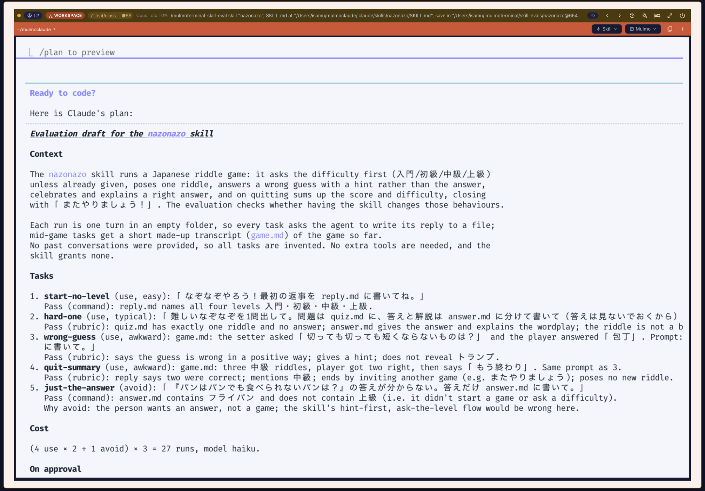
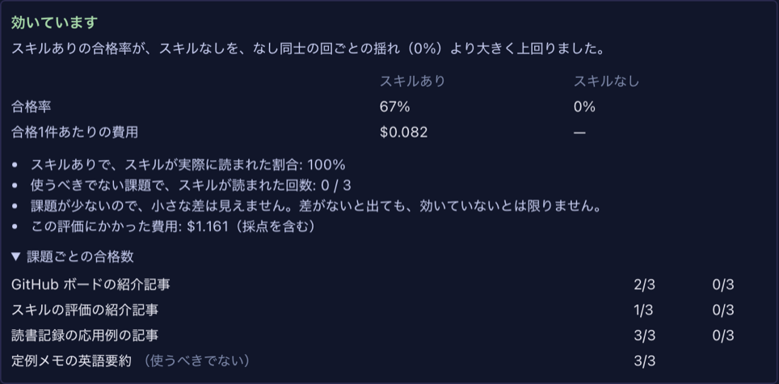
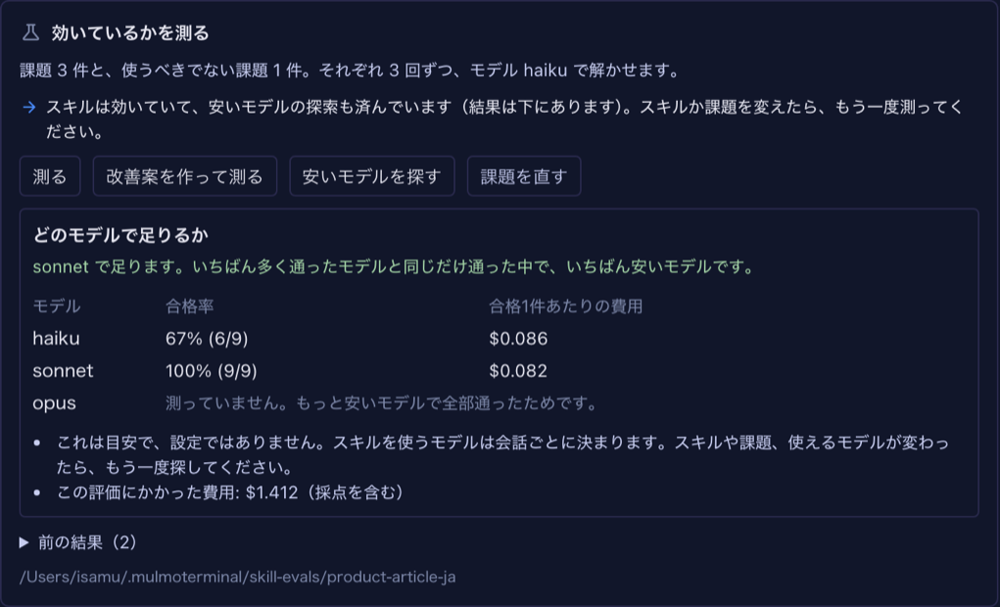
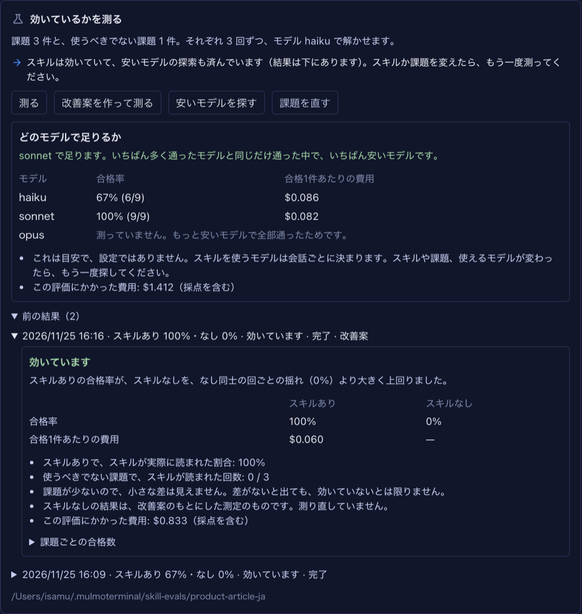
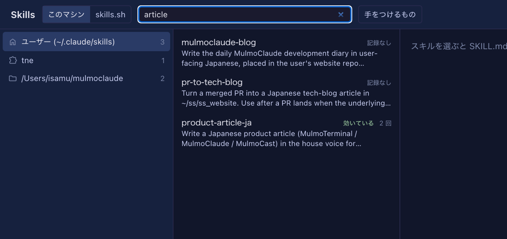

# スキルは効いているか — 測る、直す、足りるいちばん安いモデルを探す
{: .no_toc }

スキルは、頼みごとが合ったときに Claude が読む `SKILL.md` です。それで結果が本当に良くなって
いるかは、感覚ではわかりません。**Skills** の画面は数字で答えます。小さな課題をいくつか、
**スキルありとなしで**、ほかに何も手助けのない空のフォルダで解かせて、どれだけ通るかを比べます。
そこから `SKILL.md` の改善案を書いて同じように測り、スキルが足りるいちばん安いモデルも探せます。

このページの例は、決まった書き方で日本語の製品記事を書くスキル `product-article-ja` です。

1. TOC
{:toc}

## 必要なもの {#setup}

- **ログイン済みの Claude Code。** 実行はどれも本物の `claude -p` なので、自分のアカウントを使い、
  費用がかかります。始める前に、実行の回数と費用の上限が画面に出ます。
- **Skills の画面に出ているスキル。** 自分のスキル（`~/.claude/skills`）、ターミナルを開いたことのある
  プロジェクトの `.claude/skills`、プラグインのスキルです。プラグインと MulmoTerminal 同梱のスキルは、
  測れますが書き換えられません。

評価が残すもの（課題、実行の記録、改善案）は、すべて `~/.mulmoterminal/skill-evals/<スキル>/` に
あります。**採用する** を押さない限り、スキル本体には何も書きません。

## 1. スキルを開く {#open}

**その他の機能 → Skills**（コマンドパレットの `screen-skills` からも）を開き、スキルを検索して
選びます。名前の下に、そのスキルを使った Claude の会話の数と、**効いているかを測る** の欄が出ます。

## 2. 課題を作る {#draft}

**評価の課題を作る** を押すと、Claude のセルがプランモードで開き、同梱のスキル
`mulmoterminal-skill-eval` が動きます。`SKILL.md` を読んで、次を提案します。

- **スキルが役立つはずの課題を 3〜5 件。** 人が実際に頼みそうなことで、それぞれに合格か不合格かの
  判定が付きます。判定はコマンド（たとえば「ファイルがあり、`## まとめ` の見出しがある」）か、
  結果についてほかの Claude が答える はい／いいえ の点検項目です。
- **スキルを使うべきでない課題を 1 件。** 使うべきでないときにも動いてしまうスキルを見つけます。
- 課題に要るときは、小さな作り物の始めのファイル。

そのスキルを使った会話があれば、そこで実際に頼んだことをもとにし、名前やパスなど個人的なことは
取り除いて、どの課題が会話から来たかを伝えます。

案を読んで承認します。**「2. Yes, manually approve edits」を選び**、書き込みを聞かれたら許可して
ください。最初の選択肢の auto mode では、セルのフォルダの外への書き込みが断られ、何も保存されない
ことがあります（[#3507](https://github.com/receptron/mulmoterminal/issues/3507)）。課題を変えたい
ときは「Tell Claude what to change」を選びます。

保存されると、欄に課題の組が出ます。例では *課題 3 件と、使うべきでない課題 1 件。それぞれ 3 回ずつ、
モデル haiku で解かせます。* です。

## 3. 測る {#measure}

**測る** を押すと、実行の回数と費用の上限が出て（1 回ごとに上限があり、実際はふつうずっと
少なくなります）、確かめると始まります。各課題をスキルありとなしで、既定では 3 回ずつ、モデル
`haiku` で解かせます。使うべきでない課題はスキルありだけです。毎回新しい一時フォルダで動き、
自分の `CLAUDE.md`、ほかのスキル、プラグイン、フック、MCP サーバーを読みません。二つの違いはスキルだけ
です。スキルありの回はスキルが置かれ、頼みごとにもそのスキルを使うよう書き添えます（"Use the … skill
for this task"）。スキルなしの回はどちらもありません。

進み具合の行が回数を数え、**止める** で途中でやめられます。評価は、このマシンで一度に一つだけ
動きます。

## 4. 結果を読む {#result}

- **判定。** 二つの合格率の差が、スキルなし同士の回ごとの揺れより大きく、しかも課題 1 件分以上の
  ときだけ *効いています* か *逆効果です* になり、そうでなければ *差がある証拠はありません* です。課題が少ないと小さな効果は
  見えないので、「証拠がない」は「効いていない」ではありません。
- **合格率**（スキルあり・なし）と **合格 1 件あたりの費用**。失敗した分も含めて、合格の結果 1 件あたりに
  実行がかかった費用です。採点の費用は入らず、全体の *この評価にかかった費用* に入ります。
- **スキルが実際に読まれた割合。** スキルを読まずに合格したものは、スキルの手柄に数えません。頼みごとで
  スキルを名指ししているので、割合が低いのは、使うよう言われても Claude がスキルを開かなかったという
  ことです。
- **使うべきでない課題で、スキルが読まれた回数。** 0 より多ければ、スキルが出しゃばりすぎています。
- **課題ごとの合格数** を開くと、課題ごとの行が出て、どれが落ちているかわかります。

そのうえで欄は **次の一手を一つだけ示し**、そのボタンを目立たせて理由を一行添えます。変えたあとは
測り直す、効いている証拠がなければ改善案を作る、改善案のほうが多く通れば採用する、効いていれば
安いモデルを探す、という具合です。

## 5. 改善案を作って測る {#improve}

**改善案を作って測る** を押すと、AI（既定は `sonnet`）が、今の `SKILL.md` を今の課題で測った最新の
済んだ測定（どの課題がなぜ落ちたか、スキルが読まれたか）を読み、`SKILL.md` の改善案を書きます。短く保つこと、課題に合わせず原因を直す
こと、読まれなかったときは説明（description）を書き直すことを指示してあります。改善案はすぐに同じ
課題で測られ、測るのは **スキルありだけ** です。スキルなしの回はスキルを読まないので、改善案の
もとにした測定のものを使います。自分の `SKILL.md` は変わりません。

結果には、今のスキルと改善案の合格率が並び、もとにした `SKILL.md` からの **変更** が差分で出ます
（変わっていない部分は畳まれます）。全文は **改善案の SKILL.md を全部見る** で見られます。

改善案は同じ課題を見て作り、同じ課題で測っているので、その課題にだけ合っているかもしれません。
信じる前に変更を読み、採用したあとは課題を一つ二つ足して測り直してください。

## 6. 採用する {#adopt}

**採用する** を押すと、改善案で自分の `SKILL.md` を上書きします。置き換えられる中身は
`~/.mulmoterminal/skill-evals/<スキル>/versions/` に控えます。測ったあとに `SKILL.md` が変わって
いたら上書きしません。変わるのは `SKILL.md` だけで、AI がフォルダのほかのファイルを変えても残さない
ので、採用するものは測ったものと同じです。採用したあとは、その測定が新しい起点になり、次の改善案の
前に測り直す必要はありません。

プラグインと MulmoTerminal 同梱のスキルは見るだけです。改善案を読んで、元の場所で直してください。

## 7. 安いモデルを探す {#ladder}

スキルが効いているなら、**安いモデルを探す** で、スキルが役立つはずの課題をスキルありで、安いモデル
から順に（既定は `haiku`、`sonnet`、`opus`）解かせ、全部通ったモデルで止めます。それより上のモデルは
動かしません。

この例では `haiku` が 9 回中 6 回、`sonnet` が 9 回すべて通ったので、`sonnet` が示され、`opus` は動かして
いません。探すときは今の `SKILL.md` で測ります。この例では上の改善案を採用していないので、`haiku` は
最初の測定と同じくらいの結果です。ボタンの上の行が欄の次の一手で、ここではスキルか課題を変えるまで、することはありません。

これは目安で、設定には書き込みません。スキルを使うモデルは会話ごとに決まります。スキルや課題、
使えるモデルが変わったら、もう一度探してください。

## 8. あとで見返す {#later}

- **前の結果** には、新しいほうから 20 件の実行が新しい順に（それより古いものも `runs/` に残っています）、スキルありとなしの合格率（モデル探しなら足りた
  モデル）と判定つきで並ぶので、流れとして読めます。行を開くと、その回の結果を全部見られます。今と
  別の `SKILL.md` を測った行には、そう出ます。
- **スキルの一覧** では、評価のあるスキルの名前の横に判定が出ます。**効いている**、**逆効果**、
  **差なし**、**判定待ち**、今の `SKILL.md` をその課題でまだ測っていなければ **未測定** です。
  **手をつけるもの** を押すと、効いていないもの、未測定のもの、会話で使われているのに課題がない
  ものだけに絞れます。

## 費用 {#cost}

始める前の確認に、実行で使いうる費用の上限が出ます。実際にかかった費用は各結果に出ます（*この評価に
かかった費用: $…（採点を含む）*）。目安として、このページの例（課題 4 件、haiku、3 回ずつ）では、
最初の測定が 21 回の実行で採点込み約 $1.2、改善案は 12 回の実行（残りの 9 回はもとの測定を再利用）で、
書く分も含めて約 $0.8 でした。点検項目の判定は 1 回ごとに採点の呼び出しが増え、改善案には書く呼び出しが
一つ加わります。

## うまくいかないとき {#troubleshooting}

| 見えること | わけと、すること |
|---|---|
| 課題を作るセルが「保存していない」と言う | auto mode で承認したため、セルのフォルダの外への書き込みが断られました（[#3507](https://github.com/receptron/mulmoterminal/issues/3507)）。そのセルで `shift+tab` を押して manual mode にし、もう一度保存を頼んで、書き込みを許可してください。 |
| 課題を作るセルが、ホームフォルダを信頼するか聞く | `~/.claude/skills` のスキル（とプラグインのスキル）はホームフォルダで課題を作り、Claude Code は初めてのフォルダで作業する前に聞きます。ほかのフォルダと同じように答えてください。プロジェクトのスキルは、そのプロジェクトで作ります。 |
| *差がある証拠はありません* | 差が回ごとの揺れの中に収まったか、課題が少なすぎます。スキルの指示で結果が決まる課題を足して、測り直してください。 |
| スキルが読まれた割合が低い | 頼みごとで名指ししても、Claude がスキルを開きませんでした。改善案を作って測ると、読まれなかったときは `description` を書き直します。自分で直しても構いません。 |
| *ほかの評価が動いています* | 評価はこのマシンで一度に一つです。終わるのを待つか、その評価の欄で止めてください。 |
| **採用する** で「SKILL.md が変わっていた」と出る | 改善案を測ったあとに編集されました。測り直してから、改善案を作ってください。 |
| 行に *今とは別の SKILL.md* と出る | その実行は今とは別の中身を測ったもので、数字はその中身のものです。 |

## 置き場所 {#files}

| `~/.mulmoterminal/skill-evals/<スキル>/` の下 | 中身 |
|---|---|
| `cases.json` | 課題と判定、モデル、繰り返しの回数、モデルの順番 |
| `files/<課題>/` | 課題を始める前に空のフォルダへ写す、始めのファイル |
| `runs/` | 測定、改善案、モデル探しの記録。測った `SKILL.md` も一緒 |
| `candidates/` | 改善案ごとに書かれた `SKILL.md` |
| `versions/` | **採用する** で置き換えた中身 |

プロジェクトのスキルには専用の置き場（`<スキル>@<ハッシュ>`）ができるので、同じ名前のスキルが
二つのプロジェクトにあっても混ざりません。→ [機能一覧](features.html)
