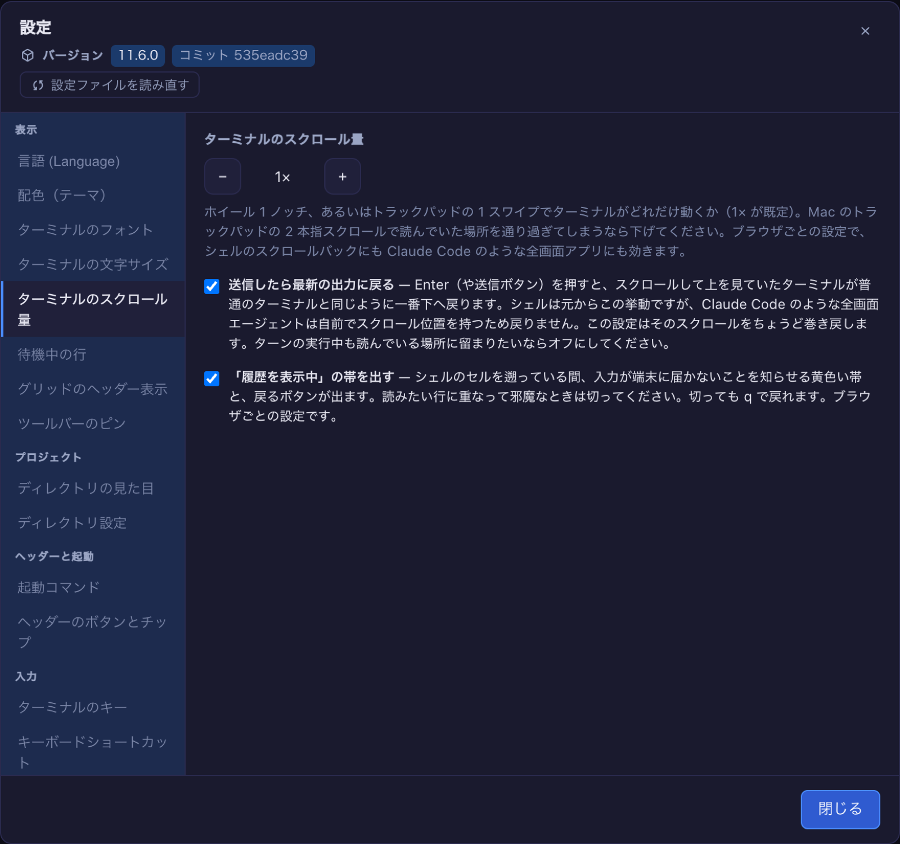

# 11.6.0 — ペインが積み重なり、会話に付けた名前が残る

**11.6.0 時点（2026-11-02 リリース）のスナップショットです。** アプリが変わるにつれて古くなります。
それは想定どおりで、最新の説明は各節からリンクしているガイドにあります。

## 新機能

### ターミナルの横のペインが積み重なる

ターミナルの横に出せるペインは一度に一つです。Files、会話、道具、履歴、Canvas。これまでは別のペインを
開くと前のペインが置き換えられていたので、Files を開いたまま会話を開き、会話を閉じると何も残らず、
Files も一緒に消えていました。いまは開いたペインが**積み重なり**、画面に出ているペインを閉じると、
その下にあったペインに戻ります（[#3217](https://github.com/receptron/mulmoterminal/pull/3217)）。

試してみる：セルのヘッダーから **Files** を開いてフォルダを一つ展開し、次に**会話**を開きます。会話を
閉じてください。Files がターミナルの横に戻り、フォルダは展開されたままです。すでに積んであるペインを
もう一度開くと一番上に移るので、同じペインが二つ積まれることはありません。積みはページを再読み込みしても
残ります。質問ペインは積みに入りません。Claude が何か尋ねると、その間だけ一番上のペインの上に出て、
答えると元のペインに戻ります。設定は要りません。詳しくは：[機能一覧](features.html)の「右ペインの積み重ね」。

### 会話に付けた名前が残る

Claude のセルで、ほかの Claude Code と同じように `/rename` に続けて名前を打ちます。その名前が
MulmoTerminal でもその会話の名前になりました。セルのヘッダー、拡大表示の一覧の行、起動画面の
**or resume here** の一覧、コマンドパレットの再開の項目と「直前に閉じた」項目のすべてです
（[#3226](https://github.com/receptron/mulmoterminal/pull/3226)、
[#3231](https://github.com/receptron/mulmoterminal/pull/3231)）。これまでそこには Claude が付けた題名か
最後のプロンプトが出ていて、付けた名前が見えるのは MulmoTerminal の外の `claude -r` だけでした。

自分で書いた**セッションメモ**（ヘッダーの文字の横の鉛筆）はいまでもその上に来て、押しのけた名前は
ツールチップに移ります。もう一度 `/rename` すれば置き換わり、名前なしで `/rename` すれば消え、`/clear`
した後の会話は名前なしで始まります。一つだけ知っておくこと：ヘッダーが名前を読むのは、セルを開いたとき、
つなぎ直したとき、ターンが終わったときです。セルを開いたまま打った名前は、打った瞬間ではなくその次の
機会に出ます。詳しくは：[機能一覧](features.html)の「会話の名前」。

### 長い再開一覧を絞り込む

起動画面の作業ディレクトリの欄の下にある **or resume here** の一覧は、長く使ったフォルダでは何十件にも
なります。6 件以上あるとき、その上に**題名で絞り込む**欄が出るようになりました
（[#3232](https://github.com/receptron/mulmoterminal/pull/3232)）。語をいくつか打つと、打った語が
すべて題名に入っている会話だけが残ります。順序は問わず、大文字小文字も区別しません。一つも残らないときは
一行でそう出ます。ディレクトリやエージェントを変えると下の一覧は別のものになるので欄は空になり、
セッションを止めて同じ一覧が読み直されたときはそのまま残ります。上の `/rename` の名前と合わせて、
一覧を自分の言葉で探せます。

### 「履歴を表示中」の帯を消す

シェルや Codex のセルで上に遡ると、セルは tmux の copy-mode に入ります。キーは履歴の移動に使われて
プログラムに届かず、黄色い**履歴を表示中**の帯が**入力に戻る**ボタンと一緒にそう知らせます。帯が読みたい
行に重なるときは、設定を開いて**ターミナルのスクロール量**を探し、**「履歴を表示中」の帯を出す**の
チェックを外してください（[#3223](https://github.com/receptron/mulmoterminal/pull/3223)）。
このブラウザではそれ以降帯が出ません。`q` で入力に戻れるのは変わりません。隣のスクロール量と同じく
ブラウザごとの設定で、チェックを付けたままなら何も変わりません。詳しくは：[機能一覧](features.html)の
「履歴表示から戻る」。

## 画面の変化

- **ファイル画面の再読み込みが、開いたことのあるフォルダをすべて読み直します**
  （[#3228](https://github.com/receptron/mulmoterminal/pull/3228)）。Files の上にある再読み込みのボタンは
  一番上のフォルダしか読み直していなかったので、展開したフォルダの中にエージェント（やターミナルの自分）が
  足したファイルがいつまでも出ず、フォルダを畳んで開き直しても同じでした。いまは一度読んだフォルダを、
  開いているかどうかによらずすべて読み直します。確かめ方：フォルダを展開し、ターミナルからその中に
  ファイルを作り、**ツリーを読み直す**を押すと、そのファイルが出ています。
- **PDF の書き出しで mermaid の図が描かれます**
  （[#3216](https://github.com/receptron/mulmoterminal/pull/3216)）。`mermaid` のコードブロックを含む
  Markdown は、Canvas では図になるのに PDF に書き出すとコードブロックのままでした。PDF でも Canvas と
  同じように図が出ます。mermaid が読めないブロックは、Canvas と同じくエラーの行の下にコードブロックとして
  残ります。数式はこの変更の範囲ではありません。

## 見えない変化

### ペインまわりのタイミングの問題を三つ、積み重ねと一緒に直しました

三つともこの版の前からあったもので、積み重ねで見えやすくなっただけです。することはありません。

- 拡大するセルを続けざまに二度動かしたり、動かしてすぐ戻したりすると、もう拡大していないセルにペインが
  残ることがありました。ペインの保存が終わる前に押したペインのボタンが、古い押下に取り消されることも
  ありました。いまは一番新しい操作だけが効きます
  （[#3221](https://github.com/receptron/mulmoterminal/pull/3221)）。
- あるセルで全幅にした会話があると、拡大するセルを隣に移したとき、そのセルの道具のペインがターミナルを
  覆っていました。拡大するセルを移して、あるいは再読み込みで出てきたペインは、ターミナルの横に出ます。
  全幅は、そのセルで頼んだときだけです（[#3224](https://github.com/receptron/mulmoterminal/pull/3224)）。
- 同じ瞬間に押したペインのボタンが処理されている間に Files を閉じると、Files がそのペインの下に残る
  ことがありました。どちらが先に終わっても両方が効きます
  （[#3227](https://github.com/receptron/mulmoterminal/pull/3227)）。

### 気づくことのない変化

- 起動画面のチップとリモートのボットのジョブが、エージェントと同じ経路でターミナルにつながるように
  なりました。コードの走査が見つけた重複を一つにしたもので、古いコードと新しいコードを並べて動かし、
  変わらないことを確かめています（[#3210](https://github.com/receptron/mulmoterminal/pull/3210)）。
- 入力を自分で生成するテストが、計算が退化しない乱数の生成器を一つ共有するようになりました。数えていた
  件数よりずっと少ない場合しか確かめていなかったテストがありました
  （[#3222](https://github.com/receptron/mulmoterminal/pull/3222)）。
- 11.5.0 のセットアップガイドにスクリーンショットが付きました
  （[#3208](https://github.com/receptron/mulmoterminal/pull/3208)）。
