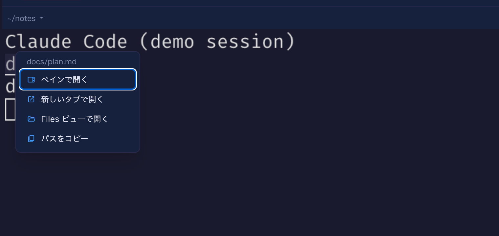
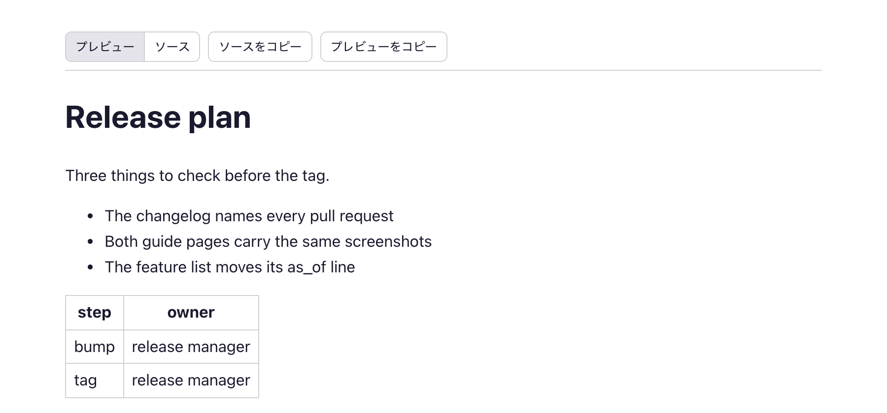
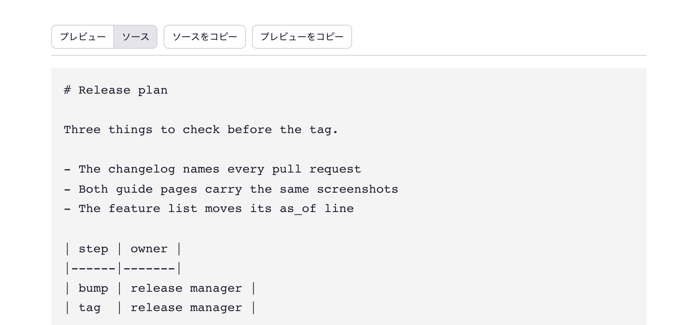
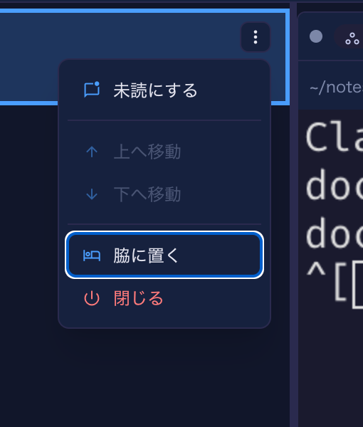

# 11.7.0 — パスを右クリックして開き方を選び、タブでソースも見られる

**11.7.0 時点（2026-11-03 リリース）のスナップショットです。** アプリが変わるにつれて古くなります。
それは想定どおりで、最新の説明は各節からリンクしているガイドにあります。

## 新機能

### ファイルパスを右クリックして開き方を選ぶ

エージェントがターミナルに書き出したファイルパスは以前からリンクで、クリックすると行き先は自動で決まって
いました。横にペインが開いていればペイン、そうでなければ拡張子に応じてタブか Files ビューです。
これからはパスを**右クリック**すると、その場に小さなメニューが出ます
（[#3256](https://github.com/receptron/mulmoterminal/pull/3256)）。

- **ペインで開く** — ふつうのクリックと同じ。
- **新しいタブで開く** — Markdown・JSON・CSV/TSV は描画した文書、ソースコードは単独のタブに開いた
  Files ビュー、セルの外にある画像や PDF はそのファイル一つ用のリンク。
- **Files ビューで開く** — このタブの全画面の Files ビュー。
- **パスをコピー** — プロンプトや issue に貼れる絶対パス。相対パスはセルのディレクトリに対して解決し、
  `.` や `..` も畳みます。Windows のセルでは `\` 区切りになります。コピーできたかどうかは、ポインタの下に
  短い通知が出ます。

試してみる：エージェントにパスを出させるか、シェルのセルで自分でパスを打ち、それを右クリックします。
メニューに焦点が移るので、矢印キーで項目を移り、Enter で選び、Esc で閉じるとキーボードはターミナルに
戻ります。リンクの外での右クリックはこれまでどおりブラウザのメニューで、Cmd/Ctrl+クリックで Files の
新しいタブが開くのも変わりません。一つだけ意図して変えたことがあります。右クリックでも、ブラウザの
メニューの下でファイルが開いてしまっていました（ターミナルがどのボタンでもリンクを発火させていたため）。
これは起きなくなりました。詳しくは：[機能一覧](features.html)の「ファイルパスのリンク化」。

### 単独のタブで開いた文書にツールバーが付く

Markdown・JSON・CSV/TSV のファイルを**単独のタブ**で開くと（上のメニューから、または Cmd/Ctrl+クリックで）、
タブの先頭にツールバーが出るようになりました（[#3252](https://github.com/receptron/mulmoterminal/pull/3252)）。
**プレビュー**と**ソース**で描画とファイルそのものを切り替え、**ソースをコピー**はファイルの文字列を
そのまま（最後の改行まで）クリップボードに載せ、**プレビューをコピー**は描画を文字と HTML の両方で
一度に載せるので、リッチエディタに貼れば見出しや表が残り、普通の欄に貼れば文字だけが入ります。
うまくいくと「コピーしました」が少しの間出ます。ターミナルの横のプレビューは変わりません。ペインには
エディタとコピーのボタンがもともとあります。

Markdown ファイルは生の HTML やスタイルシートを含められます。最初の版にあった二つの穴は、この版が出る前に
直しました（[#3259](https://github.com/receptron/mulmoterminal/pull/3259)）。ファイルのスタイルシートが
ブラウザの `hidden` の規則を上書きすると両方の表示が画面に残ることがあったのと、ソース表示中に
**プレビューをコピー**すると描画が隠れた状態のままコピーされ、貼り付け先によっては中身が落ちていた
ことです。どちらも直っていて、することはありません。詳しくは：[機能一覧](features.html)の
「ファイルパスのリンク化」。

### 他の Claude Code セッションがこのセルを呼ぶ名前

同じマシンの Claude Code セッション同士はメッセージを送り合えて、そのための名前（`myrepo-66` のような）を
それぞれ持っています。これまでその名前は、別のセッションの中からしか見えませんでした。Claude のセルの
ヘッダーにその名前が小さな印として出るようになり、押すと名前がクリップボードに載るので、別のセッションの
プロンプトにそのまま貼れます（[#3241](https://github.com/receptron/mulmoterminal/pull/3241)）。
設定は要りません。印は Claude Code が自分の実行中プロセスについて記録しているものを読むだけで、
セッションが立ち上がれば出ます。数えるのはセルのターミナルで始めたセッションだけで、セルの中から
プログラム（たとえばプラグイン）が動かした `claude` は印を奪いません
（[#3245](https://github.com/receptron/mulmoterminal/pull/3245)）。ここにスクリーンショットはありません。
印が意味を持つには本物の Claude Code セッションがもう一つ要るためです。詳しくは：
[設定](config.html#header)の「ヘッダーのカスタマイズ」。`peer` の印はそこで並べ替えたり消したりできます。

### Windows：`\` 区切りやドライブ付きのパスもリンクになる

ディレクトリが Windows のパスのセルでは、ツールが出す `.claude\evidence\test.md` や
`C:\work\app\src\a.ts` も、ほかのパスと同じようにクリックできるようになりました
（[#3243](https://github.com/receptron/mulmoterminal/pull/3243)）。`\` が区切りとして読まれ、ドライブ文字は
パスの一部に残り、`\\server\share` のようなネットワークのパスは触りません。クリックの行き先は同じパスの
`/` 形と同じで、上の右クリックメニューも使えます。設定は要りません。macOS や Linux では、`\` は
これまでどおりファイル名の一文字です。

## 画面の変化

- **空白を含むパスが、囲まれていれば丸ごとリンクになります**。引用符・バッククォート・括弧で囲まれた
  `Read(/Users/me/My Docs/a.md)` のような形です
  （[#3247](https://github.com/receptron/mulmoterminal/pull/3247)）。これまでは空白の後ろだけに下線が付き、
  クリックすると違うファイルが開いていました。何にも囲まれていない空白入りのパスは、いまも空白で
  切れます。
- **Files がリンクされたフォルダをフォルダとして並べます**
  （[#3240](https://github.com/receptron/mulmoterminal/pull/3240)）。フォルダを指すシンボリックリンク
  （Windows ではジャンクション）がファイルとして出て開けませんでしたが、ほかのフォルダと同じように
  開けます。指す先が無くなったリンクは大きさ 0 のファイルのままです。
- **一覧の行メニューがキーボードで操作できます**
  （[#3260](https://github.com/receptron/mulmoterminal/pull/3260)）。セルを拡大し、横の一覧の行にある ⋮ を
  押すと最初の項目に焦点があり、矢印キーで項目を移って端で折り返し、Home / End で端へ飛び、その行が
  動けない方向は飛ばされ、Tab か Esc で閉じると焦点は ⋮ に戻ります。これまでこのメニューではキーが
  効きませんでした。

## 見えない変化

### Windows：どの止め方でもサーバーが状態を保存してから終わる

することはなく、気づくとすれば「消えなくなった」ことでです。Windows では、Ctrl+C、`mulmoterminal stop`、
ブラウザの停止ボタン、`yarn dev` の停止のどれでも、サーバーが溜めていたセッションの状態をディスクに
書く前にプロセスが終わっていて、セッションのメモや名前の最後の変更が失われることがありました
（[#3251](https://github.com/receptron/mulmoterminal/pull/3251)）。いまはどの止め方でも先にサーバー自身の
終了処理が走ります。ソースから動かしている人向けに、Windows の `yarn dev` も Ctrl+C でバックエンドを
強制終了しなくなりました（[#3255](https://github.com/receptron/mulmoterminal/pull/3255)）。

### Volta：セルの `yarn` と `node` がプロジェクトの版を使う

Volta の下で MulmoTerminal を起動すると、セルの `yarn` が `Volta error: Node is not available.` で失敗
したり、`node` や `npm` がプロジェクトで固定した版を無視したりすることがありました
（[#3239](https://github.com/receptron/mulmoterminal/pull/3239)、
[#3242](https://github.com/receptron/mulmoterminal/pull/3242)）。Volta が自分の起動のために置く印と
PATH の項目がセルに漏れていたもので、どちらも入らなくなりました。することはありません。

### 気づくことのない変化

- psmux がセルの環境から取り除く名前の一覧が残っていましたが、共通の規則が同じ名前を扱うので
  消しました（[#3249](https://github.com/receptron/mulmoterminal/pull/3249)）。
