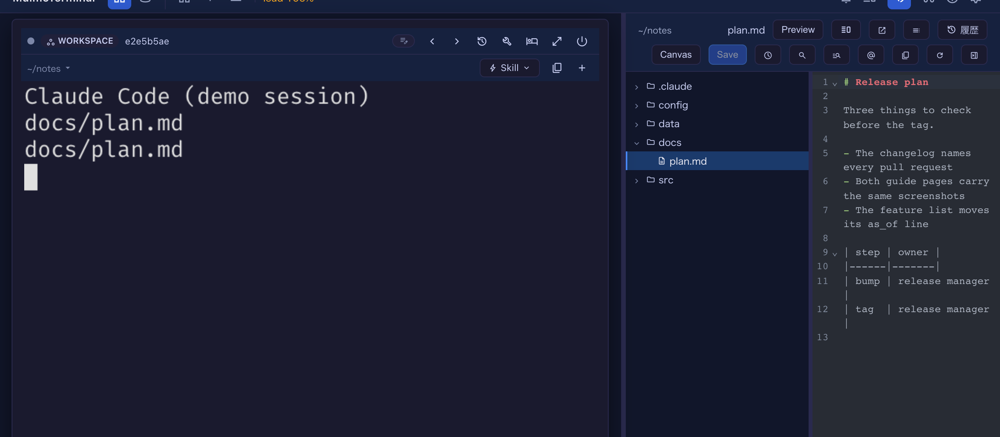
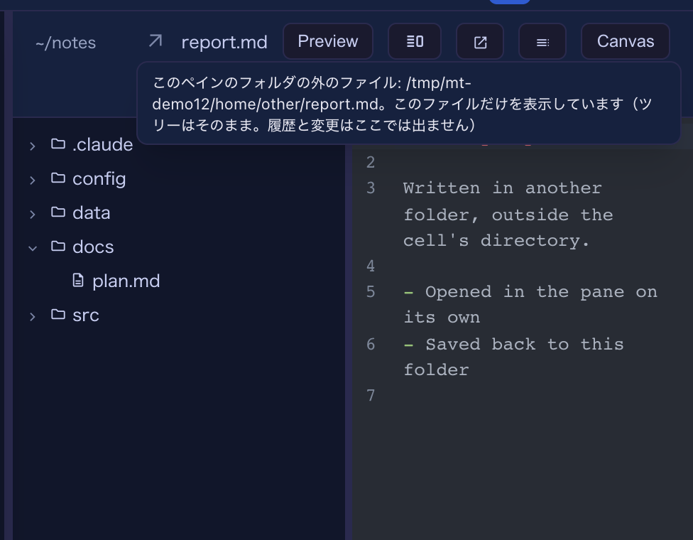
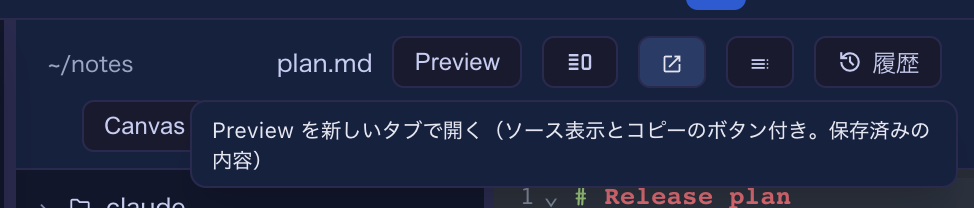

# 12.0.0 — クリックしたパスがセルの横のペインに開く。セルの外のファイルも

**12.0.0 時点（2026-11-03 リリース）のスナップショットです。** アプリが変わるにつれて古くなります。
それは想定どおりで、最新の説明は各節からリンクしているガイドにあります。

この版で、11.7.0 から始めたこと（#3238）が一通り入りました。エージェントが書き出したファイルは、ペインが
表示できる限り**書き出したターミナルの横**に開き、タブはペインが扱えないファイルと、自分でタブを選んだとき
のためのものになります。主版が上がるのは、タイル表示でのふつうのクリックの行き先が変わるためです。

## 新機能

### クリックしたパスが、タイル表示でもそのセルの横の Files ペインに開く

これまで、ターミナルに出たファイルパスをクリックしてターミナルの横に開くのは、そのセルを拡大している間
（またはタイルの横に既にペインが出ている間）だけでした。ふつうのタイル表示ではブラウザの新しいタブか
全画面の Files ビューに飛んでいました。これからは、**パスを書き出したタイルの横に Files ペインが開き**
（[#3263](https://github.com/receptron/mulmoterminal/pull/3263)）、そこにファイルが出ます。セルメニューの
**Files** で開いたときと同じ動きです。ペインが別のタイルの横に出ていれば、編集中の内容を保存してから
クリックしたタイルの横に移ります。



試してみる：何も拡大していない状態で、エージェントにパスを出させるか、シェルのセルで `docs/plan.md` と
打って、それをクリックします。そのセルの横にペインが現れ、キーボードはターミナルに残ります。セルを
拡大しているときの動きは変わらず、11.7.0 の右クリックメニューからはほかの開き方も選べます。

クリック一つでグリッドの配置が変わるのが望みでなければ、切れます。**Settings → Terminal keys →
「クリックしたパスをペインに開く」**で、すぐに反映されます。切ると、タイル表示でのクリックは以前の
行き先に戻ります。Markdown・JSON・表・画像はブラウザの新しいタブ、ソースは Files ビューです。ただし、
そのタイルの横に既にペインが開いていれば、これまでどおりそのペインが受け取ります。`config.json` の
キーは `fileLinkOpensPane` で、`false` が OFF です。

```json
{ "fileLinkOpensPane": false }
```


詳しくは：[設定](config.html#file-link-opens-pane)と[機能一覧](features.html)の「ファイルパスの
リンク化」。

### セルの外のファイルが、ペインにそのファイルだけで開く

パスはセルのディレクトリの外を指すことがあります。`../other/report.md`、絶対パス、`~/…` などです。
そういう Markdown・JSON・表・ソースのファイルは、これまでファイル自身のフォルダを基点にタブや全画面の
ビューに開いていました。これからは **Files ペインに、そのファイルだけが**開きます
（[#3264](https://github.com/receptron/mulmoterminal/pull/3264)）。ツリーはセルのディレクトリのままで、
そのファイルの行はツリーにありません。名前の前の**矢印の印**が外のファイルであることを示し、印に
ポインタを載せると絶対パスが出ます。読む、Preview に切り替える、編集する、保存する、のどれもできて、
保存はファイル自身のフォルダに書かれます。守りはほかのファイルと同じで、その間にディスク側で誰かが
ファイルを変えていれば保存は拒まれ、ペインがそう伝えます。



試してみる：シェルのセルで、セルのフォルダの外にある Markdown ファイルのパスを出し、クリックします。
クリックがペインに届く状態であることが前提です。セルを拡大中なら常に、タイル表示では「クリックした
パスをペインに開く」が ON（既定）のときです。切っていると、そうしたクリックは、既にそのタイルの横に
ペインがあるときを除き、これまでどおり新しいタブに行きます。
こうしたファイルには履歴と変更は出ません（どちらもセルのフォルダのものです）。フォルダの「最近開いた
ファイル」にも並ばず、Preview の中のリンクは開きません。セルの外の HTML ページ・画像・PDF・動画は、
これまでどおりそのファイル一つ用のリンクで新しいタブに開きます。詳しくは：[機能一覧](features.html)の
「ファイルパスのリンク化」。

### ペインのヘッダから Preview を単独のタブで開く

ペインで Markdown・JSON・CSV/TSV を開いているとき、ヘッダの **Edit / Preview** の切り替えの隣に
ボタンが一つ増えました。「新しいタブで開く」の矢印です
（[#3262](https://github.com/receptron/mulmoterminal/pull/3262)）。押すと、そのファイルの Preview が
ブラウザの新しいタブに開きます。パスをクリックしてタブに開いたときと同じ文書で、11.7.0 のツールバー
（ソースへの切り替えと、それぞれのコピー）が付いています。タブに出るのは保存済みの内容なので、編集を
見るには先に保存してください。



試してみる：ペインで Markdown ファイルを開き、矢印のボタンを押します。このボタンは、そうした文書を持つ
ファイルにだけ出ます。HTML ページや SVG はタブではファイルそのものが表示されるので、ボタンはありません。
詳しくは：[機能一覧](features.html)の「ファイルの本文をまるごとコピー」と「Preview を別のタブで」。

## 画面の変化

- **タイル表示でのふつうのクリックでグリッドの配置が変わります**。クリックしたセルの横にペインが開くか、
  そこへ移ります。主版が上がった理由はこれで、上の設定で切れます
  （[#3263](https://github.com/receptron/mulmoterminal/pull/3263)）。
- **セルの外のファイルには印が付きます**。ペインのヘッダの名前の前の矢印で、ツリーは追従しません
  （[#3264](https://github.com/receptron/mulmoterminal/pull/3264)）。
- **ペインのヘッダにボタンが一つ増えました**。Markdown・JSON・表のファイルのときです
  （[#3262](https://github.com/receptron/mulmoterminal/pull/3262)）。

## 見えない変化

### 消えたフォルダは拒まれ、ワークスペースで置き換えられない

することはありません。単独で開いたファイルは、自身のフォルダを基点に読まれ、変更を見回られます。その
フォルダが消えたとき、サーバーは「そのディレクトリはもうありません」と答えるようになりました。以前は、
既定のワークスペースにある同名のファイルを黙って代わりに読むことがありました
（[#3264](https://github.com/receptron/mulmoterminal/pull/3264)）。絶対パスで名指しされたフォルダが無い
要求はどれも同じで、右ペインと全画面の Files ビューも含みます。フォルダを名指ししない、または相対で
名指しする要求は、これまでどおりワークスペースに後退します。

### 根の下のファイルを絶対パスで出しても、根の下のファイルのまま

ツールがセルのディレクトリの下のファイルを `/Users/me/proj/src/a.ts` のような絶対パスで出したとき、
`src/a.ts` と出したときと同じに開くようになりました。ペインなら履歴と変更付きで、Files ビューでも、
タブでも同じです（[#3264](https://github.com/receptron/mulmoterminal/pull/3264)）。相対で出された
パスは出されたとおりに開くので、macOS や Linux のファイル名の中の `\` はこれまでどおり名前の一部です。
