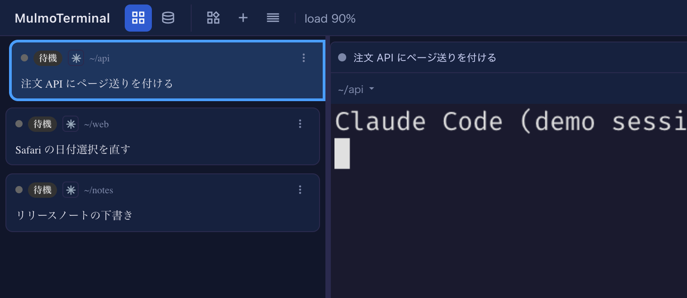
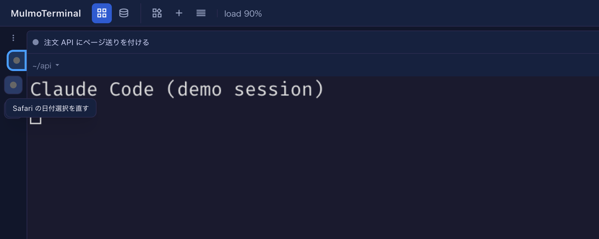

# 12.1.0 — ロスターを短く・畳めるように、異常終了したセルは残る

**12.1.0 時点（2026-11-05 リリース）のスナップショットです。** アプリが変わるにつれて古くなります。
それは想定どおりで、最新の説明は各節からリンクしているガイドにあります。

```bash
npx mulmoterminal@latest
```

変更のうち 2 つは **ロスター**（ターミナルを拡大したとき横に並ぶ、全セッションの一覧）の話です。
短くするか、畳んでどけるかを選べるようになりました。残りの 2 つは、エージェントが終わったセルの話です。

## 新機能

### コンパクト表示：見出しとセッション名だけ

ロスターの各行は、見出し（状態・ディレクトリ・エージェント）の下に、メモ・いま何をしているか・
直近のプロンプト・エージェントの返答と最大 4 段が続きます。どのセッションかを見分けて、待っている
ものを探すためだけにロスターを見るなら、この 4 段が場所を取ります。
（[#3273](https://github.com/receptron/mulmoterminal/pull/3273)）

試し方: **Settings → Waiting rows** を開き、**コンパクト表示（見出しとセッション名だけ）** に
チェックを入れます。各行が見出しと **セッション名の 1 行** だけになります。名前は、書いていれば
メモ、なければセッションの題名（`/rename` で付けた名前、次に AI が付けた題名）、それもなければ直近の
プロンプトで、セル自身の見出しと同じものです。切れているときはマウスを乗せると全文が出ます。



オンのあいだ、同じページの行数のステッパーは灰色になります。短くする段が残っていないためで、オフに
戻すと元どおり使えます。設定は `config.json` に `"cockpitCompact": true` として保存されるので、
どのブラウザでも同じロスターになります。
詳しく: [コンパクト表示](config.html#cockpit-compact)

### ロスターを、状態の点が並ぶ細い帯に畳む

ターミナルの幅がほしいときは、どの行の **⋮** メニュー（行の右クリックでも開きます）でも、新しく
一番上に入った **ロスターを畳む** を選びます。
（[#3275](https://github.com/receptron/mulmoterminal/pull/3275)、[#3279](https://github.com/receptron/mulmoterminal/pull/3279)）

ロスターは、**セッションごとに点が 1 つ** 縦に並ぶ細い帯になります。並び順もリングも行と同じで、
琥珀は入力待ち、緑は完了です。帯の上では:

- 点に **マウスを乗せる** と、セッション名が出ます
- 点を **クリック** すると、そのセッションを拡大します
- 点を **右クリック** すると、その行のメニュー（⋮ で開いたのと同じもの）が開きます



戻すときは **ロスターを開く** を選びます。どの点のメニューでも一番上にあり、帯の上端に 1 つだけある
**⋮** のメニューにもあります。畳んだかどうかは、ロスターの幅と同じくこのブラウザが覚えていて、
別のブラウザはそれぞれの状態を持ちます。詳しく: [基本編](basics.html) の「1 体に寄る」にある
「ロスターを畳む」

## 画面の変化

### エージェントが異常終了したセルは、終了コードを出して残る

10.5.0 から、エージェントが終わったセルは自分で閉じて **Reopen** に並ぶようになっていました。
これは自分で終えた（`/exit`）ときのためでしたが、**異常終了** でも同じように閉じてしまい、何かが
おかしかったことに気づけませんでした。いまは、エージェントがエラーで終わったセルは閉じずに残り、
ターミナルの一番下に赤い `[session ended — exit 137]`（数字はエージェントの終了コード）が出ます。
（[#3274](https://github.com/receptron/mulmoterminal/pull/3274)）

普通に終えたときは、これまでどおりセルが閉じます。これはセッションを tmux で動かしているときの
動きで、Windows の psmux では何も変わりません。普通に終えるときもエラーの終了コードを返す別の
エージェントでは、セルが残るようになります。そのときはいつもどおり閉じてください。

## 見えない変化

### セッションが終わったセルからは Talk を始められない

セッションが終わっても画面に残るセル（上の異常終了、worktree のセル、起動に失敗したセル）にも
**Talk** が出ていて、そこからクロストークや円卓を始めると、終わったセッションの最後の返答が相手の
セルへ送られていました。いまは、そのセルが新しいセッションを動かすまで、これらのボタンを押しても
何も起きません。新しいセッションが何か表示した時点で、また使えるようになります。
（[#3277](https://github.com/receptron/mulmoterminal/pull/3277)、[#3281](https://github.com/receptron/mulmoterminal/pull/3281)）
何もする必要はありません。
