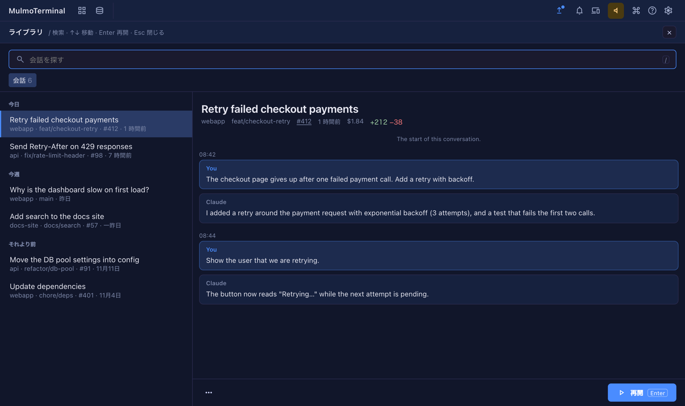

# 13.1.0 — ライブラリと、再起動で会話が戻らなくなったこと

**13.1.0（2026-11-20 リリース）時点のスナップショットです。** アプリが進むにつれて古くなります。
それは想定どおりで、最新の内容は各節からリンクしているガイドにあります。

更新:

```bash
npx mulmoterminal@latest
```

設定は要りません。以下はすべて、更新するとすぐ使えます。

## 新機能

### ライブラリ: Claude の会話をすべて探せる

**その他の機能** → **ライブラリ** を開きます。このマシンの Claude の会話が新しい順にすべて並び、
「今日」「今週」「それより前」に分かれています。各行には、タイトルと、プロジェクト・ブランチ・
その会話が作った PR・いつ、が出ます。



- **探す**: 上の欄に打ちます（`/` でも入れます）。自分と Claude が話した中身とタイトルを探し、
  一致した行を結果の下に出します。
- **読む**: 会話を押すと、右側で読めます。タイトルの下の灰色の行に、プロジェクト・ブランチ・
  PR 番号・金額・増えた行と減った行が出ます。
- **再開**: **再開**（または `Enter`）で、その会話をもとのディレクトリのターミナルで開きます。
  すでにセルで開いている会話は二重に開かず、そう知らせます。
- **ピン留めと名前**: 下の **⋯** から、会話を一覧の先頭にピン留めしたり、自分で名前を付けたり
  できます。記録は `~/.mulmoterminal/library/marks.json` に置き、会話のファイルには書きません。

`claude -p` や SDK から起動した会話と、一時ディレクトリで動いた会話は出しません。一覧を、自分が
した会話だけにするためです。初めて開いたときは裏で索引を作り、進み具合を出します。2 回目からは
新しく増えた分だけを読みます。

（[#3337](https://github.com/receptron/mulmoterminal/pull/3337) デザイン、
[#3338](https://github.com/receptron/mulmoterminal/pull/3338) 索引、
[#3341](https://github.com/receptron/mulmoterminal/pull/3341) 画面、
[#3344](https://github.com/receptron/mulmoterminal/pull/3344) ピン留めと名前）

### セルの会話をライブラリで開く

Claude のセルの **History** メニューの最後に **ライブラリで開く** が加わりました。そのセルの会話を
開いた状態でライブラリが出ます。一覧の最初のページに無い古い会話でも開きます
（[#3345](https://github.com/receptron/mulmoterminal/pull/3345)）。

### 会話とその PR を行き来する

GitHub の画面で、自分の会話が作った PR の横にライブラリのボタンが出て、その会話を開けます。
逆に、ライブラリで会話のタイトルの下にある PR 番号を押すと、その PR が開きます
（[#3346](https://github.com/receptron/mulmoterminal/pull/3346)）。

詳しく: [機能リファレンス — ライブラリ](features.html)

## 画面の変化

- **その他の機能** に **ライブラリ** が加わり、Claude のセルの **History** メニューの最後に
  **ライブラリで開く** が加わりました（[#3341](https://github.com/receptron/mulmoterminal/pull/3341)、
  [#3345](https://github.com/receptron/mulmoterminal/pull/3345)）。
- GitHub の画面で、自分の会話が作った PR の横にライブラリのボタンが出ます
  （[#3346](https://github.com/receptron/mulmoterminal/pull/3346)）。
- **セル内で `/resume` したあと**、セルには選んだ会話が出るようになりました。ヘッダーにその会話の
  最後のプロンプトと返答、タイトル、会話ペインにはその中身が出ます。これまではセルが空になって
  いました。`/clear` の直後は、新しい会話にまだ何も無いので、何か送るまで空のままです
  （[#3349](https://github.com/receptron/mulmoterminal/pull/3349)）。

## 見えない変化

### 再起動で、移った先の会話が続く

`/clear` のあとや、セルの中で `/resume` して別の会話を選んだあとにエージェントを再起動すると
（セルの **道具** メニュー → **エージェントを再起動**）、離れたはずの会話に戻っていました。マシンの再起動のあとにセルを開き直したときも同じでした。これからは移った先の
会話が続き、セルもそのままです（[#3340](https://github.com/receptron/mulmoterminal/pull/3340)、
[#3325](https://github.com/receptron/mulmoterminal/issues/3325) の修正）。

**直っているかの確かめ方**: Claude のセルで `/clear` して 1 回送信し、**道具** →
**エージェントを再起動** を選びます。`/clear` のあとに始めた会話でセルが戻れば直っています。`/clear` の前の会話に
戻るなら、まだ古い版です。

### 1 つの home には 1 つの版

同じ home フォルダで、版の違う MulmoTerminal を同時に動かすこと（たとえば古い
`npx mulmoterminal@…` をこの版の横で動かす）は対象外です。古い版が上の修正を打ち消してしまいます。
別の版を並べて試すときは、その版を別の `HOME` で起動してください
（[#3351](https://github.com/receptron/mulmoterminal/pull/3351)、
[FAQ](faq.html#two-versions)）。

### Windows: 受け渡し用フォルダの信頼の確認が出なくなった

Windows で、Claude のセルを再起動するたびに、MulmoTerminal の受け渡し用フォルダについて Claude Code が
「Is this a directory you created or one you trust?」と聞いていました。Claude Code が探すのと同じ書き方で
フォルダを記録するようにしたので、更新すると聞かれなくなります
（[#3323](https://github.com/receptron/mulmoterminal/pull/3323)）。

### 依存関係

マイナー・パッチの更新です。`@mulmoclaude/core` 7.2.1 とそのプラグイン、`@google/genai` 3.6.1、
`puppeteer` 25.18.1 などが含まれます。することはありません
（[#3326](https://github.com/receptron/mulmoterminal/pull/3326)）。
