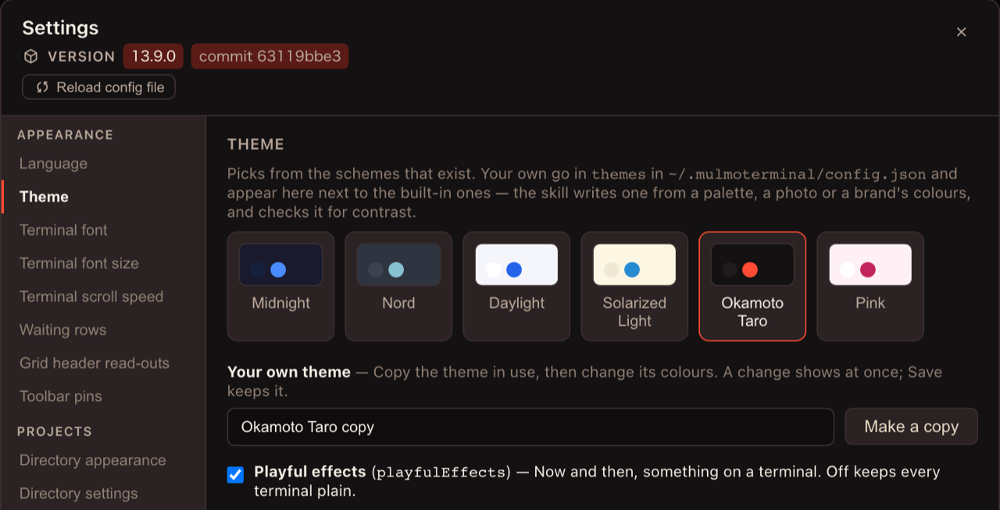
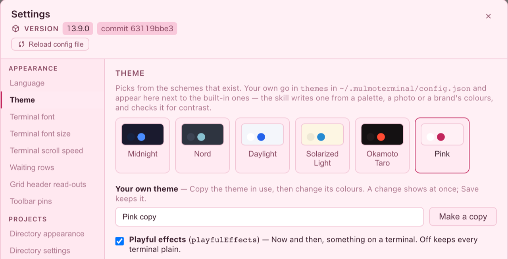

# 13.10.0 — 新しいテーマ「Okamoto Taro」と「Pink」

**13.10.0（2026-11-27 リリース）時点のスナップショットです。** アプリが進むにつれて古くなります。
それは想定どおりで、最新の内容は各節からリンクしているガイドにあります。

更新:

```bash
npx mulmoterminal@latest
```

設定は要りません。

## 新機能

- **組み込みのテーマが 2 つ増えました: Okamoto Taro と Pink。** 右上の歯車から**設定**を開き、
  **テーマ**を見てください。Midnight・Nord・Daylight・Solarized Light の隣に 2 つ並んでいます
  （[#3570](https://github.com/receptron/mulmoterminal/pull/3570)）。
  - **Okamoto Taro** は暗くて力強い配色です。ほぼ黒の背景に朱色のアクセント、ターミナルでは
    赤・黄・青がはっきり出ます。
  - **Pink** は明るい配色です。淡いピンクの背景に白いパネル、濃いローズのアクセントです。

  クリックするとターミナルも含めてアプリ全体がすぐに切り替わり、選んだものは覚えておかれます。
  プロジェクトごとに決めたいときは、そのフォルダの `.mulmoterminal.json` に `"theme": "okamoto"`
  または `"theme": "pink"` と書きます。詳しくは [設定](config.html#custom-themes)。

  

  

## 画面の変化

- **テーマの選択肢が、組み込み 4 つから 6 つになりました。** その上の説明文からは、組み込みの
  数を書いた部分をなくしました（[#3570](https://github.com/receptron/mulmoterminal/pull/3570)）。

## 見えない変化

- **自作のテーマに `okamoto` や `pink` という名前を付けていたら、名前を変えてください。**
  組み込みと同じ名前は自作のテーマに使えないため、`~/.mulmoterminal/config.json` にその `id` の
  テーマがあると読み込まれず、設定画面に読み込めなかったテーマとして出ます。別の `id` にすれば
  元どおり使えます（[#3570](https://github.com/receptron/mulmoterminal/pull/3570)）。詳しくは
  [自分の配色を作る](config.html#custom-themes)。
