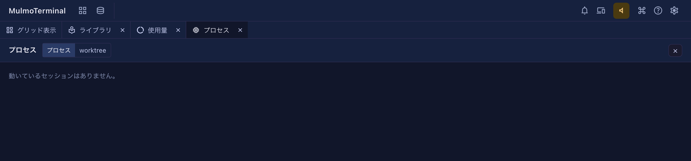

# 13.11.0 — 開いた画面のタブ、日本語入力の二重入力の修正

**13.11.0 時点（2026-11-28 リリース）のスナップショットです。** アプリの変化に合わせて古くなっていきます。
それは想定どおりで、最新の説明は各節のリンク先のガイドにあります。

アップグレード:

```bash
npx mulmoterminal@latest
```

設定は不要です。新しいキーは使いたい場合だけ割り当ててください（最初は未割り当てです）。

## 新機能

- **開いた画面のタブ。** ライブラリ・Skills・Rooms・Files・Wiki・トークン使用量などの全画面の画面を開くと、
  ツールバーの下にタブが並びます。ページを読み込んでから開いた画面がすべて並び、先頭は **グリッド表示** です。
  タブを押すとその画面に戻り、**×** を押すとそのタブを閉じて、次のタブ（なければグリッド）が前に出ます
  （[#3578](https://github.com/receptron/mulmoterminal/pull/3578)）。詳しくは [機能リファレンス](features.html)。

  

- **ライブラリ・プロセス・使用量の画面を開くキーと、行き来のキー。** **Settings**（右上の歯車）→
  **Keyboard shortcuts** に 4 つの行が増え、それぞれキーを押して割り当てられます
  （[#3577](https://github.com/receptron/mulmoterminal/pull/3577)）:
  - `screen-library`・`screen-processes`・`screen-usage` はその画面を開きます。ライブラリはコマンドパレットからも
    開けるようになりました。
  - `screen-toggle` は、最後に開いた画面と、それを開いた元の場所とを行き来します。まだ画面を開いていなければ
    何もしません。

  1 つのキーならどの画面でも効きます。2 キーの連続はグリッドでだけ効きます。詳しくは
  [キーボードショートカット](config.html#keymap)。

## 画面の変化

- **画面が離れたときのまま戻ります。** Rooms・ライブラリ・Blueprints・Skills・プロセス・使用量は、開くたびに
  作り直されなくなりました。閉じてもう一度開くと、検索の文字・選んだ項目・スクロール位置・読んでいた会話が
  そのまま残り、裏で最新の内容に更新されます（[#3576](https://github.com/receptron/mulmoterminal/pull/3576)）。
  Rooms と Blueprints を普通に開くと、前回いた場所に戻ります。
- **タブが出ている間は、画面が少し下から始まります**（タブの分）
  （[#3578](https://github.com/receptron/mulmoterminal/pull/3578)）。

## 見えない変化

- **日本語入力の変換中に Cmd を押しても、文字が二重に入らなくなりました。** ターミナルのセルで、下線つきの
  未確定の文字があるうちに Cmd を押すと、その場で 1 回、入力の確定でもう 1 回送られ、`てすと` が
  `てすとてすと` になっていました。Cmd 単体で英数・かなを送る Karabiner のルールを使っていると起きやすい現象です
  （[#3586](https://github.com/receptron/mulmoterminal/pull/3586)、報告は
  [#3584](https://github.com/receptron/mulmoterminal/issues/3584)）。直っているかの確かめ方: 日本語で打って、
  確定する前に Cmd を押すと、文字は 1 回だけ入ります。
- **開いたまま残るようになった画面の細かい修正**: 消した Blueprints の答えが元に戻らない、同じ質問がもう一度
  来たら打ちかけの下書きを消す、更新に失敗しても表示中の内容を消したり「読めない」と出したりしない、編集中に
  消されたスキルで編集欄ごと消えない（[#3587](https://github.com/receptron/mulmoterminal/pull/3587)）。
- **別のマシンでターミナルを動かす機能の準備。** まだ使える段階ではありません。設定しない限り動かず、説明も
  まだありません。何もする必要はありません
  （[#3562](https://github.com/receptron/mulmoterminal/pull/3562)、
  [#3567](https://github.com/receptron/mulmoterminal/pull/3567)、
  [#3568](https://github.com/receptron/mulmoterminal/pull/3568)、
  [#3571](https://github.com/receptron/mulmoterminal/pull/3571)、
  [#3572](https://github.com/receptron/mulmoterminal/pull/3572)、
  [#3573](https://github.com/receptron/mulmoterminal/pull/3573)、
  [#3574](https://github.com/receptron/mulmoterminal/pull/3574)、
  [#3579](https://github.com/receptron/mulmoterminal/pull/3579)、
  [#3580](https://github.com/receptron/mulmoterminal/pull/3580)、
  [#3581](https://github.com/receptron/mulmoterminal/pull/3581)、
  [#3582](https://github.com/receptron/mulmoterminal/pull/3582)、
  [#3583](https://github.com/receptron/mulmoterminal/pull/3583)）。
