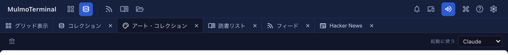

# 13.12.0 — 開いたコレクションとフィードごとのタブ

**13.12.0 時点（2026-11-28 リリース）のスナップショットです。** アプリの変化に合わせて古くなっていきます。
それは想定どおりで、最新の説明は各節のリンク先のガイドにあります。

アップグレード:

```bash
npx mulmoterminal@latest
```

設定は不要です。

## 新機能

- **開いたコレクションとフィードごとのタブ。** 13.11.0 ではコレクションの画面のタブが 1 つだけで、2 つ目の
  コレクションを開くと 1 つ目が置き換わっていました。これからは **コレクション** と **フィード** の一覧のタブは
  1 つのまま、開いたコレクションやフィードがそれぞれ自分のタブを持ち、一覧のタブのすぐ後ろに名前とアイコン付きで
  並びます。すでにタブのあるものを開くと、2 つ目は作らずそのタブに切り替わります。別のプロジェクトにある同じ名前の
  コレクションは別のタブになります（[#3600](https://github.com/receptron/mulmoterminal/pull/3600)）。
  Rooms と Blueprints は今までどおりタブ 1 つです。詳しくは [機能リファレンス](features.html)。

  

- **ライブラリは、規則を書く前にもっと強い守り方がないかを確かめます。** 会話（または繰り返し打った指示）を
  `CLAUDE.md` の規則にするとき、`mulmoterminal-library` スキルはまず、仕組み・型・lint や CI のチェック・テストで
  その規則を守れないかを確かめます。守れるなら、そのチェックを作る issue を先に提案し、規則はチェックで守れない
  部分だけにします。承認するまで何も書かないのは今までどおりです
  （[#3596](https://github.com/receptron/mulmoterminal/pull/3596)）。詳しくは [機能リファレンス](features.html)。

## 画面の変化

- **コレクションとフィードのタブには、画面の名前ではなくコレクションの名前が出ます。** コレクションの一覧が
  返ってくるまでの一瞬だけ、新しいタブにはコレクションの短い ID が出ます
  （[#3600](https://github.com/receptron/mulmoterminal/pull/3600)）。

## 見えない変化

- **ライブラリの「再開」が、ほかで開いている会話を奪わなくなりました。** 別のタブや別の端末で開いたまま止まって
  いる会話はライブラリの一覧から外れることがあり、そこで **再開** を押すともう一度開いて、ほかの画面から会話を
  取り上げていました。これからは、再開する前にその会話をだれが開いているかを確かめます
  （[#3601](https://github.com/receptron/mulmoterminal/pull/3601)、報告は
  [#3343](https://github.com/receptron/mulmoterminal/issues/3343)）。起きていたのは、一覧に載る新しい会話より古い会話だけです。そうした会話が
  ほかで開かれていると、一覧に載る会話と同じく「この会話はもう開いているか、別の画面が使っています。」と出て、
  再開しません。
- **レビューの指摘に根拠が要るようになりました。** `requestReview` で始めたレビュー役が従う同梱の
  `mulmoterminal-review` スキルは、根拠（実行した結果、筋道の証明、破っている規則の引用）のない指摘を
  「未確認」とし、そうした指摘では承認を止めなくなりました
  （[#3591](https://github.com/receptron/mulmoterminal/pull/3591)）。
- **別のマシンでターミナルを動かすための準備。** リモートのセルの Canvas に、相手のマシンの文書・HTML ページ・
  グラフ・モデル・表計算・ストーリーを、読むだけで表示できるようになりました。まだ使える段階ではなく、設定しない
  限り動かず、説明もまだありません。何も変わりません
  （[#3592](https://github.com/receptron/mulmoterminal/pull/3592)、
  [#3597](https://github.com/receptron/mulmoterminal/pull/3597)、
  [#3599](https://github.com/receptron/mulmoterminal/pull/3599)）。
- **動いている MulmoTerminal で変更を確かめる道具を追加しました。** MulmoTerminal 自体を開発する人向けです。
  何も変わりません（[#3594](https://github.com/receptron/mulmoterminal/pull/3594)）。
