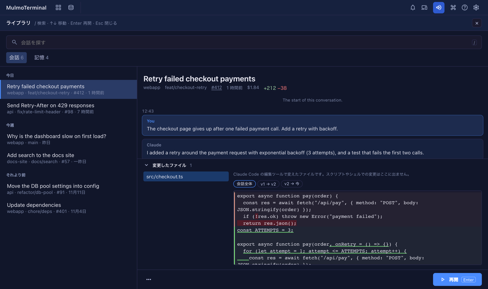
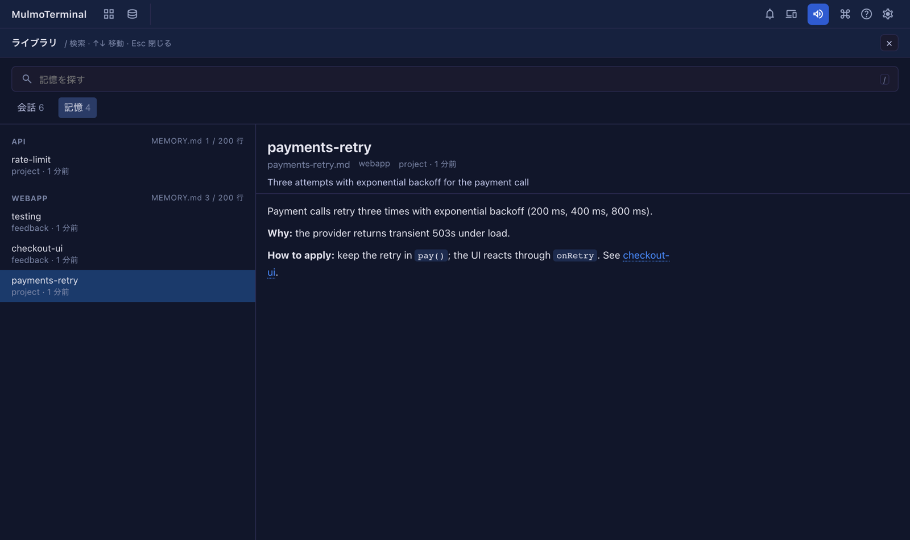

# 13.2.0 — ライブラリで、変更したファイルと記憶を見る

**13.2.0（2026-11-20 リリース）時点のスナップショットです。** アプリが進むにつれて古くなります。
それは想定どおりで、最新の内容は各節からリンクしているガイドにあります。

更新:

```bash
npx mulmoterminal@latest
```

設定は要りません。どちらも、[13.1.0](v13.1.0.html) で入ったライブラリ（**その他の機能** →
**ライブラリ**）の中にあります。

## 新機能

### 会話が変更したファイル

ライブラリで会話を開きます。読む画面の下に **変更したファイル** の欄が出て、その会話が編集した
ファイルが並びます。開いてファイルを選ぶと、変更が出ます。

- **会話全体**: その会話が最初に触る前のファイルと、今のファイルの差分。
- **v1 → v2**、**v2 → now** …: 1 ターン分ずつの変更。



Claude Code がファイルを編集するときに残す写しから読みます。そのため、Claude Code 自身の編集の道具で
変えたファイルだけが並びます。スクリプトやシェルで変えたものは出ず、欄にもそう書いてあります。
見るだけで、元に戻したり書き込んだりはしません
（[#3350](https://github.com/receptron/mulmoterminal/pull/3350)）。

### Claude Code の記憶を、プロジェクトごとに

**会話** の横に **記憶** が加わりました。Claude Code の自動の記憶を、すべてのプロジェクトについて、
プロジェクトのフォルダ名ごとにまとめて並べます。



- プロジェクトの見出しに、その `MEMORY.md` が、Claude Code がセッションの初めに読み込む上限の
  どこまで埋まっているかが出ます。上限に近づくと警告します。上限を超えた分は Claude Code が読みません。
- 記憶を選ぶと、整えた文章で読めます。`[[名前]]` のリンクは、その名前の記憶を開きます。その
  プロジェクトに無い名前は、リンクにならずに文字のまま出ます。
- 検索欄で、名前・説明・ファイル名から絞り込めます。上下キーで移動します。

今は見るだけです。編集は後の版で入ります
（[#3352](https://github.com/receptron/mulmoterminal/pull/3352)）。

詳しく: [機能リファレンス — ライブラリ](features.html)

## 画面の変化

- ライブラリの **会話** の横に **記憶** が加わりました
  （[#3352](https://github.com/receptron/mulmoterminal/pull/3352)）。
- ファイルを編集した会話では、ライブラリの読む画面の下に **変更したファイル** の欄が出ます
  （[#3350](https://github.com/receptron/mulmoterminal/pull/3350)）。

## 見えない変化

ほかに変わったところはありません。どちらも `~/.claude` には書き込みません。変更したファイルは
Claude Code 自身のファイル履歴から、記憶は各プロジェクトの memory フォルダから読みます
（[#3350](https://github.com/receptron/mulmoterminal/pull/3350)、
[#3352](https://github.com/receptron/mulmoterminal/pull/3352)）。
