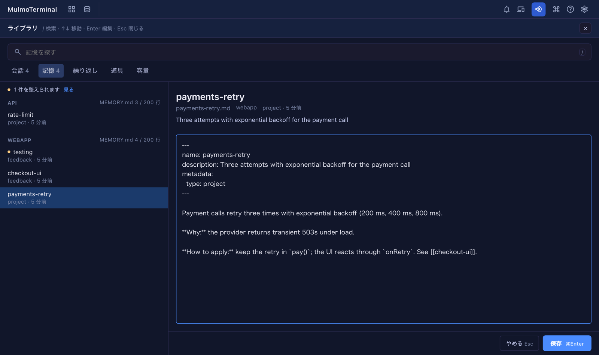
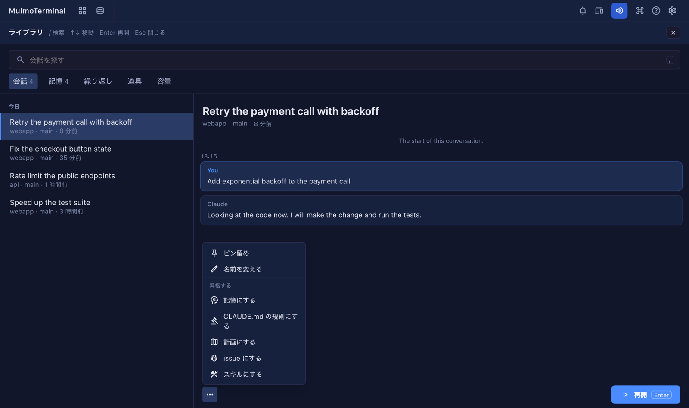
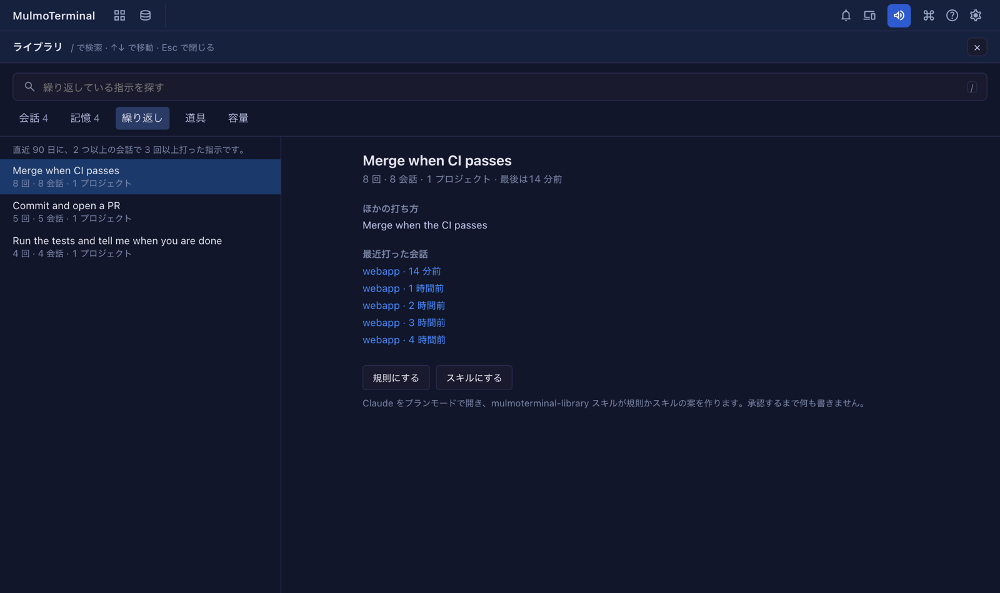
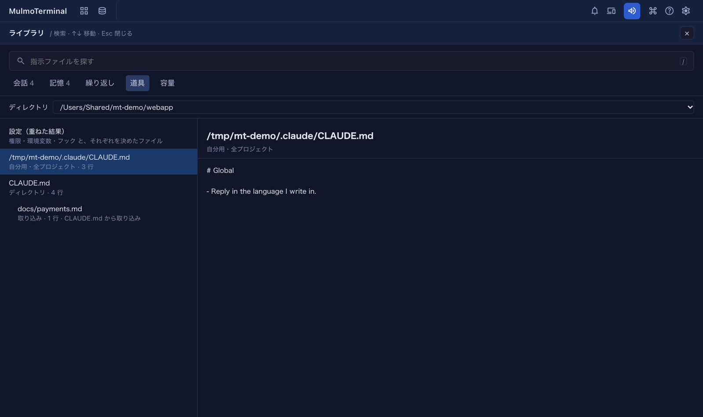
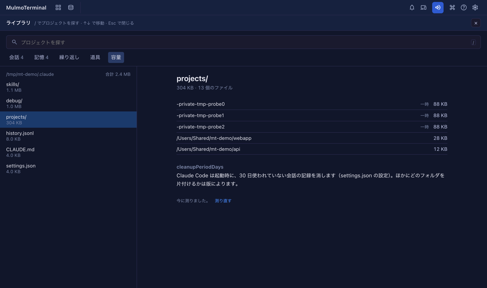

# 13.3.0 — ライブラリが広がる: 整えられる記憶、昇格、道具、容量、繰り返し

**13.3.0（2026-11-21 リリース）時点のスナップショットです。** アプリが進むにつれて古くなります。
それは想定どおりで、最新の内容は各節からリンクしているガイドにあります。

更新:

```bash
npx mulmoterminal@latest
```

設定は要りません。今回の大半はライブラリ（**その他の機能** → **ライブラリ**）の中にあります。
検索欄の下の種類の並びが **会話・記憶・繰り返し・道具・容量** になりました。

## 新機能

### 記憶: 整えられるところが分かり、その場で直せる

13.2.0 では **記憶** は読むだけでした。今回から書き換えられ、どこを直すとよいかも教えてくれます。



- **整えられるところ。** 一覧の上の **n 件を整えられます** が問題のある記憶の数で、**見る** で
  それだけに絞れます。該当する行の頭には点が付き、読む画面のいちばん上に問題が一文で出ます。
  `MEMORY.md` に載っていない、frontmatter に `name`・`description`・`type` が無い、どの記憶も指さない
  `[[リンク]]`、挙げているファイルがもう無い、`MEMORY.md` が無い・長すぎて Claude Code が最後まで
  読まない・無いファイルを挙げている、のどれかです
  （[#3353](https://github.com/receptron/mulmoterminal/pull/3353)）。
- **編集。** 読む画面の右下の **編集**（または `Enter`）で、frontmatter も含めた本文すべてを
  書き換えられます。`⌘Enter` で保存、`Esc` でやめます。編集中に Claude Code がそのファイルを書いて
  いたら保存はせず、編集内容を残したまま **読み直す** を出します。そのプロジェクトで Claude の
  セッションが動いていれば、そう知らせます
  （[#3354](https://github.com/receptron/mulmoterminal/pull/3354)）。
- **ごみ箱へ移す。** **⋯** → **ごみ箱へ移す** で、記憶を `MEMORY.md` のその行と一緒にシステムの
  ごみ箱へ移します。確認の画面は出ません。代わりに出る知らせの **取り消す** で、両方とも元に戻ります
  （[#3355](https://github.com/receptron/mulmoterminal/pull/3355)）。
- **ほかの記憶に統合する。** **⋯** → **ほかの記憶に統合する** で、同じプロジェクトのほかの記憶が
  並びます。1 つ選ぶと、その記憶の末尾にこの記憶の本文を足した状態でエディタが開きます。好きなように
  まとめて保存します。統合した側は `MEMORY.md` の行と一緒にごみ箱へ移り、それを指していた
  `[[リンク]]` は残した側を指すように書き換わります。何件書き換わるかは保存の前にエディタに出ます。
  **取り消す** で全部元に戻ります
  （[#3356](https://github.com/receptron/mulmoterminal/pull/3356)、
  [#3358](https://github.com/receptron/mulmoterminal/pull/3358)）。
- **ほかの作業コピーにある同じ記憶。** 同じリポジトリの別のクローンや worktree に同じ名前の記憶が
  あると、**このリポジトリのほかの作業コピーにもあります:** と出て、各コピーに **（同じ）** か
  **（違う）** が付きます（[#3357](https://github.com/receptron/mulmoterminal/pull/3357)）。
  違うものには、そのコピーの本文を足してエディタを開く **その本文をここに足す** と、この記憶の保存済みの
  本文をそのコピーに書く **この本文をそこへ書く** があり、**取り消す** で戻せます
  （[#3360](https://github.com/receptron/mulmoterminal/pull/3360)）。
- **書いた会話。** 記憶のタイトルの下の **書いた会話:** に、その記憶を最後に書いた会話が出ます。
  押すとその会話を開きます（[#3361](https://github.com/receptron/mulmoterminal/pull/3361)）。

### 会話を記憶・規則・計画・issue・スキルに昇格する

ライブラリで会話を開き、下の **⋯** を押します。**昇格する** の下に **記憶にする**・
**CLAUDE.md の規則にする**・**計画にする**・**issue にする**・**スキルにする** が並びます。



どれかを押すとライブラリが閉じ、その会話が動いていたディレクトリで、Claude のセルがプランモードで
開きます。そこで同梱の `mulmoterminal-library` スキルが会話を読み、書く内容の案を作ります（規則なら
どの `CLAUDE.md` に書くかを、スキルなら新しく作るか手持ちのものを直すかを尋ねます）。**計画を承認する
まで何も書きません。** 書き換えるファイルはどれも、書く前に `~/.mulmoterminal/library/backups/` に
控えを取り、変更ごとに戻し方を伝えます
（[#3366](https://github.com/receptron/mulmoterminal/pull/3366)）。

### 繰り返し: 何度も打っている指示

**繰り返し** には、直近 90 日に、2 つ以上の会話で 3 回以上打った指示が並びます。Claude Code の
プロンプトの履歴から読みます。スラッシュコマンド、`!` の行、貼り付けた文、自動の実行、ごく短い返事は
数えず、少しだけ書き方の違う同じ指示はまとめます。



1 つ選ぶと、ほかの打ち方と、最近それを打った会話が出ます（押すとその会話を開きます）。
**規則にする** か **スキルにする** で、いちばん多く打ったディレクトリで、Claude がプランモードで
`mulmoterminal-library` スキルと一緒に開きます。規則かスキルの案を出し、承認するまで何も書きません
（[#3393](https://github.com/receptron/mulmoterminal/pull/3393)）。

### 道具: そのディレクトリで Claude Code が読むもの

**道具** で **ディレクトリ**（会話が動いたもの）を選ぶと、Claude Code がそこで読む指示ファイルが、
読む順に並びます。組織のもの、自分のもの、ルートから下へ順にある各 `CLAUDE.md` と `CLAUDE.local.md`、
プロジェクトの規則、そして `@path` で取り込むファイルです。`CLAUDE.md` が無いところでは代わりに
`AGENTS.md` が並びます。選ぶと一覧の横で読めます
（[#3367](https://github.com/receptron/mulmoterminal/pull/3367)）。



- **見つからないパス。** ファイルの下に、そのファイルが挙げていて実在しないパスが出ます。
  動かしたファイルをまだ指している `CLAUDE.md` に気づけます
  （[#3385](https://github.com/receptron/mulmoterminal/pull/3385)）。
- ファイルの上の行の **設定（重ねた結果）** は、自分・プロジェクト・ここだけ・組織の
  `settings.json` を重ねて、そこで効いているものを出します。権限（**聞かずに許可**・**必ず聞く**・
  **拒否**）、環境変数、フック、そのほかの設定で、それぞれにどのファイルが決めたかが付きます
  （[#3382](https://github.com/receptron/mulmoterminal/pull/3382)）。

見るだけで、ここからファイルには書きません。

### 容量: Claude Code のフォルダがどれだけ使っているか

**容量** には、`~/.claude` の中身が大きい順に、合計と一緒に並びます。`projects/` を選ぶと
プロジェクトごとに大きい順に出て、一時ディレクトリのものには **一時** が付きます。打つと絞れます。
`cleanupPeriodDays` の値、つまり Claude Code が会話の記録をいつまで残すかも出ます。



裏で測ります。前に測ってから 1 時間を過ぎたときと、**測り直す** を押したときに測り直します。
何も消しません（[#3384](https://github.com/receptron/mulmoterminal/pull/3384)）。

詳しく: [機能リファレンス — ライブラリ](features.html)

### スキルの SKILL.md を編集する

**その他の機能** → **Skills** で、自分のスキルとプロジェクトのスキルに **編集** が付きました。
`SKILL.md` の全文が開き、`⌘Enter` で保存、`Esc` でやめます。記憶と同じく、開いたあとにファイルが
変わっていれば保存しません。プラグインのスキルと MulmoTerminal が同梱するスキルは見るだけです。
プロジェクトのスキルはそのプロジェクトの `.claude/skills` にあり、たいていコミットされているファイル
です（[#3387](https://github.com/receptron/mulmoterminal/pull/3387)）。
詳しく: [機能リファレンス — Skills](features.html)

### ほかのターミナルから、前回以降をまとめて取り込む

セルの **道具** → **ほかのターミナルと話す…** に、ほかのターミナルが並びます。各行の
「最後のやり取りをここに取り込む」の横に、リストのアイコンが加わりました。押すと、そのターミナルから
**このディレクトリに前回取り込んだ後のやり取りをすべて**、指示と返事を、道具の出力は除いて取り込みます。
貼り付けるだけで送信はせず、`Enter` は自分で押します。初めてのときは、入るだけ取り込みます
（[#3392](https://github.com/receptron/mulmoterminal/pull/3392)）。
詳しく: [機能リファレンス](features.html)

### 使用量で、この数週間を振り返る

**その他の機能** → **使用量** の最初に **この数週間** が出ます。12 週分の会話にかかった金額、会話の
数、それが作った PR の数を、週・プロジェクト・エージェントごとに並べます。ライブラリの索引から足し合わせ、
会話は始まった週に数えます（[#3390](https://github.com/receptron/mulmoterminal/pull/3390)）。
詳しく: [トークンのローテーション](token-rotation.html)

### GitHub ボードが、開いているターミナルに合わせる

GitHub の画面の **ボードを開く（実験的）** で:

- ボードのヘッダーの **ターミナルを開いている作業だけ** で、ターミナルが開いているカードだけに
  絞れます。最初からオンで、外すと全部出ます。選んだ状態はこのブラウザが覚えます
  （[#3362](https://github.com/receptron/mulmoterminal/pull/3362)）。
- ターミナルを閉じるとカードからすぐに消え、開くと数秒で現れます
  （[#3364](https://github.com/receptron/mulmoterminal/pull/3364)）。
- 登録していない GitHub のリポジトリでも、そのクローンでターミナルを開いていれば、**未登録** と
  付いて出ます（[#3374](https://github.com/receptron/mulmoterminal/pull/3374)）。PR と issue の
  一覧にも同じように出ます（[#3391](https://github.com/receptron/mulmoterminal/pull/3391)）。
- デフォルトブランチ（`main` など）や、ブランチのない状態で開いているターミナルは、どこにも出なかった
  代わりに、そのリポジトリの列の上にブランチごとにまとめて出ます
  （[#3386](https://github.com/receptron/mulmoterminal/pull/3386)）。

詳しく: [GitHub — ボード](github.html#board)

### ほかのエージェントのやり取りも、取り込めて読める

- 「最後のやり取りをここに取り込む」、1 往復のやり取り、円卓が、Copilot・Antigravity・Grok の
  セルの答えも運ぶようになりました。これまでは何も運びませんでした。Copilot と Antigravity の
  セルでは、ターンが終わったときの通知にも答えが入ります
  （[#3369](https://github.com/receptron/mulmoterminal/pull/3369)、
  [#3371](https://github.com/receptron/mulmoterminal/pull/3371)、
  [#3373](https://github.com/receptron/mulmoterminal/pull/3373)）。
- Grok と Antigravity のセッションの会話が、会話ペインとスマホの会話の画面に出るように
  なりました（[#3381](https://github.com/receptron/mulmoterminal/pull/3381)、
  [#3383](https://github.com/receptron/mulmoterminal/pull/3383)）。

詳しく: [エージェント](agents.html)

## 画面の変化

- ライブラリの種類に **繰り返し**・**道具**・**容量** が加わりました
  （[#3393](https://github.com/receptron/mulmoterminal/pull/3393)、
  [#3367](https://github.com/receptron/mulmoterminal/pull/3367)、
  [#3384](https://github.com/receptron/mulmoterminal/pull/3384)）。
- **記憶** では、一覧の上に整えられる件数、行の頭に点、読む画面の下に **編集**、**⋯** に
  **ごみ箱へ移す** と **ほかの記憶に統合する**、タイトルの下に **書いた会話:** が出ます
  （[#3353](https://github.com/receptron/mulmoterminal/pull/3353)、
  [#3354](https://github.com/receptron/mulmoterminal/pull/3354)、
  [#3355](https://github.com/receptron/mulmoterminal/pull/3355)、
  [#3356](https://github.com/receptron/mulmoterminal/pull/3356)、
  [#3361](https://github.com/receptron/mulmoterminal/pull/3361)）。
- 会話の **⋯** メニューに **昇格する** の欄ができました
  （[#3366](https://github.com/receptron/mulmoterminal/pull/3366)）。
- Skills の画面で、自分のスキルとプロジェクトのスキルに **編集** が付きました
  （[#3387](https://github.com/receptron/mulmoterminal/pull/3387)）。
- **ほかのターミナルと話す…** の各ターミナルの行に、リストのアイコンが付きました
  （[#3392](https://github.com/receptron/mulmoterminal/pull/3392)）。
- **その他の機能** に、いつも **使用量** が出ます（以前は **トークンの使用量** という名前で、
  トークンのローテーションを設定したときだけ出ていました）。トークンの表は、トークンがあるときだけ
  出ます（[#3390](https://github.com/receptron/mulmoterminal/pull/3390)）。
- **GitHub ボードは、開いたときに以前より少なく見えます。** **ターミナルを開いている作業だけ** が
  最初からオンだからです。外すと、すべてのカードが出ます
  （[#3362](https://github.com/receptron/mulmoterminal/pull/3362)）。
- ボードと PR / issue の一覧は、最初の読み込みが終わるまで読み込み中の表示を出し、読み直している間は
  更新のボタンが回ります（[#3380](https://github.com/receptron/mulmoterminal/pull/3380)）。

## 見えない変化

- **更新したあと、ライブラリは索引を一度作り直します。** 初めて開いたときと同じく裏で作り、終わるまでは
  会話の一覧がもう一度埋まっていく途中で、**書いた会話:** も出ません
  （[#3361](https://github.com/receptron/mulmoterminal/pull/3361)）。
- 絵文字を含む記憶を統合するとき、下書きの末尾の文字が欠けていたのを直しました
  （[#3365](https://github.com/receptron/mulmoterminal/pull/3365)）。
- Copilot のどの版がターンの記録を 1 ターン遅れて書くかを、開発者向けの文書に書き足しました。
  することはありません（[#3388](https://github.com/receptron/mulmoterminal/pull/3388)）。
