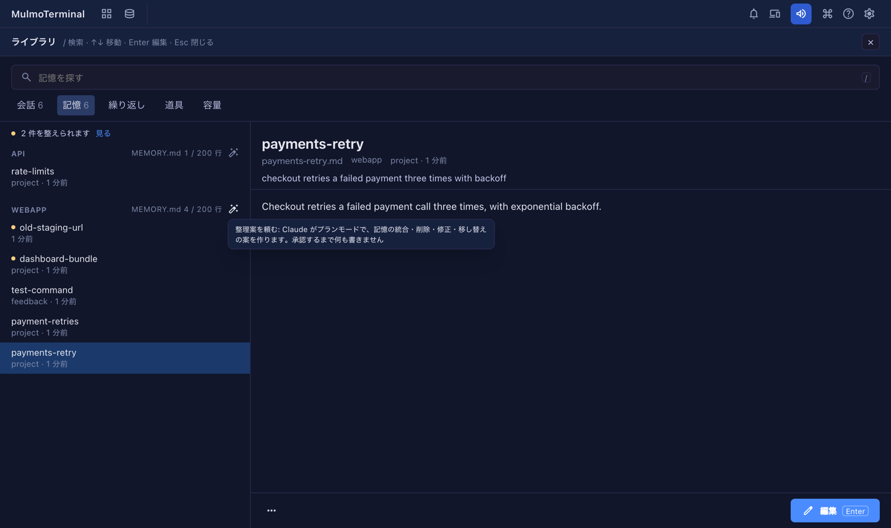

# 13.4.0 — プロジェクトの記憶の整理を Claude に頼む

**13.4.0（2026-11-22 リリース）時点のスナップショットです。** アプリが進むにつれて古くなります。
それは想定どおりで、最新の内容は各節からリンクしているガイドにあります。

更新:

```bash
npx mulmoterminal@latest
```

設定は要りません。

## 新機能

### プロジェクトの記憶の整理案を頼む

13.3.0 では、ライブラリで記憶を一つずつ直せるようになりました。今回は、プロジェクトの記憶をまとめて
Claude に見てもらい、どうするかの案を出してもらえます。



1. **その他の機能** → **ライブラリ** → **記憶** を開きます。
2. プロジェクトの見出し（上の画像では **WEBAPP**）の右端に杖のボタンがあります。整理したいプロジェクトの
   ボタンを押します。
3. ライブラリが閉じ、**そのプロジェクトのディレクトリで、プランモードの** Claude のセルが開きます。同梱の
   `mulmoterminal-library` スキルが、そのプロジェクトの記憶のフォルダを相手に動きます。
4. Claude は記憶をすべてと、プロジェクトの `MEMORY.md`、ライブラリの健康診断の結果を読み、次のような案を
   出します。
   - 同じことを言っている記憶を一つに**統合**する
   - 当てはまらなくなった記憶を**削除**する（そう言う前にコードを確かめます）
   - 健康診断で印が付いたもの（`MEMORY.md` に載っていない、frontmatter が足りない、どの記憶も指さない
     `[[リンク]]` など）を**直す**
   - いつも守る規則を、本来の置き場所である `CLAUDE.md` やスキルへ**移す**
5. **案を承認するまで何も書きません。** 承認すると、書き換えたり消したりするファイルはどれも先に
   `~/.mulmoterminal/library/backups/` へ控えを取り、`MEMORY.md` も合わせて直します。ファイルを戻すときは、
   そこからコピーします。

そのプロジェクトのディレクトリがこのマシンに無いときや、ライブラリが知っているディレクトリが二つとも同じ
記憶のフォルダを使うことになるときは、ボタンは断り、見出しの下に理由を出します。どちらのコードと照らして
記憶を確かめればよいか、Claude に分からないためです
（[#3394](https://github.com/receptron/mulmoterminal/pull/3394)）。

詳しくは [機能 → ライブラリ](features.html)。

## 画面の変化

- ライブラリの **記憶** で、プロジェクトの見出しの右端、`MEMORY.md` の使用量の横に杖のボタンが付きました
  （[#3394](https://github.com/receptron/mulmoterminal/pull/3394)）。

## 見えない変化

- 記憶の画面で、プロジェクトのディレクトリを、Claude Code が記憶のフォルダに名前を付けるのと同じ規則で
  見つけるようになりました（ディレクトリの実パスをもとに、`_` などの文字を `-` に置き換える規則）。
  ディレクトリ名に `_` を含むプロジェクトや、リンク越しに使っているプロジェクトで、これまで出なかった
  ディレクトリが出ます。二つのディレクトリが一つのフォルダを使うことになるときは、推測せずどちらも出しません。
  何もする必要はありません（[#3394](https://github.com/receptron/mulmoterminal/pull/3394)）。
