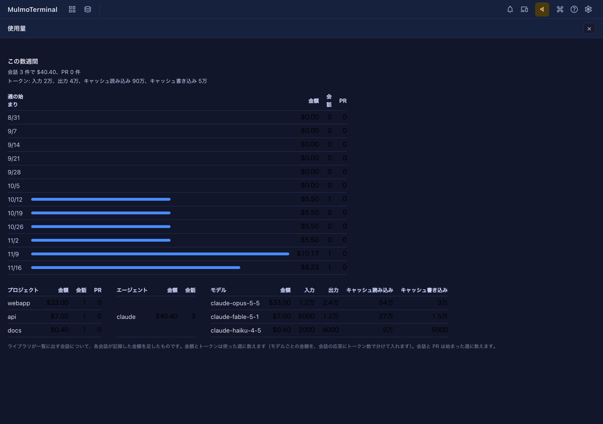

# 13.5.0 — 使用量が、使った週とモデルごとに金額を数える

**13.5.0（2026-11-22 リリース）時点のスナップショットです。** アプリが進むにつれて古くなります。
それは想定どおりで、最新の内容は各節からリンクしているガイドにあります。

更新:

```bash
npx mulmoterminal@latest
```

設定は要りません。更新したあと、ライブラリが裏で一度索引を作り直します（**見えない変化** を参照）。

## 新機能

### 使用量: 金額とトークンを使った週に、モデルごとに

**その他の機能** → **使用量** を開きます。この 12 週の振り返りが次のようになりました
（[#3396](https://github.com/receptron/mulmoterminal/pull/3396)）。



- **金額を使った週に数えます。** これまでは会話の金額が丸ごと始まった週に入っていたので、2 か月続いた
  会話が 1 週だけ大きく出ていました。今は、モデルごとの金額を、その会話の応答に使ったトークン数で分け、
  応答ごとにその週に数えます。
- **トークンを出します。** 合計の下に **トークン:** の行があり、入力・出力・キャッシュ読み込み・
  キャッシュ書き込みの数が出ます。
- **モデル別の表** が加わりました。モデルごとの金額とトークン数です。Claude Code がモデルを書かずに
  記録した金額は **（モデルの記録なし）** として出ます。
- **数え直す前の金額も足します。** Claude Code は会話の金額を途中から 0 に戻して数え直すことがあり、
  これまではその前の分が落ちていました。今は足しています。そのため、長い会話のライブラリでの金額は、
  Claude Code の `/cost` が今のセッションについて出す額より大きくなることがあります。差は数え直す前の分です。

会話と PR の数は、これまでどおり会話が始まった週に数えます。

詳しくは [README](https://github.com/receptron/mulmoterminal#readme) の **その他の機能** → **使用量** の説明。

## 画面の変化

- **使用量** の合計の下にトークンの行が、**プロジェクト** と **エージェント** の横に **モデル** の表が
  加わりました（[#3396](https://github.com/receptron/mulmoterminal/pull/3396)）。
- 長い会話の金額が続いた週に分かれるので、週ごとの棒が平らになります。

## 見えない変化

- **更新したあと、ライブラリが一度索引を作り直します。** 初めて開いたときと同じく裏で動きます。履歴が
  多いと数分かかり、その間は会話の一覧が埋まり直していきます。何もする必要はありません
  （[#3396](https://github.com/receptron/mulmoterminal/pull/3396)）。
