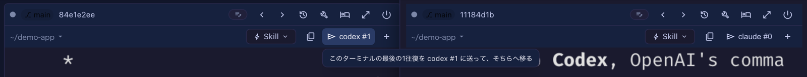

# 13.6.0 — 隣のターミナルにやり取りを送る

**13.6.0（2026-11-22 リリース）時点のスナップショットです。** アプリが進むにつれて古くなります。
それは想定どおりで、最新の内容は各節からリンクしているガイドにあります。

更新:

```bash
npx mulmoterminal@latest
```

設定は要りません。送る相手がいるときに、ボタンが自然に出ます。

## 新機能

### 各ターミナルに送るボタン

同じリポで、エージェントのターミナルを2つ開きます。たとえば片方で Claude、もう片方で Codex を、同じ
フォルダか、同じリポの2つのワークツリーで動かします。両方で会話が始まると、それぞれのヘッダーの2段目に、
相手の名前のボタン（**codex #1** など）が出ます
（[#3400](https://github.com/receptron/mulmoterminal/pull/3400)、
[#3401](https://github.com/receptron/mulmoterminal/pull/3401)）。



押すと、このターミナルの最後の1往復（あなたの質問とエージェントの答え）が相手の入力欄に貼り付けられ、
相手のターミナルが前に出てキー入力もそちらへ移ります。**送信はしません。** 読んで、自分の一言を足して、
Enter は自分で押します。何を渡すかを決めるのは、間に立つあなた、というのがこの機能の考え方です。

- 相手が複数いるときは **2 個の相手** のように出て、押すとどれに送るかを選べます。
- 送る相手がいないときは、ボタンは出ません。
- 消したいときは、設定 → **ヘッダーのボタンとチップ** の **各ターミナルの送るボタン** のチェックを外します。

詳しくは [会話 → 一日に何度もする受け渡しをボタンに](conversation.html#send)、
[`cellSendButton`](config.html#cell-send-button)。

### 前回以降をまとめて送る

最初から付いているボタンは1往復だけを送ります。このターミナルがそのフォルダへ前回送った後のやり取りを
まとめて送るには、スパナのメニュー（**道具**）→ **ほかのターミナルと話す…** を開き、相手の行の受信箱の
アイコンを押します（[#3398](https://github.com/receptron/mulmoterminal/pull/3398)）。各行のアイコンは
4つになりました。

| アイコン | 動き |
| --- | --- |
| リスト | 相手の前回以降のやり取りを、こちらに持ってくる |
| 紙飛行機 | このターミナルの最後の1往復を、相手に送る |
| 受信箱 | このターミナルの、そのフォルダへ前回送った後のやり取りを、相手に送る |
| 左右の矢印 | 1往復を自動でやり取りする（Enter まで押すのはこれだけ） |

初めて送るときは、入る分だけを送ります。

### 受け渡しをボタンやキーに

4つの受け渡しが、ヘッダーのボタン（`run: "action"`）、`keymap` のキー、コマンドパレットから呼べる
動作になりました（[#3398](https://github.com/receptron/mulmoterminal/pull/3398)）。名前は
`terminal-send-turn`、`terminal-send-since`、`terminal-bring-turn`、`terminal-bring-since` です。

たとえば前回以降をまとめて送るボタンは、`~/.mulmoterminal/config.json` にこう書きます。

```json
{ "buttons": [
  { "id": "send-since", "icon": "forward_to_inbox", "label": "Send since last time", "run": "action", "action": "terminal-send-since" }
] }
```

`buttons` を書くと最初からあるボタンと置き換わるので、残したいものも一緒に書いてください。相手の
決め方は送るボタンと同じです。1つならそれに、複数なら **ほかのターミナルと話す…** が開き、いなければ
セルにそう出ます。

詳しくは [ヘッダーのカスタマイズ](header.html)、[会話](conversation.html#send)。

## 画面の変化

- エージェントのターミナルのヘッダー2段目に、相手の名前の送るボタンが出ることがあります
  （[#3400](https://github.com/receptron/mulmoterminal/pull/3400)、
  [#3401](https://github.com/receptron/mulmoterminal/pull/3401)）。
- **ほかのターミナルと話す…** の各行に、紙飛行機と受信箱のアイコンが増えました
  （[#3398](https://github.com/receptron/mulmoterminal/pull/3398)）。
- 設定 → **ヘッダーのボタンとチップ** に **各ターミナルの送るボタン** のチェック（最初はオン）が増えました。

## 見えない変化

- **貼り付ける文にブランチ名が入ります。** 1行目が
  `Another terminal (codex · feat/login) just finished the exchange below.` のようになります。別の
  ワークツリーにいる相手には、あなたのファイルが無いためです
  （[#3398](https://github.com/receptron/mulmoterminal/pull/3398)）。
- **受け取ったやり取りを送り返しません。** 送る質問が、それ自体貼り付けられた受け渡しだったときは、
  その後にあなたが書き足した言葉だけが渡ります。持ってくるときも同じです
  （[#3398](https://github.com/receptron/mulmoterminal/pull/3398)）。何もする必要はありません。
