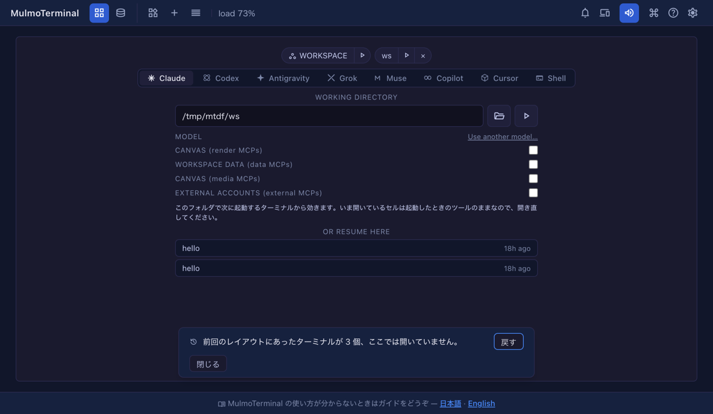

# 13.7.0 — issue をエージェントに渡す、スキルを測る

**13.7.0（2026-11-25 リリース）時点のスナップショットです。** アプリが進むにつれて古くなります。
それは想定どおりで、最新の内容は各節からリンクしているガイドにあります。

更新:

```bash
npx mulmoterminal@latest
```

スキルの測定とレイアウトの控えは設定不要です。issue とレビューの道具には、リポジトリの
`.mulmoterminal.json` に下の1ブロックが要ります。

## 新機能

### issue を merge まで、別のエージェントのレビューつきで

同梱のスキルが4つ増え、組み合わせて動きます。使う道具がそろっている **ワークスペース** の
ターミナルで実行してください。

1. リポジトリの直下の `.mulmoterminal.json` に、PR のレビューのしかたを書きます
   （[#3408](https://github.com/receptron/mulmoterminal/pull/3408)、
   [#3429](https://github.com/receptron/mulmoterminal/pull/3429)）。

   ```json
   { "review": { "reviewer": "codex", "maxRounds": 10, "requiredLgtm": 1 } }
   ```

   `skill` はレビュアーが従うスキルで、書かなければ同梱の `mulmoterminal-review` です。どれか1つでも
   値がおかしいとブロックごと無視されるので、書き間違いでレビュアーが勝手に決まることはありません。
   設定 → **ディレクトリ設定** に **Review** の行として出ます。
2. `/mulmoterminal-issue-to-merge 123` と打ちます。エージェントが issue を読み、書かれていないことだけを
   聞いて、ブランチで実装し、PR を出します
   （[#3411](https://github.com/receptron/mulmoterminal/pull/3411)）。
3. レビューの1往復ごとに `requestReview` を呼びます。MulmoTerminal がレビュアーを自分で起動します。
   PR の最新の push を取り出したワークツリーで、専用のセルとして動きます。その判定と CI を読んで、
   **merge の条件** を満たしたかを作者に伝えます
   （[#3410](https://github.com/receptron/mulmoterminal/pull/3410)、
   [#3430](https://github.com/receptron/mulmoterminal/pull/3430)）。レビュアーが質問で止まったときは、
   どのセルで答えればよいかが作者に伝わります
   （[#3431](https://github.com/receptron/mulmoterminal/pull/3431)）。勝手に merge はされません。作者は
   条件を満たしてから merge し、`endReview` でレビュアーを閉じます。

いくつもの issue を一度に渡すときは `/mulmoterminal-dispatch-issues #12 #13 #14` と打ちます
（[#3418](https://github.com/receptron/mulmoterminal/pull/3418)）。issue ごとに、専用のワークツリーの
実装役が `startIssueSession` で起動します
（[#3416](https://github.com/receptron/mulmoterminal/pull/3416)）。PR が merge・close されたときや、
実装役があなたを待っているときは配る側に伝わり
（[#3417](https://github.com/receptron/mulmoterminal/pull/3417)）、1つ merge されるたびに次の issue を
始めます。merge された実装役のセルとワークツリーは自動で閉じ、手で閉じるには `closeIssueSession` を使います
（[#3433](https://github.com/receptron/mulmoterminal/pull/3433)）。同時に動くのは2つまでです。増やすには
`~/.mulmoterminal/config.json` の `maxIssueSessions` を変えます。

詳しくは [このリポジトリの PR のレビューのしかた](config.html#dir-review)、
[同時に進める issue の数](config.html#max-issue-sessions)。

### 自分が起動したセッションと話せる

`sendToSession` は、自分が起動したセッションに入力して Enter を押します。`waitForSessionReply` は、
その入力への返事を待ちます。`spawnBackgroundChat` はどのエージェントでも起動できるようになりました
（[#3405](https://github.com/receptron/mulmoterminal/pull/3405)、
[#3406](https://github.com/receptron/mulmoterminal/pull/3406)）。上のスキルはこれを土台にしています。

### スキルが効いているかを測る

**その他の機能 → Skills** を開いて、スキルを選びます。

- 各行に、そのスキルを使った Claude の会話の数（**3 回**、または **記録なし**）が出て、詳細には最後に
  使った日が出ます（[#3442](https://github.com/receptron/mulmoterminal/pull/3442)）。
- **効いているかを測る** の欄: **評価の課題を作る** を押すとターミナルが開きます。同梱の
  `mulmoterminal-skill-eval` スキルが、合否の判定つきの小さな課題をいくつか作り、保存する前に見せます。
  **測る** は課題ごとにスキルあり・なしで走らせ、合格率、合格1回あたりの費用、判定（*効いています*、
  *差がある証拠はありません*、*逆効果です*）を出します
  （[#3443](https://github.com/receptron/mulmoterminal/pull/3443)）。実際に `claude -p` を走らせるので、
  先に費用の確認が出ます。
- **改善案を作って測る** は、最新の測定から改善した SKILL.md を書き、同じ課題で測ります。**採用する** で
  入れ替わり、今のものは控えに残ります（[#3450](https://github.com/receptron/mulmoterminal/pull/3450)）。
  改善案は測るのと同じ課題から書かれるので、採用する前に中身を読んでください。
- **安いモデルを探す** は、課題を haiku、sonnet、opus の順に走らせ、全部通った最初のモデルで止まります
  （[#3456](https://github.com/receptron/mulmoterminal/pull/3456)）。目安を出すだけで、設定は書き換えません。

詳しくは [機能 → 自動化 & エラー調査](features.html)。

### ディスクが満杯になってもグリッドが戻る

グリッドのレイアウトは、これまでブラウザの中にしかありませんでした。いまは
`~/.mulmoterminal/grid-layout.json` にも控えます。グリッドが空のまま開くと、下にバーが出ます。
ディスクが満杯でブラウザが保存できなかったとき、ブラウザのデータを消したとき、別のアドレスで開いたとき
などです。バーには **前回のレイアウトにあったターミナルが 3 個、ここでは開いていません。** と出ます。
**戻す** で、それぞれ会話を再開して開き直します。**閉じる** なら空のままです
（[#3432](https://github.com/receptron/mulmoterminal/pull/3432)）。



詳しくは [機能 → 監督](features.html)。

## 画面の変化

- 終わり方の記録を残せずに終わったエージェントのセルは、閉じずに残り、赤い行
  `[session ended — how it ended was not recorded; is the disk full?]` が出ます。ディスクが満杯のとき
  これが起きます。前は正常終了と読まれ、すべてのセルが自分から閉じていました
  （[#3426](https://github.com/receptron/mulmoterminal/pull/3426)）。
- 消したフォルダのランチャーのチップが消え、一日後に `config.json` からも外れます。届かないだけかも
  しれないフォルダ（外したドライブ、切れたリンク）は戻るまで隠れ、設定の一覧には残ります
  （[#3415](https://github.com/receptron/mulmoterminal/pull/3415)）。
- GitHub ボードの判定のバッジが **Codex 2 回: LGTM** から **判定 2 回: LGTM** になりました。どの
  レビュアーでも書けるようになったためです。リポジトリが要る LGTM が最新の push に揃い CI も通ったカードには
  **merge できます** が付きます（[#3412](https://github.com/receptron/mulmoterminal/pull/3412)）。
- MulmoTerminal が閉じた実装役やレビュアーのセルは、`[session ended]` のまま残らずグリッドから消えます
  （[#3447](https://github.com/receptron/mulmoterminal/pull/3447)）。

## 見えない変化

- MulmoTerminal が起動した codex の実装役とレビュアーは、ネットワークにつながり、ワークツリーでコミット
  でき、誰も見ていない承認の確認で止まりません。断られた操作は失敗として codex に返ります。自分で開いた
  codex のセルは、あなたの設定のままです
  （[#3452](https://github.com/receptron/mulmoterminal/pull/3452)、
  [#3455](https://github.com/receptron/mulmoterminal/pull/3455)、
  [#3461](https://github.com/receptron/mulmoterminal/pull/3461)）。
- 配る側が、前の試みで閉じた PR を今回のものとして伝えなくなりました
  （[#3441](https://github.com/receptron/mulmoterminal/pull/3441)）。
- Windows でスキルの測定が、ファイルが一瞬使われていただけで途中で止まらなくなりました。止まったときは
  理由が出ます（[#3460](https://github.com/receptron/mulmoterminal/pull/3460)）。
- jinglescript の道具がまた音を書き出せます。呼んだセッションのディレクトリの `jinglescript/` に出ます
  （[#3436](https://github.com/receptron/mulmoterminal/pull/3436)）。
- 依存を更新しました（[#3419](https://github.com/receptron/mulmoterminal/pull/3419)）。このリポジトリ自身の
  レビューの決まりを書きました（[#3439](https://github.com/receptron/mulmoterminal/pull/3439)）。README の
  API の表に新しい道具を載せました（[#3422](https://github.com/receptron/mulmoterminal/pull/3422)、
  [#3445](https://github.com/receptron/mulmoterminal/pull/3445)、
  [#3457](https://github.com/receptron/mulmoterminal/pull/3457)、
  [#3463](https://github.com/receptron/mulmoterminal/pull/3463)）。何もする必要はありません。
