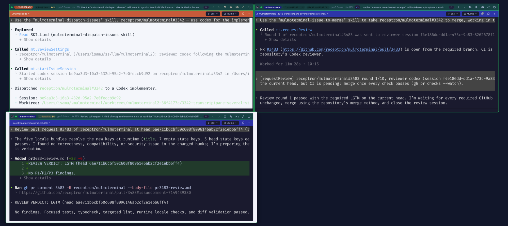

# 13.8.0 — issue から merge までのガイド、迷わないスキルの評価

**13.8.0（2026-11-25 リリース）時点のスナップショットです。** アプリが進むにつれて古くなります。
それは想定どおりで、最新の内容は各節からリンクしているガイドにあります。

更新:

```bash
npx mulmoterminal@latest
```

以下はどれも設定不要です。

## 新機能

### issue をエージェントに渡す手順を1ページに

13.7.0 で、issue を merge まで運ぶ道具が入りました。実装役が専用のワークツリーで作り、別のセッションの
レビュー役が往復でレビューし、リポジトリの merge の条件を満たすまで進めます。その使い方を1ページの
ガイドにまとめました。準備するもの、1件と複数件それぞれで打つコマンド、各セルに見えるもの、人が要る
とき、うまくいかないときにすることを、実際に動かしたときの画面写真つきで説明しています
（[#3487](https://github.com/receptron/mulmoterminal/pull/3487)）。



読む: [issue をエージェントに渡して merge まで](issue-to-merge.html)

### 手をつけるスキルが一覧でわかる

**その他の機能 → Skills** を開きます。評価のあるスキルには、名前の横に結果が出ます。
**効いている**、**逆効果**、**差なし**、**判定待ち**、**未測定** のどれかです。**手をつけるもの** の
ボタンを押すと、見るべきスキルだけに絞れます。評価で効いていなかったもの、課題はあるのに今の
SKILL.md をまだ測っていないもの、会話で使われているのに課題がまだないものです
（[#3481](https://github.com/receptron/mulmoterminal/pull/3481)）。

詳しく: [機能一覧](features.html)

### 次に何をすればよいかを示す

**効いているかを測る** の欄が、次に押すボタンを一つだけ目立たせ、その理由を一行で添えます。まず測る、
効いている証拠がなければ改善案を作る、改善案のほうが多く通ったら採用する、効いていれば安いモデルを
探す、という順です（[#3478](https://github.com/receptron/mulmoterminal/pull/3478)）。

### 前の結果を開いて、流れで読める

**前の結果** の各行に、スキルあり・なしの合格率と判定が出ます。行を開くと、その回の結果を全部
見られます。今のディスクにある SKILL.md とは別のものを測った行には **今とは別の SKILL.md** と出ます
（[#3480](https://github.com/receptron/mulmoterminal/pull/3480)、
[#3484](https://github.com/receptron/mulmoterminal/pull/3484)）。

### 課題を、実際の使い方から作る

**評価の課題を作る** が、そのスキルを使った最近の会話を下書き役のセルに渡すようになりました。提案される課題は、
あなたが実際に頼んだことをもとにし、名前やパス、人に見せたくないものは取り除かれます。承認の前に、
どれが過去の依頼から来たかも伝えます（[#3482](https://github.com/receptron/mulmoterminal/pull/3482)）。
そうした会話が無ければ、これまでどおりに作ります。

## 画面の変化

- 改善案は、もとにした SKILL.md からの変更として出るようになりました。消えた行はその場所に残り、
  変わらない部分は畳まれます。全文は **改善案の SKILL.md を全部見る** で見られます
  （[#3479](https://github.com/receptron/mulmoterminal/pull/3479)）。
- 会話ペインの見出しや知らせが、いつも英語ではなくアプリの言語で出ます
  （[#3483](https://github.com/receptron/mulmoterminal/pull/3483)）。

## 見えない変化

- MulmoTerminal が起動した codex の実装役やレビュー役は、codex が終わったあとにセルを開き直して会話を
  再開しても、ネットワーク、ワークツリーでの commit、確認を出さない設定をそのまま保ちます。これまでは、
  再開した実装役が GitHub に届かず、commit もできませんでした
  （[#3471](https://github.com/receptron/mulmoterminal/pull/3471)、
  [#3474](https://github.com/receptron/mulmoterminal/pull/3474)）。入ったかどうかは、再開した codex の
  実装役が確認なしで push と merge まで進むことでわかります。
- **改善案を作って測る** は、スキルありの回だけを走らせます。スキルなしの回はスキルを読まないので、
  改善案のもとになった測定の結果をそのまま使います。かかるお金と時間が減ります
  （[#3476](https://github.com/receptron/mulmoterminal/pull/3476)）。
- 改善案が変えるのは SKILL.md だけになり、**採用する** で入るものは測ったものと同じです。採用したあとは
  その測定が新しい基準になるので、次の改善案の前に測り直す必要はありません
  （[#3477](https://github.com/receptron/mulmoterminal/pull/3477)）。
- Windows で、ライブラリの会話へのピン留めや名前付けが二つ同時にぶつかったとき、次の保存が待たされて
  失敗することがなくなりました（[#3490](https://github.com/receptron/mulmoterminal/pull/3490)）。
- CI でときどき落ちていたテストの直し（[#3486](https://github.com/receptron/mulmoterminal/pull/3486)）。
  することはありません。
