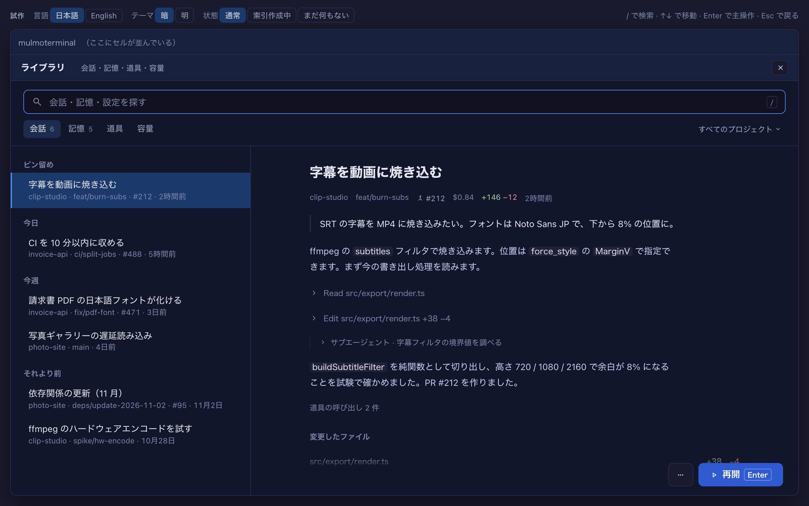
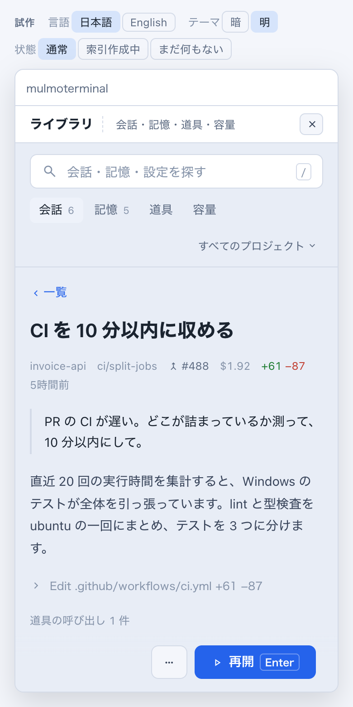
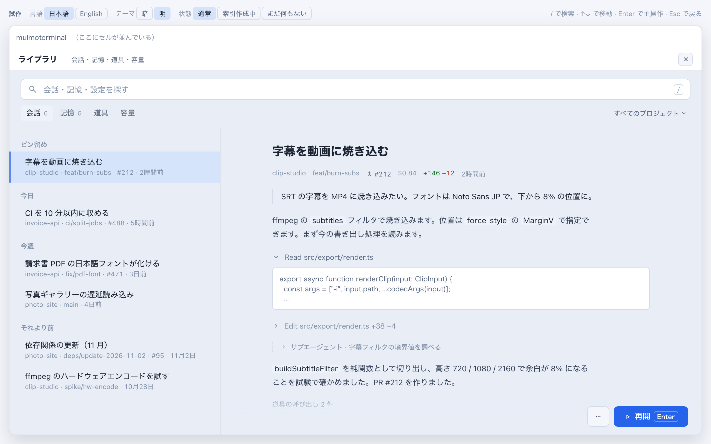
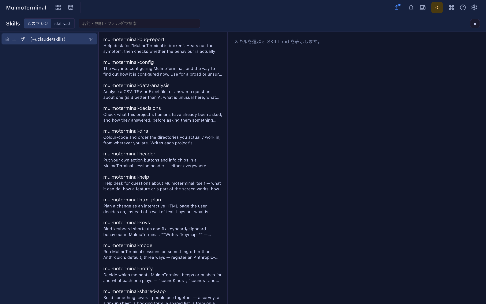

# The Library: how it looks and behaves

The Library (`/library`, ライブラリ) is one full-screen view for everything Claude Code leaves on
disk: conversations, memory, the settings and skills in effect, and the space all of it takes.
This page is the design every implementation task under #3327 builds to. It was decided against a
clickable prototype, `plans/feat-library-design/prototype.html` (invented data; the strip along
its top is a prototype-only switcher and does not ship).

Read it before adding a kind, a row field, a button, or a warning to the Library. Most of what
follows is a refusal to add one of those, and the reason sits next to it.

## Principles

1. **One way in, one search field.** The view opens with the cursor in the search field, and typing
   searches every kind at once. The kinds are one quiet switch underneath it. Wanting another tab
   is a sign the design is wrong.
2. **The content is the interface.** Minimal borders, rules and colour. A list row is a title and
   one grey line; the reader wins on typeface and line spacing.
3. **One prominent action per item.** Everything else goes in `more_horiz`. `Enter` always runs
   the prominent one.
4. **Nothing is destroyed.** Every removal moves to the trash and shows a toast with Undo. Files of
   a running session are read-only.
5. **Warnings do not shout.** A small dot at the start of the row and one sentence in the reader.
   No red bars, no badge counts.
6. **Numbers only when asked for.** The list is never a report. The retrospective lives in `/usage`
   (#3335), not here.
7. **Speed is part of the design.** The index updates incrementally in the background; results
   change as you type; loading shows the skeleton, never a spinner.
8. **Speak the app's language.** `FullScreenOverlay`, theme tokens, Material Symbols, en/ja,
   no emojis. Keys: `/` search, arrows move, `Enter` acts, `Esc` closes.
9. **Reachable from elsewhere.** A PR in the GitHub view links to the conversation that made it; a
   cell's History menu links to its session.

## Scope

- **Name and entry**: ライブラリ / Library, from the feature menu and the `/library` route. A
  permanent header button waits until usage shows it is wanted.
- **Agents**: Claude first. The index shape is agent-neutral, so another agent's reader can be
  added later without a new view.
- **Writes**: memory and temporary data only. Transcripts are read-only. How far the Library may
  read and write under `~/.claude` is a containment decision; it is argued against
  [`file-surfaces.md`](file-surfaces.md) when the index lands (#3328), and that page is updated
  then.

## Skeleton

- The existing `FullScreenOverlay` frame. Title "ライブラリ", with "会話・記憶・道具・容量" in grey.
- Three bands inside it: the search field; the kind switch (会話 / 記憶 / 道具 / 容量) with the
  project filter on the right; then list | reader.
- At 760px and narrower only the list shows. Choosing a row replaces it with the reader, whose back
  button reads "一覧".

 

## Search

- Typing searches across kinds and groups the results under a heading per kind. Each kind in the
  switch shows its count; pressing it narrows to that kind, pressing again widens back.
- Matches are marked in a quiet colour. A conversation shows up to two lines of the turn that
  matched.
- No match: one sentence saying what did not match and what to try next.

## A list row

- Line one is the title. Line two, grey: project · branch · PR · when.
- Cost and lines changed appear only in the reader, so the list stays scannable.
- Conversations are grouped ピン留め / 今日 / 今週 / それより前.
- A small dot at the start of the row is the only sign that something can be tidied.

## The reader

- Title, one grey meta line (project, branch, PR, cost, lines changed, when), then the body.
- User turns are paragraphs with a thin left rule; replies are plain paragraphs, kept to a reading
  measure of about 65 characters.
- Tool calls fold to one monospace line and open on click. Subagents nest under a dotted rule and
  fold the same way.
- "変更したファイル" closes the conversation.

## Actions

- One primary button bottom right: 再開 (conversation), 編集 (memory), 開く (tools), 片付ける
  (storage). `Enter` runs it.
- The rest live in `more_horiz`. For a conversation: branch from here, pin, rename, promote (to
  memory, rule, plan or issue), export.
- Removing moves to the trash, with a short toast offering Undo.
- 片付ける confirms what will move inside the reader itself. No modal dialog.

## Memory

- Grouped by project. Each group heading carries the `MEMORY.md` line count against the limit that
  is loaded; past nine tenths of it, the gauge takes the warn colour.
- When something can be tidied, one line above the list: "n 件を整えられます", with 見る to filter
  to just those.
- The reader states the issue in one sentence (for example, a function it names no longer exists
  in the repository), then file, type, updated, and source (a link to the conversation that wrote
  it).
- Editing happens in place: `⌘ Enter` saves, `Esc` cancels.

## Tools and storage

- Tools: pick one directory (the project filter becomes a directory picker) and list its rules,
  permissions, hooks and skills, each row naming the file that sets it.
- Storage: what can be tidied first, then the size of each location. One sentence explains what
  `cleanupPeriodDays` removes and what it leaves.

## Visuals

- Colours come from the app's theme tokens only (Midnight and Daylight were used to design it). No
  new colours; the issue dot is `--warn`.
- `system-ui` and the app's monospace face. No uppercase transforms: project names and setting
  names are identifiers and keep their shape.
- Icons are Material Symbols (outlined) only.

## Against the existing full-screen views

Compared with `/skills` on a running server (scratch `HOME`):

- **Same**: the frame, header colour, close button, the list | reader split, and grey secondary
  lines under a row title.
- **Search sits on its own band, deliberately.** `/skills` puts a small search input in its header
  row. In the Library search is the entry point (principle 1), so it gets the
  full width under the header. Do not move it into the header to match.
- **The reader opens on the first item**, where `/skills` shows "select a skill" until clicked:
  the Library always has something worth reading first, and `Enter` needs a target.
- **The reader centres a reading measure** where `/skills` runs text to the pane edge, because a
  conversation is read as prose.
- **Two columns, not three.** `/skills` has a source tree on the left; the Library's equivalent is
  the project filter, which keeps the list wide enough for a title and its meta line.
