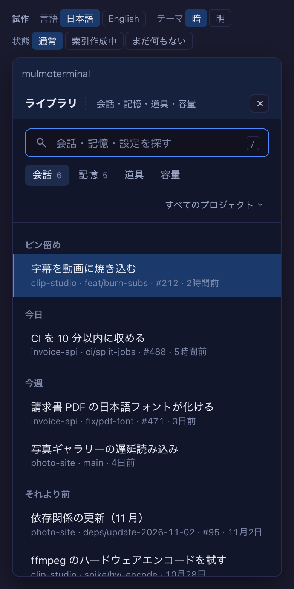
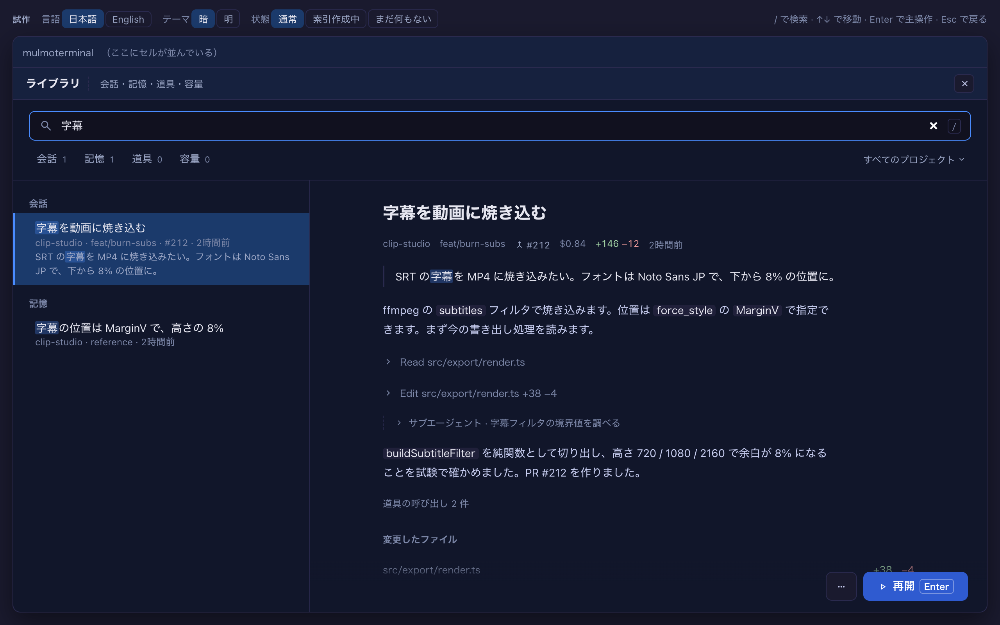
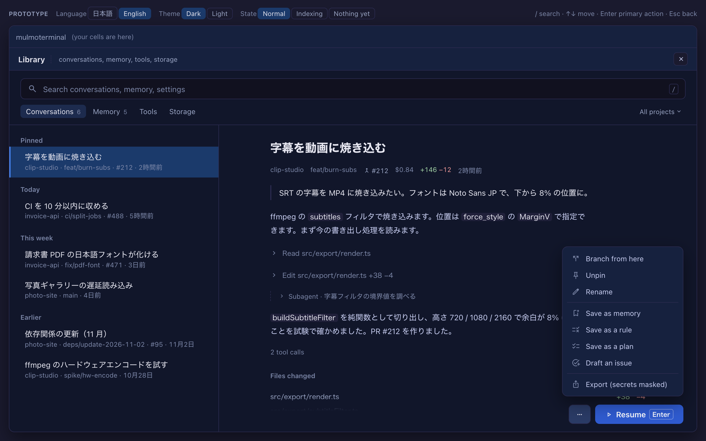
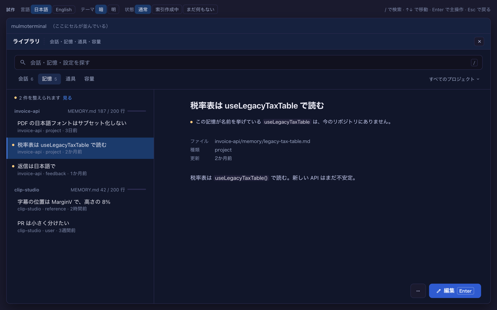
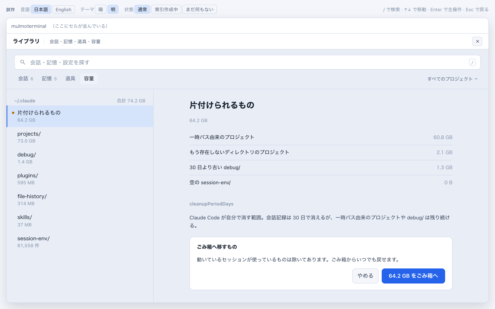

# The Library: how it looks and behaves

The Library (`/library`, ライブラリ) is one full-screen view for everything Claude Code leaves on
disk: conversations, memory, the settings and skills in effect, and the space all of it takes.
This page is the design every implementation task under #3327 builds to. It was decided against a
clickable prototype, `plans/feat-library-design/prototype.html` (invented data; the strip along
its top is a prototype-only switcher and does not ship).

Read it before adding a kind, a row field, a button, or a warning to the Library. Most of what
follows is a refusal to add one of those, and the reason sits next to it.

## Principles

1. **One way in, one search field.** The view opens with the cursor in the search field, and typing
   searches every kind at once. The kinds are one quiet switch underneath it. Wanting another tab
   is a sign the design is wrong.
2. **The content is the interface.** Minimal borders, rules and colour. A list row is a title and
   one grey line; the reader wins on typeface and line spacing.
3. **One prominent action per item.** Everything else goes in `more_horiz`. `Enter` always runs
   the prominent one.
4. **Nothing is destroyed.** Every removal moves to the trash and shows a toast with Undo. Files of
   a running session are read-only — except memory, which the agent shares with the person by
   design: changing a project's memory while a session runs there is warned of, not refused, since
   the projects most worth tidying are the ones in use.
5. **Warnings do not shout.** A small dot at the start of the row and one sentence in the reader.
   No red bars, no badge counts.
6. **Numbers only when asked for.** The list is never a report. The retrospective lives in `/usage`
   (#3335), not here.
7. **Speed is part of the design.** The index updates incrementally in the background; results
   change as you type; loading shows the skeleton, never a spinner.
8. **Speak the app's language.** `FullScreenOverlay`, theme tokens, Material Symbols, en/ja,
   no emojis. Keys: `/` search, arrows move, `Enter` acts, `Esc` closes.
9. **Reachable from elsewhere.** A PR in the GitHub view links to the conversation that made it; a
   cell's History menu links to its session.

## Scope

- **Name and entry**: ライブラリ / Library, from the feature menu and the `/library` route. A
  permanent header button waits until usage shows it is wanted.
- **Agents**: Claude first. The index shape is agent-neutral, so another agent's reader can be
  added later without a new view.
- **Writes**: memory and temporary data only. Transcripts are read-only.
- **What is listed**: conversations someone typed into. A transcript records how claude was started
  (`entrypoint`): `cli` and `claude-desktop` are interactive, `sdk-cli` is `claude -p` and the SDK —
  hooks and tools on a working machine start so many of those that they would bury everything else.
  They are left out of the list and search by default, as are runs from temp directories; the index
  keeps both, for the storage view.
- **Containment**: the index (#3328) reads only the agent's own data root, which the server
  resolves; no route takes a path, and a conversation is asked for by its id, which is looked up
  in the index rather than joined onto a directory. So the index opens no surface in the sense of
  [`file-surfaces.md`](file-surfaces.md). The first route that writes is memory's (#3331), and it
  still takes no path: a client names a project folder by its slug and a memory by its file name,
  each checked against the shape Claude Code gives it, and the server joins them under the agent's
  own projects root. Measured against `file-surfaces.md`, it is the narrowest surface there: it
  reaches only `<projects>/<slug>/memory/<name>.md`; it writes only over a regular file (never a
  link, never creating one); and it writes only over the text the editor opened, by its SHA-256, so
  a change the agent made meanwhile is refused rather than lost. The window between that check
  and the atomic rename is the one gap, and it is stated where the write is. Deleting a memory
  (`memory-trash.ts`) moves it to the machine's Trash and writes `MEMORY.md` too, but only to take
  out the lines that link to that file; Undo is named by an id the server issued, never a path, and
  puts the file back without replacing one made at that name since. Its gap is the save's: another
  process writing between a check and the step it guards. Each step re-reads what it changes, so
  the cost of such a race is an index line (which the health check then reports), never a memory's text.
  Merging two memories is that delete plus a save over the other, under the same checks, and its one
  Undo reverses both; every change takes its files in name order, then the index. A merge also points
  the `[[links]]` to the merged memory at the one kept, in every memory of the folder as listed when
  it starts, and holds all of their turns (one made after that is left as it is); where code is in each is decided by the same lexer as the health check, and a
  link it cannot place exactly stops the merge before anything is written. Each memory is read again
  just before its rewrite is written, and one another process changed since stops the merge and puts
  it all back. The save in a merge,
  and putting that memory back on Undo, keep the save's own gap: a change landing between the check
  and the rename is written over.
- **The index**: `~/.mulmoterminal/library/index.db`, shared by every server under the same HOME
  and built by one of them at a time. It is a copy of the agent's files and is rebuilt if deleted.
  It is opened only on a worker thread, which both builds and queries it: SQLite in Node is
  synchronous, and a first pass over a long history stalled the main thread — which carries every
  terminal — for seconds at a time when it ran there.
  The plan behind it is `plans/feat-library-index.md`.

## Skeleton

- The existing `FullScreenOverlay` frame. Title "ライブラリ", with "会話・記憶・道具・容量" in grey.
- Three bands inside it: the search field; the kind switch (会話 / 記憶 / 道具 / 容量) with the
  project filter on the right; then list | reader.
- At 760px and narrower only the list shows. Choosing a row replaces it with the reader, whose back
  button reads "一覧".

 

## Search

- Typing searches across kinds and groups the results under a heading per kind. Each kind in the
  switch shows its count; pressing it narrows to that kind, pressing again widens back.
- Matches are marked in a quiet colour. A conversation shows up to two lines of the turn that
  matched.
- No match: one sentence saying what did not match and what to try next.

## A list row

- Line one is the title. Line two, grey: project · branch · PR · when.
- Cost and lines changed appear only in the reader, so the list stays scannable.
- Conversations are grouped ピン留め / 今日 / 今週 / それより前.
- A small dot at the start of the row is the only sign that something can be tidied.

## The reader

- Title, one grey meta line (project, branch, PR, cost, lines changed, when), then the body.
- User turns are paragraphs with a thin left rule; replies are plain paragraphs, kept to a reading
  measure of about 65 characters.
- Tool calls fold to one monospace line and open on click. Subagents nest under a dotted rule and
  fold the same way.
- "変更したファイル" closes the conversation.

## Actions

- One primary button bottom right: 再開 (conversation), 編集 (memory), 開く (tools), 片付ける
  (storage). `Enter` runs it.
- The rest live in `more_horiz`. For a conversation: branch from here, pin, rename, promote (to
  memory, rule, plan, issue or skill), export. Promote calls no AI from the Library: it opens a
  Claude cell in the conversation's directory, in plan mode, running the bundled
  `mulmoterminal-library` skill, which writes nothing until the person approves its plan (#3334).
  Plan mode because the cell reads another conversation, which may carry instructions planted in it:
  the approval is then held by Claude Code, not only by the skill's text.
- Removing moves to the trash, with a short toast offering Undo.
- 片付ける confirms what will move inside the reader itself. No modal dialog.

## Memory

- Grouped by project. Each group heading carries the `MEMORY.md` line count against the limit that
  is loaded; past nine tenths of it, the gauge takes the warn colour.
- When something can be tidied, one line above the list: "n 件を整えられます", with 見る to filter
  to just those.
- The reader states the issue in one sentence (for example, a function it names no longer exists
  in the repository), then file, type, updated, and source (a link to the conversation that wrote
  it).
- Editing happens in place: `⌘ Enter` saves, `Esc` cancels.

## Tidying memory

- Each project in Memory has a tidy-up button (#3334): the same skill, in plan mode in the project's
  directory, proposes merges, removals (checked against the code), health-check fixes and moves to a
  rule or a skill, backing up every file it changes. The turn carries the project's folder name only.

## Repeats

- Instructions typed again and again (#3334): read from Claude Code's prompt log, the counted ones
  being what a person typed in a conversation (no commands, pastes, automated runs or one-prompt
  sessions), grouped by their words and, for short ones in one project, by most of their letters.
  Nothing shows until the kind is opened. A candidate becomes a rule or a skill through the same
  skill and plan-mode cell as Promote, by its id.

## Tools and storage

- Tools: pick one directory (the project filter becomes a directory picker) and list its rules,
  permissions, hooks and skills, each row naming the file that sets it. The first part shipped is the
  instruction files: what Claude Code loads in that directory, in its own order (code.claude.com/docs/en/memory),
  read only. Which files load and in what order is a pure function (`instruction-files.ts`); the
  routes take a directory only when a conversation ran there, and a file only when that directory's
  listing names it.
- Storage: what can be tidied first, then the size of each location. One sentence explains what
  `cleanupPeriodDays` removes and what it leaves.

## Visuals

- Colours come from the app's theme tokens only (Midnight and Daylight were used to design it). No
  new colours; the issue dot is `--warn`.
- `system-ui` and the app's monospace face. No uppercase transforms: project names and setting
  names are identifiers and keep their shape.
- Icons are Material Symbols (outlined) only.

## Against the existing full-screen views

Compared with `/skills` on a running server (scratch `HOME`):

- **Same**: the frame, header colour, close button, the list | reader split, and grey secondary
  lines under a row title.
- **Search sits on its own band, deliberately.** `/skills` puts a small search input in its header
  row. In the Library search is the entry point (principle 1), so it gets the
  full width under the header. Do not move it into the header to match.
- **The reader opens on the first item**, where `/skills` shows "select a skill" until clicked:
  the Library always has something worth reading first, and `Enter` needs a target.
- **The reader centres a reading measure** where `/skills` runs text to the pane edge, because a
  conversation is read as prose.
- **Two columns, not three.** `/skills` has a source tree on the left; the Library's equivalent is
  the project filter, which keeps the list wide enough for a title and its meta line.
